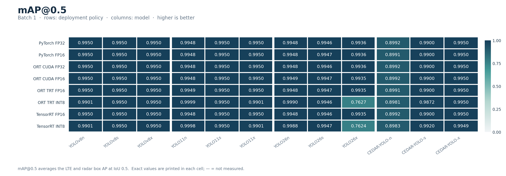

# CBRS-CEDAR-RT

**ONNX Runtime and NVIDIA TensorRT deployment for CBRS radar/LTE detection.**

CBRS-CEDAR-RT converts pretrained YOLO and CEDAR-YOLO detectors into deployable
ONNX models and TensorRT engines, then measures how runtime, precision and batch
size affect inference speed and detection quality. It extends
[CBRS-CEDAR-MDI](https://github.com/UIC-Networking-Research-Lab/CBRS-CEDAR-MDI)
with a PC GPU deployment and benchmarking pipeline.

**These experiments were run on the author's personal PC, without a rigorously
controlled benchmarking environment. The reported results are for reference only.**
We encourage you to download the [source code](https://github.com/UIC-Networking-Research-Lab/CBRS-CEDAR-RT)
and [datasets and pretrained models](https://github.com/UIC-Networking-Research-Lab/CBRS-CEDAR-RT/releases/tag/assets),
set up a controlled experimental environment, and repeat the measurements on your
own hardware. See [Get weights and data](#get-weights-and-data) for setup instructions.

The pipeline supports FP32/FP16 export, INT8 calibration with training images,
ONNX Runtime execution, and direct TensorRT engine building. The evaluation
compares nine original YOLO models (YOLOv8/YOLO11/YOLO26, n/s/x) and three
CEDAR-YOLO models. Each detector takes a 640×640 spectrogram and predicts LTE
(class 0) and radar (class 1) bounding boxes.

## Deployment backends compared in the figures

The figures compare **four GPU backends**, each with two precision settings.
The table follows their left-to-right order in the speed plots.
A deployment policy means a backend/precision setting; an experimental configuration
combines that setting with a model and batch size.

| Backend | Figure label | Execution | Precision | Modes |
|---|---|---|---|---|
| **PyTorch** | `Torch` | Execute the pretrained model directly with PyTorch on the GPU | FP32, FP16 | `torch_cuda_fp32`, `torch_cuda_fp16` |
| **ONNX Runtime CUDA** | `CUDA` | Execute the exported ONNX graph with the CUDA execution provider | FP32, FP16 | `ort_cuda_fp32`, `ort_cuda_fp16` |
| **ONNX Runtime TensorRT** | `ORT TRT` | ONNX Runtime delegates supported graph regions to its TensorRT execution provider | FP16, INT8 | `ort_trt_fp16`, `ort_trt_int8` |
| **Direct TensorRT** | `TRT` | Build a TensorRT engine from ONNX and execute it directly | FP16, INT8 | `trt_fp16`, `trt_int8` |

**All reported results are GPU measurements; no CPU experiments are included.**
PyTorch FP32 is the speed-up reference. INT8 deployment uses calibrated Q/DQ ONNX
graphs; FP16 TensorRT engines are built from FP32 ONNX. ONNX Runtime TensorRT
and direct TensorRT are separate deployment paths, as shown by `ORT TRT` and
`TRT` in the figures.

## Results

> **Historical results:** The figures and tables below use the previous CEDAR checkpoint edition and box-detection macro F1. They have not been rerun with the updated weights or Overlap F1. New runs use the June model collection and report frame-level Overlap F1; these measurements must be reported separately.

**288/288 GPU configurations completed: 12 models, batches 1, 4, 8, 8 deployment policies.**

The experiments evaluate 12 pretrained detectors on an **NVIDIA GeForce RTX 2070** PC. The figures show **batch 1, model computation**; quality is evaluated on the same **846 validation images**. INT8 calibration uses 512 training images. Each policy uses the same source checkpoint for its model.

### Inference speed


Inference time per frame is the inverse of mean throughput across the timing rounds; lower is better. Each panel uses its own time scale. Figure labels: Torch = PyTorch; CUDA = ONNX Runtime CUDA; ORT TRT = ONNX Runtime TensorRT; TRT = direct TensorRT.

ONNX Runtime with TensorRT FP16 achieves **2.94–6.94× the PyTorch FP32 throughput** across 12 models in this timing scope. Direct TensorRT FP16 achieves **3.22–7.94× the PyTorch FP32 throughput** across 12 models in this timing scope. For YOLOv8x, ORT CUDA FP16 takes 0.1191 s/frame, compared with 0.0412 s/frame for PyTorch FP32.

### Detection F1


Rows are deployment policies and columns are models. Values average LTE and radar box-detection F1 at confidence 0.25 and box IoU 0.5; higher is better.

The TensorRT FP16 configurations track each model's PyTorch FP32 quality: the largest absolute detection-F1 change is **0.00085**. INT8 has a larger, model-dependent effect. For YOLO26x, direct TensorRT INT8 changes F1 from **0.9774 to 0.6581**.

### mAP@0.5



The matrix reports mean average precision for LTE and radar boxes at IoU 0.5; higher is better.

Across the TensorRT FP16 configurations, the largest absolute mAP@0.5 change from PyTorch FP32 is **0.00008**. The largest mAP@0.5 reduction under direct TensorRT INT8 occurs on YOLO26x: **0.9936 → 0.7624**. INT8 deployment therefore requires validation for each model and batch configuration.

**Deployment assessment.** TensorRT FP16 provides the most consistent combination of faster model execution and preserved detection quality in this testbed. INT8 can further reduce computation time for selected models, with quality checked for the selected configuration. The full report separates model computation, the detector pipeline, and PNG-to-detection execution so application costs can be assessed alongside kernel speed.

[Complete report](results/REPORT.md) · [Combined measurements](results/data/summary.csv) · [Data guide](results/data/README.md)

## Timing scopes

| Scope | Timed work |
|---|---|
| `model_compute` | forward pass only; the input tensor is already on the device |
| `detector_pipeline` | decoded image → tensor → forward pass → decoding and NMS |
| `image_to_detection` | PNG file → decode → the whole `detector_pipeline` |

Speed-ups are relative to PyTorch GPU FP32 for the same model, batch, scope and environment.

## Installation

The tested/recommended environment is the Windows PC Conda environment
**`torch270_py312_cuda`**, using an **NVIDIA GeForce RTX 2070**:

| Component | Tested PC version |
|---|---|
| Python | 3.12.13 |
| PyTorch / torchvision | 2.7.1+cu128 / 0.22.1+cu128 |
| Ultralytics | 8.4.46 |
| ONNX / ONNX Runtime GPU | 1.18.0 / 1.22.0 |
| TensorRT | 10.9.0.34 (`tensorrt-cu12`) |
| NumPy / SciPy | 2.2.4 / 1.14.1 |
| Matplotlib / Pillow | 3.10.8 / 11.2.1 |

The Conda environment name does not imply PyTorch 2.7.0; its installed version
is 2.7.1. Activate this environment if already available. For a new environment,
use Python 3.12 and install CUDA-compatible PyTorch, ONNX Runtime GPU and TensorRT.
Compatible runtime versions can be used; the table records the tested combination,
not an exact-version requirement for every dependency. **Raw-I/Q rendering versions
and parameters require separate care**, as explained below.

```bash
python -m pip install -r requirements.txt
pip install onnxruntime-gpu==1.22.0 tensorrt==10.9.0.34
python cli.py doctor --require cuda tensorrt     # checks the available ORT providers
```

## Get weights and data

**[Download CBRS-CEDAR-RT-ASSETS from GitHub Releases](https://github.com/UIC-Networking-Research-Lab/CBRS-CEDAR-RT/releases/tag/assets)**

1. Open the release's **Assets** list and download **all 3 archive parts**:
   `CBRS-CEDAR-RT-ASSETS.7z.001` through `CBRS-CEDAR-RT-ASSETS.7z.003`.
   Keep all parts in the same folder with their original names.
2. Use **7-Zip** to extract `CBRS-CEDAR-RT-ASSETS.7z.001` only. It reads the remaining
   parts automatically; do not extract each part separately.
3. Place the extracted `CBRS-CEDAR-RT-ASSETS` folder beside the repository:

```text
workspace/
  CBRS-CEDAR-RT/
  CBRS-CEDAR-RT-ASSETS/
    datasets/
    weights/
    splits.csv
    README.md
```

Alternatively, extract from the folder containing all parts with:

```bash
7z x CBRS-CEDAR-RT-ASSETS.7z.001
```

GitHub's **Source code (zip/tar.gz)** downloads contain code, not the datasets or
weights. Use this project's asset package; the MDI and RT packages are independent.

The package includes every experiment PNG and label at **640 × 640**, the fixed
train/val/test split and all 12 RT checkpoints. After installing the dependencies
listed above, run from the repository root:

```bash
python reproduce.py --assets ../CBRS-CEDAR-RT-ASSETS --task install
python reproduce.py --task check
python reproduce.py --task smoke
python reproduce.py --task full
```

The smoke test uses the two nano detectors and a small subset of images; `full` runs
the matrix of 288 model/batch/backend-precision configurations. Add `--dry-run` to inspect the command. After installing
`requirements.txt`, run the scripts directly from this repository.

The installer places PNGs in `data/yolo_split/`, weights in `artifacts/weights/`, and
runtime metadata in `artifacts/`. Reference checksums are maintained in this repository.
It replaces only recognized previous CEDAR checkpoints; other mismatched files are rejected.
**New runs use the latest local CEDAR checkpoints from the June model collection**,
for nano, small and extra-large at a 20 x 20 feature grid and full coverage.
The extra-large file is byte-identical to the previous RT checkpoint; nano and small are updated.
The nine original YOLO checkpoints are unchanged. The installer upgrades recognized
old CEDAR weights and checks every downloaded file. Start a new run; do not resume
an old run or reuse ONNX graphs/TensorRT engines exported from different weights.
This package includes its own copy of every required
weight and dataset file; no MDI checkout or MDI asset package is needed.

See the [download package layout](docs/download_bundle.md) for the dataset splits
and checkpoint contents.

### Preprocessing compatibility

**Use the supplied PNGs directly.** GPU inference and calibration require no raw I/Q
recordings. For raw data, follow the parent project's data guide and the
[Genesys Lab over-the-air CBRS dataset](https://genesys-lab.org/CBRS). Raw recordings
are needed only if you want raw-frame inputs or to regenerate spectrograms; they
are not redistributed in the bundle.

**The original recordings do not come with our train/validation/test partitions.**
When using them, apply our [fixed split list](splits/cbrs_split.csv), also provided
as `splits.csv` in the RT assets, before training, calibration or evaluation.
Follow the parent repository's
[raw-data split restoration steps](https://github.com/UIC-Networking-Research-Lab/CBRS-CEDAR-MDI/blob/main/docs/data.md#5-build-the-raw-sigmf-split).
Keep the same membership when converting recordings to PNGs. The supplied RT
PNGs are already split: calibration uses training images, and the reported RT
quality measurements use validation images. Do not create a new random split
when reproducing these results.

**Both library versions and preprocessing parameters affect the spectrogram pixels.**
Even a small mismatch can invalidate predictions from pretrained weights, despite
similar-looking images and matching dimensions. Preserve the renderer's versions
and parameters, then compare regenerated pixels with the supplied PNGs before using
the weights. For your own preprocessing or recordings, **retrain your own model on consistently
rendered images**, then use the same rendering for calibration and deployment.

Reference settings: 512-point FFT, 384-sample overlap, 5th–95th percentile clipping,
`viridis`, frequency horizontally and time vertically, 640 × 640 RGB. The checked raw
PC renderer uses NumPy 2.2.4, SciPy 1.14.1, Matplotlib 3.10.8 and Pillow 11.2.1.
The parent project's [preprocessing guide](https://github.com/UIC-Networking-Research-Lab/CBRS-CEDAR-MDI/blob/main/docs/preprocessing.md)
documents the full contract and a pixel-comparison check. The RT experiments use
supplied PNGs; they do not include raw-I/Q conversion. A custom conversion workflow
must pass pixel checks first. New evaluations report frame-level **Overlap F1**,
using the same frequency-overlap decision as MDI, on the RT validation split.

## Run the experiments

New evaluations use **Overlap F1** for the frame-level CBRS decision
and **mAP@0.5** for box localization quality. A frame is overlap-positive when
any predicted LTE/radar pair has a positive-width intersection along frequency;
the time-axis intersection is not required. Detections are filtered at confidence
0.25, and F1 is computed from confusion counts pooled over all validation frames.
This is the same decision rule as MDI, on the RT validation split.

```bash
python run_experiments.py --dry-run                                  # show the plan only
python run_experiments.py --models cbrs_yolo8n --batches 1 --smoke   # quick end-to-end check
python run_experiments.py                                            # full matrix
python run_experiments.py --models cbrs_yolo8n sig_yolo_v8n_f20t20_c100 --batches 1 8 --modes ort_cuda_fp32 ort_cuda_fp16 trt_fp16 trt_int8
```

Defaults are at the top of `run_experiments.py` and can be overridden on the command line:
all 12 models; batches 1, 4, 8; and the eight precision settings of the four GPU
backends listed above. This gives 288 model/batch/backend configurations.
The published experiments do not include CPU measurements. With 3 scopes ×
3 rounds × 2 timing loops of at least 30 s each, timing alone takes at least 43.2 hours. INT8 calibration
uses 512 training PNGs.

`--resume --output output/<run>` continues an interrupted run, and `--retry-failed` retries
failed configurations. A host-memory guard (`--maximum-worker-gib`, default 8) stops configurations that
would exhaust RAM, and such failures are recorded in `results.csv`.

New experiment output layout (the included reference data is consolidated in `results/data/`):

```
output/<run>/<model>/
  results.csv            every configuration, timing round and validation metric
  comparison.csv         mean speed / latency, quality and speed-up per configuration
  model.json             experiment, environment and artifact provenance
  best.pt                copy of the source checkpoint
  batch_001_fp32.onnx    exported models (+ .onnx.json metadata), one per batch and precision
  demo/                  up to 10 annotated predictions
```

### Makeup runs

To re-run selected `{model, batch, mode}` configurations of an existing run, list them in
[`makeup/experiments.json`](makeup/experiments.json) (set `run` to your run directory), then:

```bash
python run_experiments.py --makeup --dry-run
python run_experiments.py --makeup            # --force-makeup repeats configurations that already passed
```

### Complete batches 1, 4 and 8

```bash
python scripts/complete_batch_sweep.py --run output/<run> --batches 1 4 8 --dry-run
python scripts/complete_batch_sweep.py --run output/<run> --batches 1 4 8
```

This selects failed, missing and pending configurations, keeps completed configurations, and uses the
original measurement protocol. Completion selects GPU policies by default. Afterwards it rebuilds
`results/` and the README comparison. On Windows, system sleep is prevented for the
process lifetime. Optional `--sync-to <RT-repository>` copies the finished report and
analysis code to another prepared RT repository. Status and logs belong under
`analysis_outputs/batch_completion/`. Rerun the command to retry any remaining configurations.

## Analyze

All recorded data is combined in `results/data/`. Rebuild the report and figures in place:

```bash
python -m pip install -r requirements.txt
python analyze_results.py
```

The command verifies checksums, recomputes the full-precision tables, regenerates the figures
and updates the root README. It requires no GPU, images, weights or former `output/` directories.

For direct analysis, use `results/data/summary.csv` (final aggregates), `rounds.csv` (original
rows) and `routes.csv` (scope and configuration states). All model metadata, the dataset manifest and
historical attempts are in the same directory. See the [data guide](results/data/README.md).

```python
import sys
sys.path.insert(0, "src")
from cbrs_quant.results_store import table
rows = table("results", "summary")
```

To analyze a new compact experiment without replacing the included paper-independent reference dataset:

```bash
python analyze_results.py --run output/<run> --publish results_new
```

Time charts use vertical bars; F1 and mAP use annotated matrices. PNG and PDF figures are
saved under `results/figures/`. The [complete report](results/REPORT.md) contains all models,
batches and timing scopes in one document. `--overview-scope image_to_detection` includes
PNG decoding and preprocessing in the README timing comparison.

## Export to ONNX

```bash
python export_onnx.py --model cbrs_yolo8n                                 # dynamic-batch FP32
python export_onnx.py --model cbrs_yolo11n --batch 16                     # fixed batch FP32
python export_onnx.py --model cbrs_yolo8n --precision fp16 --device cuda
python export_onnx.py --model cbrs_yolo8n --precision int8 --device cuda  # needs the training PNGs and dataset manifest
python export_onnx.py --weights /path/to/best.pt --model cbrs_yolo8n --output /path/to/model.onnx
```

Every ONNX file is written with an adjacent `.onnx.json` that this project's inference code
needs. INT8 export produces a Q/DQ model with a floating-point detector head. The experiment
and prediction backends accept fixed-batch ONNX only. The dynamic export is for external
runtimes; TensorRT needs an optimization profile for it.

## Deploy and predict

Copy the selected `.onnx`, its `.onnx.json` and `src/cbrs_quant/` to the target machine:

```bash
python cli.py predict --model cbrs_yolo8n --batch 1 \
    --mode ort_trt_int8 --onnx output/<run>/cbrs_yolo8n/batch_001_int8.onnx \
    --input /path/to/spectrogram.png --output /path/to/predictions
```

`ort_cuda_fp32` and `ort_trt_fp16` use the FP32 ONNX, `ort_cuda_fp16` uses the FP16 ONNX, and
`ort_trt_int8` uses the calibrated INT8 ONNX. TensorRT engines are specific to the GPU and the
TensorRT version, so build them on the target device. The PyTorch checkpoint is not needed
for ONNX prediction.

## Notes on precision

* The YOLO checkpoints were saved by Ultralytics in FP16, so their FP32 ONNX exports start
  from FP16-stored weights. The CEDAR-YOLO checkpoints are stored in FP32. `model.json`
  records the storage dtype.
* FP32 and FP16 quality is usually the same here, but the comparison table reports the measured
  values for every configuration. INT8 is more sensitive to quantization and calibration, so compare
  its quality as well as its speed.
* YOLO26 uses its native one-to-one head to select the final boxes. This is model behavior,
  not feature compression.

## Repository layout

```
run_experiments.py      experiment launcher (configure at the top or with CLI options)
cli.py                 direct commands: doctor, validate-inputs, predict, benchmark
requirements.txt       Python dependencies
export_onnx.py          PT -> ONNX (FP32 / FP16 / INT8 Q/DQ, fixed or dynamic batch)
analyze_results.py      complete report and bar charts from recorded measurements
src/cbrs_quant/         export, calibration, ORT / TensorRT / PyTorch backends, metrics, sweep
  vendor/asym_yolo.py   copy of the CEDAR-YOLO model definition from CBRS-CEDAR-MDI
configs/spectrogram.json  rendering profile recorded in the dataset manifest
scripts/                asset installation, deployment utilities, smoke tests
tests/                  unit tests:  PYTHONPATH=src python -m unittest discover -s tests
results/                reference results of the run above
```

## License

[GNU AGPL-3.0](LICENSE). This project uses [Ultralytics](https://github.com/ultralytics/ultralytics)
(AGPL-3.0). ONNX Runtime, TensorRT and the dataset keep their own licenses.

### Overlap F1 in new runs

A frame is positive when any LTE/radar box pair intersects with positive width along the frequency axis, irrespective of time overlap. Predicted boxes use confidence 0.25. F1 is computed from pooled frame-level TP/FP/FN counts. Box mAP remains a separate localization metric. Old box-detection F1 cannot be relabeled as Overlap F1. The report generator rejects runs without this metric, preserving the archived figures. No experiments were rerun for this model/code update.
