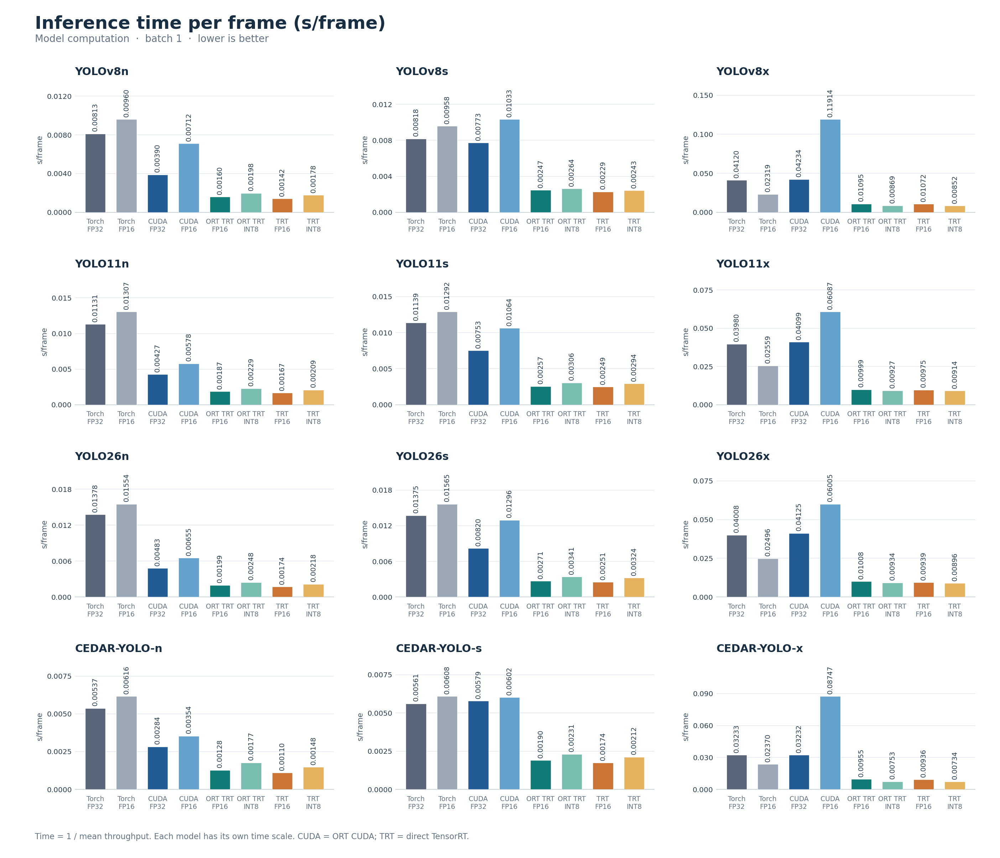

# CBRS-CEDAR-RT

**A derivative project of CBRS-CEDAR-MDI exploring GPU deployment of pretrained CBRS spectrogram detectors.**

We reuse the CBRS radar/LTE detectors from
[CBRS-CEDAR-MDI](https://github.com/UIC-Networking-Research-Lab/CBRS-CEDAR-MDI). The code exports
the trained models to ONNX and runs them with PyTorch, ONNX Runtime (CUDA and TensorRT
execution providers) and TensorRT in FP32, FP16 and INT8. For each deployment route it
measures inference speed and detection quality on the same validation images.

Models: 9 original YOLO detectors (`cbrs_yolo{8,11,26}{n,s,x}`) and the 3 CEDAR-YOLO
detectors (`sig_yolo_v8{n,s,x}_f20t20_c100`). All of them take a 640×640 spectrogram and
return LTE (class 0) and radar (class 1) boxes.

**All RT experiments run on the PC GPU; this repository reports no Jetson experiments.**
Its deployment and quantization results are separate from the paper's Jetson CPU/MDI results. The parent
repository contains the paper implementation, training and distributed-inference pipelines.

## Results

**288/288 GPU routes completed: 12 models, batches 1, 4, 8, 8 deployment policies.**

**NVIDIA GeForce RTX 2070 · batch 1 · model computation.** Quality uses the **validation split (846 images)**.

**Inference time per frame (s/frame) ↓ · Detection F1 ↑ · mAP@0.5 ↑**. Time is the inverse of mean throughput; F1 averages LTE and radar box-detection F1.

**Example: YOLOv8x, same checkpoint and validation images.**

| Policy | Time (s/frame) ↓ | Detection F1 ↑ | mAP@0.5 ↑ |
|---|---:|---:|---:|
| PyTorch FP32 | 0.0412 | 0.9976 | 0.9950 |
| ORT TRT FP16 | 0.0109 | 0.9976 | 0.9950 |
| ORT TRT INT8 | 0.0087 | 0.9979 | 0.9950 |

<details>
<summary>All 12 models: inference time, F1 and mAP comparisons</summary>




</details>

FP16 and INT8 can reduce model computation time; compare detection quality alongside speed. The full report also includes preprocessing and image decoding.

[Complete report](results/REPORT.md) · [Combined measurements](results/data/summary.csv) · [Data guide](results/data/README.md)

## Deployment routes

| Mode | Runtime | Model file | Precision |
|---|---|---|---|
| `torch_cuda_fp32` / `torch_cuda_fp16` | PyTorch (Ultralytics / CEDAR-YOLO module) | `.pt` | FP32 / FP16 |
| `ort_cuda_fp32` / `ort_cuda_fp16` (route A) | ONNX Runtime, CUDA EP | FP32 / FP16 ONNX | FP32 / FP16 |
| `ort_trt_fp16` / `ort_trt_int8` (route B) | ONNX Runtime, TensorRT EP | FP32 ONNX / INT8 Q/DQ ONNX | FP16 / INT8 |
| `trt_fp16` / `trt_int8` (route C) | TensorRT engine built directly | FP32 ONNX / INT8 Q/DQ ONNX | FP16 / INT8 |
| `ort_cpu_fp32` (route D) | ONNX Runtime, CPU EP | FP32 ONNX | FP32 |

Timing scopes:

| Scope | Timed work |
|---|---|
| `model_compute` | forward pass only; the input tensor is already on the device |
| `detector_pipeline` | decoded image → tensor → forward pass → decoding and NMS |
| `image_to_detection` | PNG file → decode → the whole `detector_pipeline` |

Speed-ups are relative to PyTorch GPU FP32 for the same model, batch, scope and environment.

## Installation

The tested/recommended environment is the Windows PC Conda environment
**`torch270_py312_cuda`**, using an **NVIDIA GeForce RTX 2070**:

| Component | Tested PC version |
|---|---|
| Python | 3.12.13 |
| PyTorch / torchvision | 2.7.1+cu128 / 0.22.1+cu128 |
| Ultralytics | 8.4.46 |
| ONNX / ONNX Runtime GPU | 1.18.0 / 1.22.0 |
| TensorRT | 10.9.0.34 (`tensorrt-cu12`) |
| NumPy / SciPy | 2.2.4 / 1.14.1 |
| Matplotlib / Pillow | 3.10.8 / 11.2.1 |

The Conda environment name does not imply PyTorch 2.7.0; its installed version
is 2.7.1. Activate this environment if already available. For a new environment,
use Python 3.12 and install CUDA-compatible PyTorch, ONNX Runtime GPU and TensorRT.
Compatible runtime versions can be used; the table records the tested combination,
not an exact-version requirement for every dependency. **Raw-I/Q rendering versions
and parameters require separate care**, as explained below.

```bash
python -m pip install -r requirements.txt
pip install onnxruntime-gpu==1.22.0 tensorrt==10.9.0.34
python cli.py doctor --require cuda tensorrt     # checks the available ORT providers
```

## Get weights and data

Download **CBRS-CEDAR-RT-ASSETS**, this project's independent data/model package.
It contains only `datasets/`, `weights/`, `splits.csv` and a README. The cloud-drive
URL will be added after upload. It includes every experiment PNG and label at
**640 × 640**, the fixed train/val/test split and all 12 RT checkpoints.
From this repository root:

```bash
python reproduce.py --assets ../CBRS-CEDAR-RT-ASSETS --task install
python reproduce.py --task check
python reproduce.py --task smoke
python reproduce.py --task full
```

The smoke test uses the two nano detectors and a small subset of images; `full` runs
the 288-route matrix. Add `--dry-run` to inspect the command. After installing
`requirements.txt`, run the scripts directly from this repository.

The installer places PNGs in `data/yolo_split/`, weights in `artifacts/weights/`, and
runtime metadata in `artifacts/`. Reference checksums are maintained in this repository.
It rejects existing files with different contents.
**The RT reference experiments use the earlier Jetson-era CEDAR checkpoints**, not the
later local/sweep checkpoints. This names the checkpoint edition, **not the RT
execution platform: these deployment tests ran on the PC GPU**.
This package includes its own copy of every required
weight and dataset file; no MDI checkout or MDI asset package is needed.

See the [download package layout](docs/download_bundle.md) for the dataset splits
and checkpoint contents.

### Preprocessing compatibility

**Use the supplied PNGs directly.** GPU inference and calibration require no raw I/Q
recordings. For raw data, follow the parent project's data guide and the
[original Genesys Lab dataset page](https://genesys-lab.org/CBRS). That dataset is not
redistributed in the bundle.

**Both library versions and preprocessing parameters affect the spectrogram pixels.**
Even a small mismatch can invalidate predictions from pretrained weights, despite
similar-looking images and matching dimensions. Preserve the renderer's versions
and parameters, then compare regenerated pixels with the supplied PNGs before using
the weights. For your own preprocessing or recordings, **retrain your own model on consistently
rendered images**, then use the same rendering for calibration and deployment.

Reference settings: 512-point FFT, 384-sample overlap, 5th–95th percentile clipping,
`viridis`, frequency horizontally and time vertically, 640 × 640 RGB. The checked raw
PC renderer uses NumPy 2.2.4, SciPy 1.14.1, Matplotlib 3.10.8 and Pillow 11.2.1.
The parent project's [preprocessing guide](https://github.com/UIC-Networking-Research-Lab/CBRS-CEDAR-MDI/blob/main/docs/preprocessing.md)
documents the full contract and a pixel-comparison check. The RT experiments use
supplied PNGs; they do not include raw-I/Q conversion. A custom conversion route
must pass pixel checks first. F1 here is **box-detection macro F1**, not the
parent paper's frame-level overlap F1.

## Run the experiments

```bash
python run_experiments.py --dry-run                                  # show the plan only
python run_experiments.py --models cbrs_yolo8n --batches 1 --smoke   # quick end-to-end check
python run_experiments.py                                            # full matrix
python run_experiments.py --models cbrs_yolo8n sig_yolo_v8n_f20t20_c100 --batches 1 8 --routes A C
```

Defaults are at the top of `run_experiments.py` and can be overridden on the command line:
all 12 models; batches 1, 4, 8; PyTorch GPU FP32/FP16 plus routes A–C. The GPU matrix has
288 routes. CPU inference is available only when explicitly selecting route D. With 3 scopes ×
3 rounds × 2 timing loops of at least 30 s each, timing alone takes at least 43.2 hours. INT8 calibration
uses 512 training PNGs.

`--resume --output output/<run>` continues an interrupted run, and `--retry-failed` retries
failed routes. A host-memory guard (`--maximum-worker-gib`, default 8) stops routes that
would exhaust RAM, and such failures are recorded in `results.csv`.

New experiment output layout (the included reference data is consolidated in `results/data/`):

```
output/<run>/<model>/
  results.csv            every route, timing round and validation metric
  comparison.csv         mean speed / latency, quality and speed-up per route
  model.json             experiment, environment and artifact provenance
  best.pt                copy of the source checkpoint
  batch_001_fp32.onnx    exported models (+ .onnx.json metadata), one per batch and precision
  demo/                  up to 10 annotated predictions
```

### Makeup runs

To re-run selected `{model, batch, mode}` routes of an existing run, list them in
[`makeup/experiments.json`](makeup/experiments.json) (set `run` to your run directory), then:

```bash
python run_experiments.py --makeup --dry-run
python run_experiments.py --makeup            # --force-makeup repeats routes that already passed
```

### Complete batches 1, 4 and 8

```bash
python scripts/complete_batch_sweep.py --run output/<run> --batches 1 4 8 --dry-run
python scripts/complete_batch_sweep.py --run output/<run> --batches 1 4 8
```

This selects failed, missing and pending routes, keeps completed routes, and uses the
original measurement protocol. Completion selects GPU policies by default. Afterwards it rebuilds
`results/` and the README comparison. On Windows, system sleep is prevented for the
process lifetime. Optional `--sync-to <RT-repository>` copies the finished report and
analysis code to another prepared RT repository. Status and logs belong under
`analysis_outputs/batch_completion/`. Rerun the command to retry any remaining routes.

## Analyze

All recorded data is combined in `results/data/`. Rebuild the report and figures in place:

```bash
python -m pip install -r requirements.txt
python analyze_results.py
```

The command verifies checksums, recomputes the full-precision tables, regenerates the figures
and updates the root README. It requires no GPU, images, weights or former `output/` directories.

For direct analysis, use `results/data/summary.csv` (final aggregates), `rounds.csv` (original
rows) and `routes.csv` (scope and route states). All model metadata, the dataset manifest and
historical attempts are in the same directory. See the [data guide](results/data/README.md).

```python
import sys
sys.path.insert(0, "src")
from cbrs_quant.results_store import table
rows = table("results", "summary")
```

To analyze a new compact experiment without replacing the included paper-independent reference dataset:

```bash
python analyze_results.py --run output/<run> --publish results_new
```

Time charts use vertical bars; F1 and mAP use annotated matrices. PNG and PDF figures are
saved under `results/figures/`. The [complete report](results/REPORT.md) contains all models,
batches and timing scopes in one document. `--overview-scope image_to_detection` includes
PNG decoding and preprocessing in the README timing comparison.

## Export to ONNX

```bash
python export_onnx.py --model cbrs_yolo8n                                 # dynamic-batch FP32
python export_onnx.py --model cbrs_yolo11n --batch 16                     # fixed batch FP32
python export_onnx.py --model cbrs_yolo8n --precision fp16 --device cuda
python export_onnx.py --model cbrs_yolo8n --precision int8 --device cuda  # needs the training PNGs and dataset manifest
python export_onnx.py --weights /path/to/best.pt --model cbrs_yolo8n --output /path/to/model.onnx
```

Every ONNX file is written with an adjacent `.onnx.json` that this project's inference code
needs. INT8 export produces a Q/DQ model with a floating-point detector head. The experiment
and prediction backends accept fixed-batch ONNX only. The dynamic export is for external
runtimes; TensorRT needs an optimization profile for it.

## Deploy and predict

Copy the selected `.onnx`, its `.onnx.json` and `src/cbrs_quant/` to the target machine:

```bash
python cli.py predict --model cbrs_yolo8n --batch 1 \
    --mode ort_trt_int8 --onnx output/<run>/cbrs_yolo8n/batch_001_int8.onnx \
    --input /path/to/spectrogram.png --output /path/to/predictions
```

`ort_cuda_fp32` and `ort_trt_fp16` use the FP32 ONNX, `ort_cuda_fp16` uses the FP16 ONNX, and
`ort_trt_int8` uses the calibrated INT8 ONNX. TensorRT engines are specific to the GPU and the
TensorRT version, so build them on the target device. The PyTorch checkpoint is not needed
for ONNX prediction.

## Notes on precision

* The YOLO checkpoints were saved by Ultralytics in FP16, so their FP32 ONNX exports start
  from FP16-stored weights. The CEDAR-YOLO checkpoints are stored in FP32. `model.json`
  records the storage dtype.
* FP32 and FP16 quality is usually the same here, but the comparison table reports the measured
  values for every route. INT8 is more sensitive to quantization and calibration, so compare
  its quality as well as its speed.
* YOLO26 uses its native one-to-one head to select the final boxes. This is model behavior,
  not feature compression.

## Repository layout

```
run_experiments.py      experiment launcher (configure at the top or with CLI options)
cli.py                 direct commands: doctor, validate-inputs, predict, benchmark
requirements.txt       Python dependencies
export_onnx.py          PT -> ONNX (FP32 / FP16 / INT8 Q/DQ, fixed or dynamic batch)
analyze_results.py      complete report and bar charts from recorded measurements
src/cbrs_quant/         export, calibration, ORT / TensorRT / PyTorch backends, metrics, sweep
  vendor/asym_yolo.py   copy of the CEDAR-YOLO model definition from CBRS-CEDAR-MDI
configs/spectrogram.json  rendering profile recorded in the dataset manifest
scripts/                asset installation, deployment utilities, smoke tests
tests/                  unit tests:  PYTHONPATH=src python -m unittest discover -s tests
results/                reference results of the run above
```

## License

[GNU AGPL-3.0](LICENSE). This project uses [Ultralytics](https://github.com/ultralytics/ultralytics)
(AGPL-3.0). ONNX Runtime, TensorRT and the dataset keep their own licenses.
