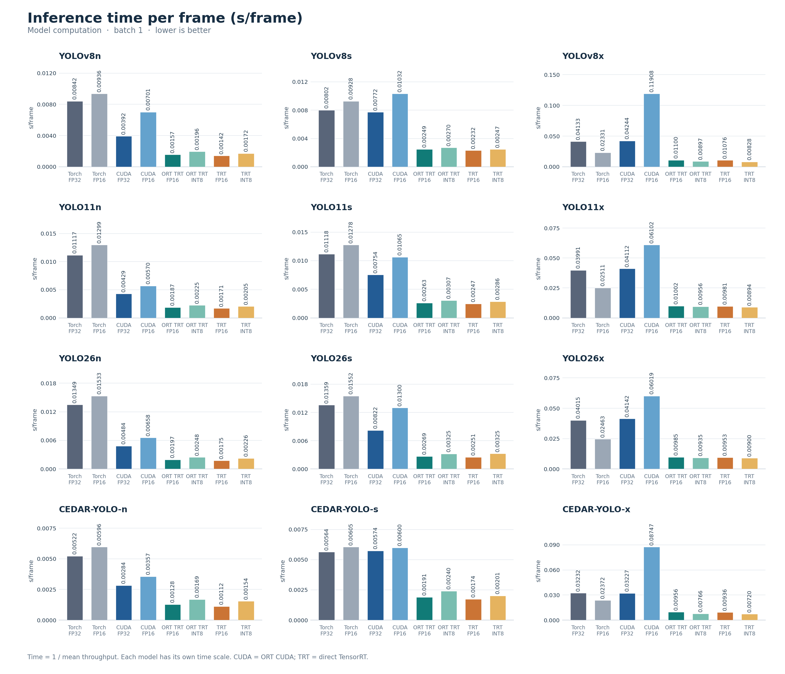
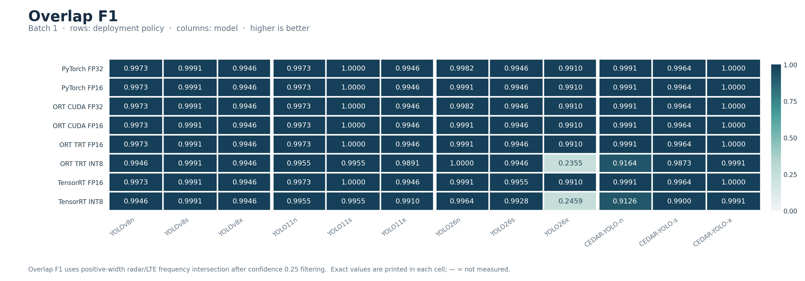
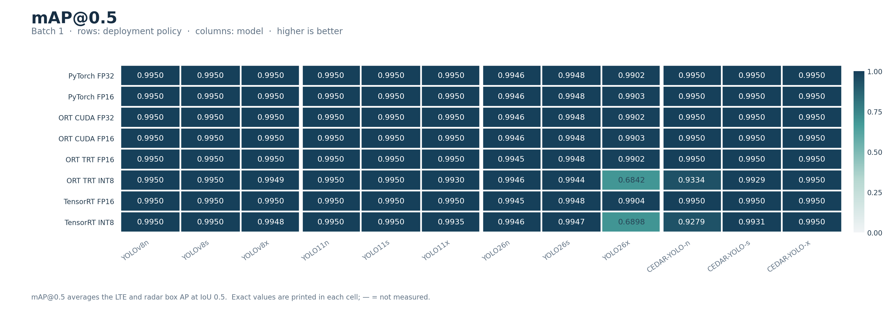
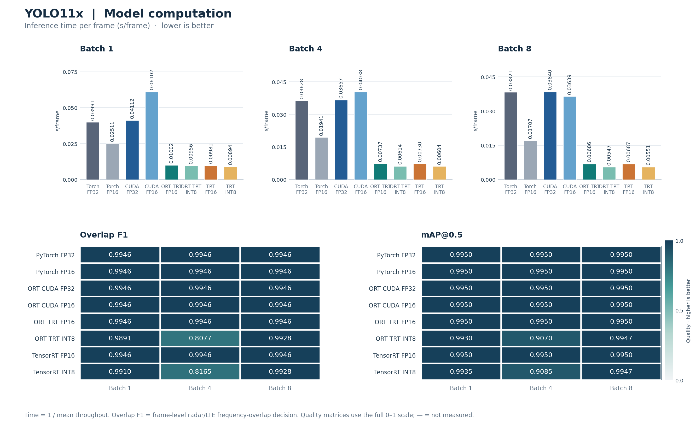
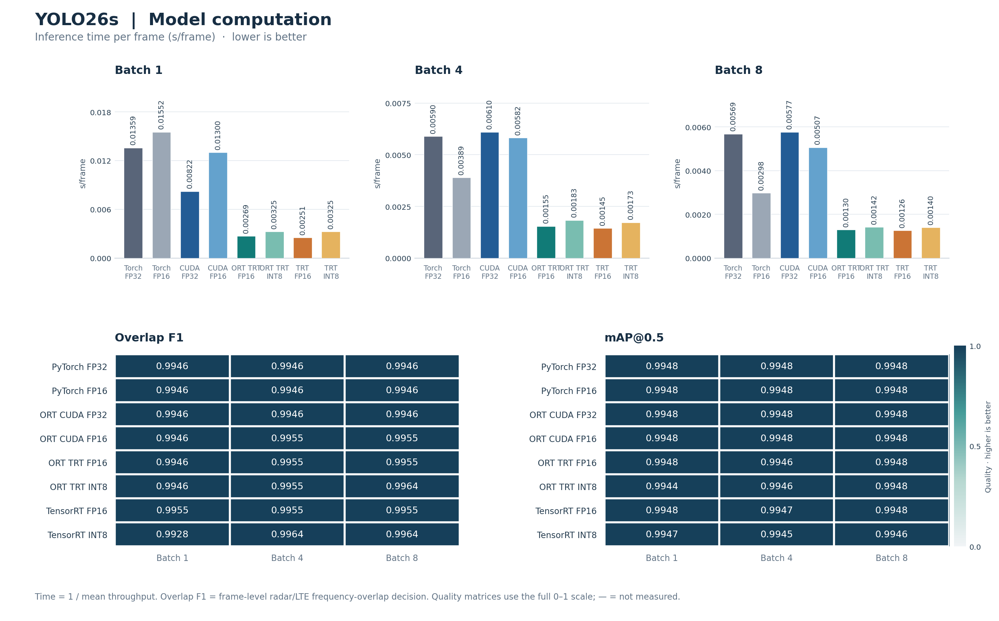
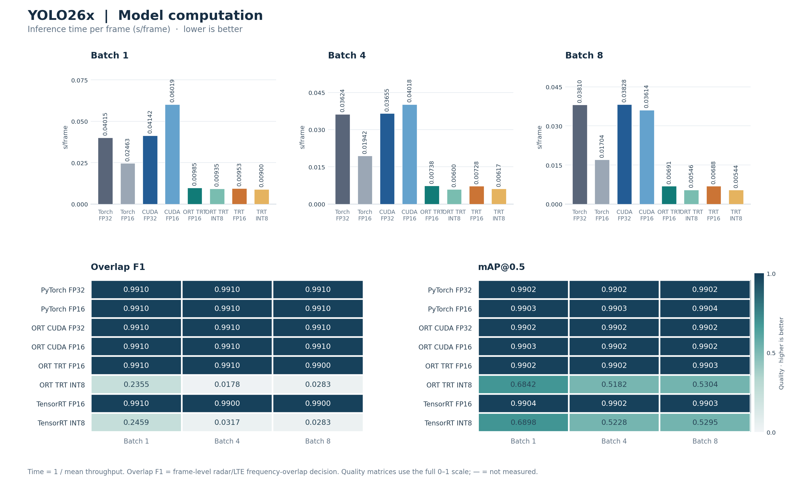
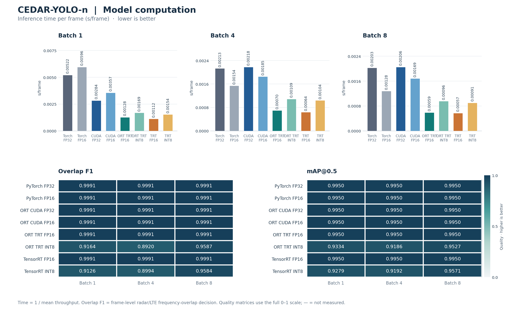
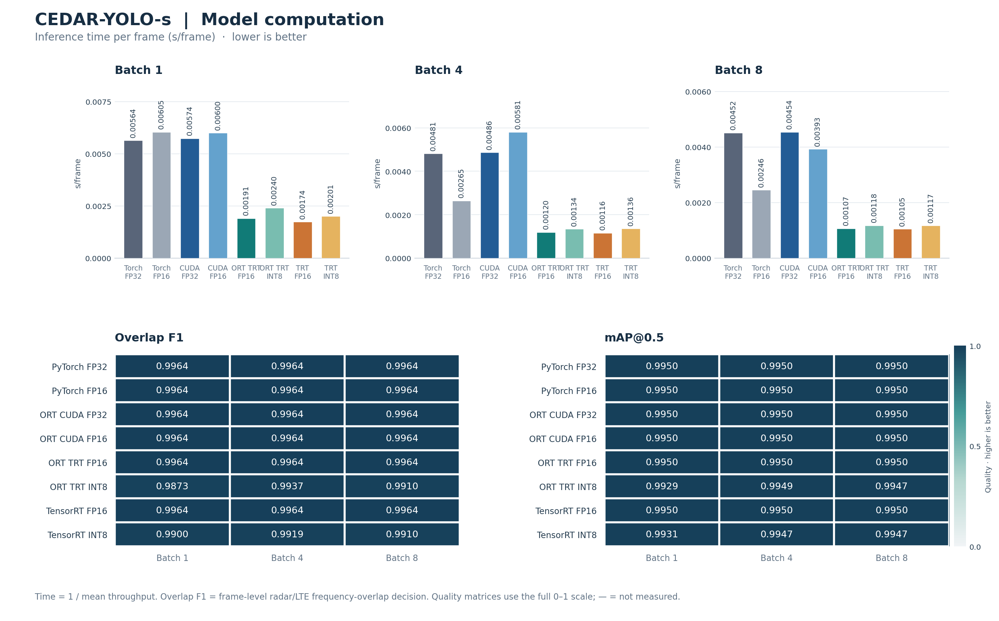
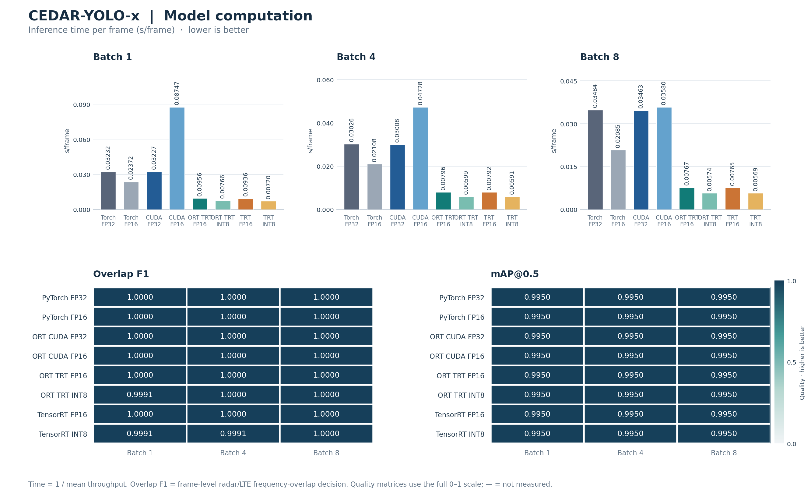

# CBRS-CEDAR-RT: complete GPU experiment report

**288/288 GPU configurations completed: 12 models, batches 1, 4, 8, 8 deployment policies.**

Current test experiment: `test-june-models-20261031-011345`. All final measurements and earlier recorded attempts are stored together in [data/](data/README.md).

## Setup

The four GPU backends are **PyTorch (`Torch`)**, **ONNX Runtime CUDA (`CUDA`)**, **ONNX Runtime TensorRT (`ORT TRT`)**, and **direct TensorRT (`TRT`)**. PyTorch and ONNX Runtime CUDA use FP32/FP16; both TensorRT backends use FP16/INT8. These form eight backend/precision settings. One experimental configuration is one model, batch size, and backend/precision setting. **No CPU measurements are included.**

**All experiments in this report run on the PC GPU**, using Python 3.12 and CUDA-compatible PyTorch; no Jetson deployment tests are reported. Checkpoint hashes identify the exact model edition used in each run.

The [README environment table](../../README.md#installation) lists tested/recommended versions. Compatible general runtime libraries can be used. For raw-I/Q conversion, preserve preprocessing library versions and parameters: even small pixel changes can invalidate pretrained predictions. The recorded RT experiments use the supplied PNGs directly.

- Device: **NVIDIA GeForce RTX 2070**, Windows-11-10.0.26300-SP0.
- Software: Python 3.12.13; PyTorch 2.7.1+cu128; ONNX Runtime 1.22.0; TensorRT 10.9.0.34.
- Evaluation: **test split, 848 images**. INT8 calibration uses 512 training images.
- Models: YOLOv8, YOLO11 and YOLO26 at nano, small and extra-large sizes; CEDAR-YOLO-n/s/x with a 20 × 20 feature grid. Checkpoint identities are recorded in the experiment metadata.
- Timing: 3 rounds per scope, with separate synchronized latency and throughput loops. Each loop uses the recorded minimum duration and image count; inputs and runtime caches are warmed.
- Scope: GPU policies at batches 1, 4, 8. All eight GPU policies are evaluated for every model and batch.

| Timing scope | Included work |
|---|---|
| Model computation | Forward pass, with the input tensor already on the device |
| Detector pipeline | Preprocessing, forward pass and box decoding/NMS from a decoded image |
| Image to detection | PNG reading/decoding and the full detector pipeline; warm file cache |

## Metrics

| Metric | Meaning |
|---|---|
| Inference time per frame (s/frame) ↓ | Inverse of mean throughput across the three rounds. At batch > 1, this is time normalized by throughput, not request latency. |
| Overlap F1 ↑ | Frame-level radar/LTE frequency-overlap F1, using the MDI rule: any positive-width frequency intersection. Detections use confidence 0.25; overlap is the positive class. |
| mAP@0.5 ↑ | Mean LTE/radar box AP at IoU 0.5, using CEDAR-MDI matching and interpolated trapezoidal AP. |
| mAP@0.5:0.95 ↑ | Mean AP over IoU thresholds 0.50 to 0.95; retained in all detailed tables. |
| p50 / p95 / p99 | Per-batch request latency percentiles in milliseconds, averaged across rounds. |

Quality is evaluated once per model/batch/policy on the test split, using the same checkpoint as its timing experiment. Overlap F1 and mAP are measured together; these are not historical scores or a separate supplementary evaluation. Repeated quality columns across timing scopes refer to that same evaluation.

### Quality protocol used in this experiment

**Overlap F1 is a frame-level decision metric.** Predictions with confidence strictly greater than 0.25 are retained. A frame is positive if at least one LTE box and one radar box have a positive-width intersection along the horizontal frequency axis. The same rule is applied to ground-truth boxes. Touching edges do not count; time-axis intersection is not required. Counts are pooled over the test frames, and `F1 = 2 TP / (2 TP + FP + FN)`. This is not the mean of LTE and radar box F1 scores.

**mAP measures box detection.** The evaluator uses the same confidence-filtered predictions, matches same-class predictions to labels greedily by descending IoU, and permits one match per prediction and label. For each class, predictions are sorted by confidence; AP integrates the precision envelope on 101 recall points with the trapezoidal rule. mAP@0.5 averages the two class APs at IoU 0.5; mAP@0.5:0.95 additionally averages ten IoU thresholds. This is the CEDAR-MDI evaluation protocol used by the code, rather than an unqualified COCO benchmark score.

Dense YOLO outputs use class-aware NMS at IoU 0.45 and a maximum of 300 detections. YOLO26 retains its native end-to-end output and is confidence-filtered without an additional NMS pass. All backends use the same postprocessing rule for a given model.

### Checkpoints and comparison scope

CEDAR-YOLO nano and small use the updated local June checkpoints. The extra-large checkpoint is byte-identical to the earlier edition; the nine original YOLO checkpoints are unchanged. This report uses the new test sweep throughout. Old validation results and old class-averaged F1 are not mixed into its plots or conclusions.

The experiments ran on the author's personal RTX 2070 PC. These measurements describe that setup; reproduce the comparison on a controlled target system before selecting a deployment configuration.

## Results

The three figures below compare inference speed, overlap F1 and mAP@0.5 at batch 1. The detailed tables cover all evaluated batch sizes and timing scopes.

### Inference speed



Inference time per frame is the inverse of mean throughput across the timing rounds; lower is better. Each panel uses its own time scale. Figure labels: Torch = PyTorch; CUDA = ONNX Runtime CUDA; ORT TRT = ONNX Runtime TensorRT; TRT = direct TensorRT.

ONNX Runtime with TensorRT FP16 achieves **2.96–6.83× the PyTorch FP32 throughput** across 12 models in this timing scope. Direct TensorRT FP16 achieves **3.25–7.71× the PyTorch FP32 throughput** across 12 models in this timing scope. For YOLOv8x, ORT CUDA FP16 takes 0.1191 s/frame, compared with 0.0413 s/frame for PyTorch FP32.

### Overlap F1



Rows are deployment policies and columns are models. Overlap F1 measures the frame-level radar/LTE frequency-overlap decision at confidence 0.25, using the same rule as MDI; higher is better.

The TensorRT FP16 configurations track each model's PyTorch FP32 quality: the largest absolute overlap-F1 change is **0.00090**. The largest absolute Overlap-F1 change with direct TensorRT INT8 is **0.74508** on YOLO26x: **0.9910 to 0.2459**. CEDAR-YOLO-n reaches **0.9991** with PyTorch FP32 and **0.9126** with direct TensorRT INT8. The INT8 drop is present in the frame-level overlap metric itself, not a comparison against box F1.

### mAP@0.5



The matrix reports mean average precision for LTE and radar boxes at IoU 0.5; higher is better.

Across the TensorRT FP16 configurations, the largest absolute mAP@0.5 change from PyTorch FP32 is **0.00019**. The largest mAP@0.5 reduction under direct TensorRT INT8 occurs on YOLO26x: **0.9902 to 0.6898**. INT8 deployment therefore requires validation for each model and batch configuration.

## Completion and data audit

| Batch | Completed GPU configurations | Remaining |
|---:|---:|---:|
| 1 | 96/96 | 0 |
| 4 | 96/96 | 0 |
| 8 | 96/96 | 0 |

The final tables contain **864 model × batch × policy × timing-scope aggregates**. Each aggregate is checked against its original rounds and protocol signatures.

Earlier attempts are retained in `data/history.jsonl` (see manifest distinct archived attempts). They are excluded from the final averages. Final configuration states and checkpoint identities are recorded in `data/routes.csv` and `data/metadata.json`.

## All model results

| Model | Final configurations | Detailed results |
|---|---:|---|
| YOLOv8n | 24/24 | [Tables and figures](#cbrs_yolo8n) |
| YOLOv8s | 24/24 | [Tables and figures](#cbrs_yolo8s) |
| YOLOv8x | 24/24 | [Tables and figures](#cbrs_yolo8x) |
| YOLO11n | 24/24 | [Tables and figures](#cbrs_yolo11n) |
| YOLO11s | 24/24 | [Tables and figures](#cbrs_yolo11s) |
| YOLO11x | 24/24 | [Tables and figures](#cbrs_yolo11x) |
| YOLO26n | 24/24 | [Tables and figures](#cbrs_yolo26n) |
| YOLO26s | 24/24 | [Tables and figures](#cbrs_yolo26s) |
| YOLO26x | 24/24 | [Tables and figures](#cbrs_yolo26x) |
| CEDAR-YOLO-n | 24/24 | [Tables and figures](#sig_yolo_v8n_f20t20_c100) |
| CEDAR-YOLO-s | 24/24 | [Tables and figures](#sig_yolo_v8s_f20t20_c100) |
| CEDAR-YOLO-x | 24/24 | [Tables and figures](#sig_yolo_v8x_f20t20_c100) |

<a id="cbrs_yolo8n"></a>
### YOLOv8n

#### Model computation


| Batch | Policy | Time (s/frame) ↓ | Overlap F1 ↑ | mAP@0.5 ↑ | mAP@0.5:0.95 ↑ | p50 (ms/batch) | p95 (ms/batch) | p99 (ms/batch) |
|---:|---|---:|---:|---:|---:|---:|---:|---:|
| 1 | PyTorch FP32 | 0.008421 | 0.9973 | 0.9950 | 0.9945 | 8.053 | 9.457 | 11.326 |
| 1 | PyTorch FP16 | 0.009363 | 0.9973 | 0.9950 | 0.9945 | 9.294 | 10.586 | 12.645 |
| 1 | ORT CUDA FP32 | 0.003922 | 0.9973 | 0.9950 | 0.9945 | 3.836 | 4.339 | 4.964 |
| 1 | ORT CUDA FP16 | 0.007012 | 0.9973 | 0.9950 | 0.9944 | 7.092 | 7.344 | 7.915 |
| 1 | ORT TRT FP16 | 0.001567 | 0.9973 | 0.9950 | 0.9946 | 1.563 | 1.658 | 2.058 |
| 1 | ORT TRT INT8 | 0.001957 | 0.9946 | 0.9950 | 0.9929 | 1.946 | 2.071 | 2.681 |
| 1 | TensorRT FP16 | 0.001417 | 0.9973 | 0.9950 | 0.9944 | 1.490 | 1.582 | 1.971 |
| 1 | TensorRT INT8 | 0.001720 | 0.9946 | 0.9950 | 0.9928 | 1.818 | 1.917 | 2.385 |
| 4 | PyTorch FP32 | 0.002382 | 0.9973 | 0.9950 | 0.9945 | 9.862 | 10.175 | 12.337 |
| 4 | PyTorch FP16 | 0.002323 | 0.9973 | 0.9950 | 0.9945 | 9.181 | 10.337 | 12.102 |
| 4 | ORT CUDA FP32 | 0.002645 | 0.9973 | 0.9950 | 0.9945 | 10.623 | 10.789 | 10.880 |
| 4 | ORT CUDA FP16 | 0.002790 | 0.9973 | 0.9950 | 0.9944 | 11.207 | 11.357 | 11.460 |
| 4 | ORT TRT FP16 | 0.000790 | 0.9973 | 0.9950 | 0.9945 | 3.157 | 3.244 | 3.303 |
| 4 | ORT TRT INT8 | 0.001059 | 0.9946 | 0.9950 | 0.9930 | 4.238 | 4.356 | 4.410 |
| 4 | TensorRT FP16 | 0.000753 | 0.9973 | 0.9950 | 0.9946 | 3.081 | 3.157 | 3.206 |
| 4 | TensorRT INT8 | 0.000989 | 0.9964 | 0.9950 | 0.9930 | 4.052 | 4.165 | 4.231 |
| 8 | PyTorch FP32 | 0.002263 | 0.9973 | 0.9950 | 0.9945 | 18.473 | 18.666 | 18.774 |
| 8 | PyTorch FP16 | 0.001411 | 0.9973 | 0.9950 | 0.9945 | 11.577 | 12.001 | 14.968 |
| 8 | ORT CUDA FP32 | 0.002421 | 0.9973 | 0.9950 | 0.9945 | 19.387 | 19.636 | 19.752 |
| 8 | ORT CUDA FP16 | 0.002345 | 0.9973 | 0.9950 | 0.9944 | 18.765 | 18.961 | 19.079 |
| 8 | ORT TRT FP16 | 0.000671 | 0.9973 | 0.9950 | 0.9944 | 5.363 | 5.460 | 5.516 |
| 8 | ORT TRT INT8 | 0.000864 | 0.9946 | 0.9950 | 0.9933 | 6.910 | 7.021 | 7.095 |
| 8 | TensorRT FP16 | 0.000648 | 0.9973 | 0.9950 | 0.9945 | 5.278 | 5.359 | 5.401 |
| 8 | TensorRT INT8 | 0.000820 | 0.9955 | 0.9950 | 0.9930 | 6.675 | 6.776 | 6.840 |

#### Decoded image to detections

[Comparison figure](figures/cbrs_yolo8n_detector_pipeline.png)

| Batch | Policy | Time (s/frame) ↓ | Overlap F1 ↑ | mAP@0.5 ↑ | mAP@0.5:0.95 ↑ | p50 (ms/batch) | p95 (ms/batch) | p99 (ms/batch) |
|---:|---|---:|---:|---:|---:|---:|---:|---:|
| 1 | PyTorch FP32 | 0.012989 | 0.9973 | 0.9950 | 0.9945 | 12.727 | 14.918 | 17.291 |
| 1 | PyTorch FP16 | 0.013896 | 0.9973 | 0.9950 | 0.9945 | 13.721 | 15.307 | 17.912 |
| 1 | ORT CUDA FP32 | 0.008235 | 0.9973 | 0.9950 | 0.9945 | 8.076 | 8.920 | 9.703 |
| 1 | ORT CUDA FP16 | 0.011479 | 0.9973 | 0.9950 | 0.9944 | 11.561 | 12.073 | 12.618 |
| 1 | ORT TRT FP16 | 0.006690 | 0.9973 | 0.9950 | 0.9946 | 6.672 | 7.226 | 7.831 |
| 1 | ORT TRT INT8 | 0.006724 | 0.9946 | 0.9950 | 0.9929 | 6.637 | 7.178 | 7.756 |
| 1 | TensorRT FP16 | 0.006089 | 0.9973 | 0.9950 | 0.9944 | 6.045 | 6.592 | 7.181 |
| 1 | TensorRT INT8 | 0.006191 | 0.9946 | 0.9950 | 0.9928 | 6.110 | 6.682 | 7.419 |
| 4 | PyTorch FP32 | 0.006589 | 0.9973 | 0.9950 | 0.9945 | 25.852 | 28.299 | 30.097 |
| 4 | PyTorch FP16 | 0.006437 | 0.9973 | 0.9950 | 0.9945 | 25.584 | 27.341 | 30.837 |
| 4 | ORT CUDA FP32 | 0.006791 | 0.9973 | 0.9950 | 0.9945 | 26.798 | 28.832 | 29.651 |
| 4 | ORT CUDA FP16 | 0.006742 | 0.9973 | 0.9950 | 0.9944 | 26.811 | 27.965 | 28.708 |
| 4 | ORT TRT FP16 | 0.006034 | 0.9973 | 0.9950 | 0.9945 | 24.084 | 27.199 | 28.046 |
| 4 | ORT TRT INT8 | 0.005926 | 0.9946 | 0.9950 | 0.9930 | 23.782 | 26.412 | 27.506 |
| 4 | TensorRT FP16 | 0.005766 | 0.9973 | 0.9950 | 0.9946 | 22.588 | 24.628 | 25.386 |
| 4 | TensorRT INT8 | 0.005763 | 0.9964 | 0.9950 | 0.9930 | 22.660 | 24.821 | 25.677 |
| 8 | PyTorch FP32 | 0.006429 | 0.9973 | 0.9950 | 0.9945 | 52.000 | 54.287 | 55.953 |
| 8 | PyTorch FP16 | 0.005712 | 0.9973 | 0.9950 | 0.9945 | 45.816 | 47.453 | 49.282 |
| 8 | ORT CUDA FP32 | 0.006543 | 0.9973 | 0.9950 | 0.9945 | 52.694 | 55.030 | 56.052 |
| 8 | ORT CUDA FP16 | 0.006233 | 0.9973 | 0.9950 | 0.9944 | 50.093 | 51.593 | 53.064 |
| 8 | ORT TRT FP16 | 0.005799 | 0.9973 | 0.9950 | 0.9944 | 46.489 | 50.036 | 51.495 |
| 8 | ORT TRT INT8 | 0.005757 | 0.9946 | 0.9950 | 0.9933 | 46.200 | 49.411 | 50.890 |
| 8 | TensorRT FP16 | 0.005557 | 0.9973 | 0.9950 | 0.9945 | 43.572 | 47.371 | 48.620 |
| 8 | TensorRT INT8 | 0.005599 | 0.9955 | 0.9950 | 0.9930 | 43.819 | 47.661 | 48.878 |

#### PNG file to detections

[Comparison figure](figures/cbrs_yolo8n_image_to_detection.png)

| Batch | Policy | Time (s/frame) ↓ | Overlap F1 ↑ | mAP@0.5 ↑ | mAP@0.5:0.95 ↑ | p50 (ms/batch) | p95 (ms/batch) | p99 (ms/batch) |
|---:|---|---:|---:|---:|---:|---:|---:|---:|
| 1 | PyTorch FP32 | 0.033573 | 0.9973 | 0.9950 | 0.9945 | 34.264 | 35.978 | 39.851 |
| 1 | PyTorch FP16 | 0.033562 | 0.9973 | 0.9950 | 0.9945 | 32.817 | 37.295 | 40.455 |
| 1 | ORT CUDA FP32 | 0.034476 | 0.9973 | 0.9950 | 0.9945 | 34.713 | 36.474 | 41.877 |
| 1 | ORT CUDA FP16 | 0.035123 | 0.9973 | 0.9950 | 0.9944 | 35.609 | 36.866 | 38.796 |
| 1 | ORT TRT FP16 | 0.034169 | 0.9973 | 0.9950 | 0.9946 | 34.382 | 36.038 | 42.237 |
| 1 | ORT TRT INT8 | 0.035433 | 0.9946 | 0.9950 | 0.9929 | 36.597 | 38.496 | 45.909 |
| 1 | TensorRT FP16 | 0.034963 | 0.9973 | 0.9950 | 0.9944 | 35.208 | 37.153 | 43.402 |
| 1 | TensorRT INT8 | 0.034239 | 0.9946 | 0.9950 | 0.9928 | 35.513 | 37.483 | 42.134 |
| 4 | PyTorch FP32 | 0.028036 | 0.9973 | 0.9950 | 0.9945 | 112.051 | 142.940 | 148.527 |
| 4 | PyTorch FP16 | 0.029101 | 0.9973 | 0.9950 | 0.9945 | 115.232 | 153.549 | 161.830 |
| 4 | ORT CUDA FP32 | 0.028719 | 0.9973 | 0.9950 | 0.9945 | 113.657 | 144.076 | 149.331 |
| 4 | ORT CUDA FP16 | 0.029900 | 0.9973 | 0.9950 | 0.9944 | 119.594 | 141.906 | 154.771 |
| 4 | ORT TRT FP16 | 0.029448 | 0.9973 | 0.9950 | 0.9945 | 109.506 | 140.093 | 141.511 |
| 4 | ORT TRT INT8 | 0.030810 | 0.9946 | 0.9950 | 0.9930 | 118.720 | 156.656 | 159.021 |
| 4 | TensorRT FP16 | 0.030066 | 0.9973 | 0.9950 | 0.9946 | 112.137 | 142.439 | 143.617 |
| 4 | TensorRT INT8 | 0.031016 | 0.9964 | 0.9950 | 0.9930 | 119.348 | 157.149 | 159.190 |
| 8 | PyTorch FP32 | 0.028238 | 0.9973 | 0.9950 | 0.9945 | 230.872 | 235.050 | 238.052 |
| 8 | PyTorch FP16 | 0.027442 | 0.9973 | 0.9950 | 0.9945 | 225.039 | 244.030 | 331.561 |
| 8 | ORT CUDA FP32 | 0.028893 | 0.9973 | 0.9950 | 0.9945 | 236.066 | 239.963 | 244.771 |
| 8 | ORT CUDA FP16 | 0.027803 | 0.9973 | 0.9950 | 0.9944 | 228.605 | 259.980 | 265.703 |
| 8 | ORT TRT FP16 | 0.028497 | 0.9973 | 0.9950 | 0.9944 | 218.040 | 287.154 | 289.711 |
| 8 | ORT TRT INT8 | 0.030439 | 0.9946 | 0.9950 | 0.9933 | 236.776 | 314.943 | 317.725 |
| 8 | TensorRT FP16 | 0.028723 | 0.9973 | 0.9950 | 0.9945 | 221.834 | 288.497 | 289.964 |
| 8 | TensorRT INT8 | 0.030006 | 0.9955 | 0.9950 | 0.9930 | 232.447 | 306.938 | 310.013 |


<a id="cbrs_yolo8s"></a>
### YOLOv8s

#### Model computation


| Batch | Policy | Time (s/frame) ↓ | Overlap F1 ↑ | mAP@0.5 ↑ | mAP@0.5:0.95 ↑ | p50 (ms/batch) | p95 (ms/batch) | p99 (ms/batch) |
|---:|---|---:|---:|---:|---:|---:|---:|---:|
| 1 | PyTorch FP32 | 0.008022 | 0.9991 | 0.9950 | 0.9950 | 8.015 | 9.042 | 10.651 |
| 1 | PyTorch FP16 | 0.009283 | 0.9991 | 0.9950 | 0.9950 | 9.203 | 10.637 | 13.093 |
| 1 | ORT CUDA FP32 | 0.007718 | 0.9991 | 0.9950 | 0.9950 | 7.755 | 7.945 | 8.644 |
| 1 | ORT CUDA FP16 | 0.010320 | 0.9991 | 0.9950 | 0.9950 | 10.338 | 10.543 | 11.370 |
| 1 | ORT TRT FP16 | 0.002491 | 0.9991 | 0.9950 | 0.9950 | 2.487 | 2.575 | 2.783 |
| 1 | ORT TRT INT8 | 0.002703 | 0.9991 | 0.9950 | 0.9947 | 2.696 | 2.809 | 3.210 |
| 1 | TensorRT FP16 | 0.002317 | 0.9991 | 0.9950 | 0.9950 | 2.403 | 2.488 | 2.650 |
| 1 | TensorRT INT8 | 0.002466 | 0.9991 | 0.9950 | 0.9949 | 2.541 | 2.643 | 3.023 |
| 4 | PyTorch FP32 | 0.005833 | 0.9991 | 0.9950 | 0.9950 | 23.681 | 24.033 | 24.222 |
| 4 | PyTorch FP16 | 0.003205 | 0.9991 | 0.9950 | 0.9950 | 13.090 | 13.839 | 16.012 |
| 4 | ORT CUDA FP32 | 0.006135 | 0.9991 | 0.9950 | 0.9950 | 24.578 | 24.967 | 25.143 |
| 4 | ORT CUDA FP16 | 0.008336 | 0.9991 | 0.9950 | 0.9950 | 33.307 | 33.990 | 34.254 |
| 4 | ORT TRT FP16 | 0.001447 | 0.9991 | 0.9950 | 0.9950 | 5.787 | 5.877 | 5.932 |
| 4 | ORT TRT INT8 | 0.001485 | 0.9991 | 0.9950 | 0.9950 | 5.939 | 6.035 | 6.096 |
| 4 | TensorRT FP16 | 0.001400 | 0.9991 | 0.9950 | 0.9950 | 5.729 | 5.808 | 5.858 |
| 4 | TensorRT INT8 | 0.001421 | 0.9991 | 0.9950 | 0.9950 | 5.798 | 5.892 | 5.940 |
| 8 | PyTorch FP32 | 0.005564 | 0.9991 | 0.9950 | 0.9950 | 44.778 | 45.431 | 45.631 |
| 8 | PyTorch FP16 | 0.002847 | 0.9991 | 0.9950 | 0.9950 | 23.088 | 23.333 | 23.429 |
| 8 | ORT CUDA FP32 | 0.005772 | 0.9991 | 0.9950 | 0.9950 | 46.099 | 46.771 | 46.998 |
| 8 | ORT CUDA FP16 | 0.005624 | 0.9991 | 0.9950 | 0.9950 | 44.980 | 45.538 | 45.714 |
| 8 | ORT TRT FP16 | 0.001280 | 0.9991 | 0.9950 | 0.9950 | 10.230 | 10.366 | 10.446 |
| 8 | ORT TRT INT8 | 0.001242 | 0.9991 | 0.9950 | 0.9949 | 9.915 | 10.035 | 10.100 |
| 8 | TensorRT FP16 | 0.001249 | 0.9991 | 0.9950 | 0.9950 | 10.085 | 10.220 | 10.284 |
| 8 | TensorRT INT8 | 0.001242 | 0.9991 | 0.9950 | 0.9949 | 10.054 | 10.203 | 10.275 |

#### Decoded image to detections

[Comparison figure](figures/cbrs_yolo8s_detector_pipeline.png)

| Batch | Policy | Time (s/frame) ↓ | Overlap F1 ↑ | mAP@0.5 ↑ | mAP@0.5:0.95 ↑ | p50 (ms/batch) | p95 (ms/batch) | p99 (ms/batch) |
|---:|---|---:|---:|---:|---:|---:|---:|---:|
| 1 | PyTorch FP32 | 0.012761 | 0.9991 | 0.9950 | 0.9950 | 12.591 | 14.261 | 16.305 |
| 1 | PyTorch FP16 | 0.013917 | 0.9991 | 0.9950 | 0.9950 | 13.806 | 15.308 | 18.321 |
| 1 | ORT CUDA FP32 | 0.012357 | 0.9991 | 0.9950 | 0.9950 | 12.283 | 12.910 | 13.516 |
| 1 | ORT CUDA FP16 | 0.014674 | 0.9991 | 0.9950 | 0.9950 | 14.671 | 15.168 | 15.855 |
| 1 | ORT TRT FP16 | 0.007034 | 0.9991 | 0.9950 | 0.9950 | 7.013 | 7.467 | 7.913 |
| 1 | ORT TRT INT8 | 0.007181 | 0.9991 | 0.9950 | 0.9947 | 7.113 | 7.712 | 8.311 |
| 1 | TensorRT FP16 | 0.006543 | 0.9991 | 0.9950 | 0.9950 | 6.501 | 6.986 | 7.427 |
| 1 | TensorRT INT8 | 0.006648 | 0.9991 | 0.9950 | 0.9949 | 6.569 | 7.147 | 7.727 |
| 4 | PyTorch FP32 | 0.010054 | 0.9991 | 0.9950 | 0.9950 | 39.955 | 41.909 | 42.622 |
| 4 | PyTorch FP16 | 0.007420 | 0.9991 | 0.9950 | 0.9950 | 29.685 | 32.047 | 33.917 |
| 4 | ORT CUDA FP32 | 0.010425 | 0.9991 | 0.9950 | 0.9950 | 41.283 | 44.709 | 45.446 |
| 4 | ORT CUDA FP16 | 0.012300 | 0.9991 | 0.9950 | 0.9950 | 49.184 | 50.300 | 50.956 |
| 4 | ORT TRT FP16 | 0.005861 | 0.9991 | 0.9950 | 0.9950 | 23.149 | 25.255 | 26.190 |
| 4 | ORT TRT INT8 | 0.005838 | 0.9991 | 0.9950 | 0.9950 | 22.983 | 25.027 | 25.778 |
| 4 | TensorRT FP16 | 0.005779 | 0.9991 | 0.9950 | 0.9950 | 22.710 | 24.715 | 25.208 |
| 4 | TensorRT INT8 | 0.005792 | 0.9991 | 0.9950 | 0.9950 | 22.805 | 24.851 | 25.535 |
| 8 | PyTorch FP32 | 0.009747 | 0.9991 | 0.9950 | 0.9950 | 78.657 | 80.166 | 81.029 |
| 8 | PyTorch FP16 | 0.006755 | 0.9991 | 0.9950 | 0.9950 | 54.152 | 55.649 | 56.770 |
| 8 | ORT CUDA FP32 | 0.009884 | 0.9991 | 0.9950 | 0.9950 | 79.745 | 81.379 | 82.243 |
| 8 | ORT CUDA FP16 | 0.009524 | 0.9991 | 0.9950 | 0.9950 | 76.255 | 77.751 | 78.751 |
| 8 | ORT TRT FP16 | 0.005772 | 0.9991 | 0.9950 | 0.9950 | 45.816 | 48.578 | 49.748 |
| 8 | ORT TRT INT8 | 0.006394 | 0.9991 | 0.9950 | 0.9949 | 50.116 | 56.127 | 57.155 |
| 8 | TensorRT FP16 | 0.005562 | 0.9991 | 0.9950 | 0.9950 | 43.569 | 47.438 | 48.403 |
| 8 | TensorRT INT8 | 0.005593 | 0.9991 | 0.9950 | 0.9949 | 43.688 | 47.452 | 48.392 |

#### PNG file to detections

[Comparison figure](figures/cbrs_yolo8s_image_to_detection.png)

| Batch | Policy | Time (s/frame) ↓ | Overlap F1 ↑ | mAP@0.5 ↑ | mAP@0.5:0.95 ↑ | p50 (ms/batch) | p95 (ms/batch) | p99 (ms/batch) |
|---:|---|---:|---:|---:|---:|---:|---:|---:|
| 1 | PyTorch FP32 | 0.033781 | 0.9991 | 0.9950 | 0.9950 | 34.283 | 38.051 | 42.439 |
| 1 | PyTorch FP16 | 0.033159 | 0.9991 | 0.9950 | 0.9950 | 32.305 | 38.277 | 39.672 |
| 1 | ORT CUDA FP32 | 0.035005 | 0.9991 | 0.9950 | 0.9950 | 35.526 | 36.876 | 38.612 |
| 1 | ORT CUDA FP16 | 0.035120 | 0.9991 | 0.9950 | 0.9950 | 35.627 | 36.882 | 37.930 |
| 1 | ORT TRT FP16 | 0.032178 | 0.9991 | 0.9950 | 0.9950 | 32.171 | 39.886 | 44.800 |
| 1 | ORT TRT INT8 | 0.034155 | 0.9991 | 0.9950 | 0.9947 | 33.859 | 42.835 | 45.546 |
| 1 | TensorRT FP16 | 0.032812 | 0.9991 | 0.9950 | 0.9950 | 32.434 | 42.543 | 45.101 |
| 1 | TensorRT INT8 | 0.033519 | 0.9991 | 0.9950 | 0.9949 | 33.318 | 42.620 | 44.886 |
| 4 | PyTorch FP32 | 0.030803 | 0.9991 | 0.9950 | 0.9950 | 125.735 | 129.098 | 135.157 |
| 4 | PyTorch FP16 | 0.030373 | 0.9991 | 0.9950 | 0.9950 | 123.865 | 127.173 | 128.575 |
| 4 | ORT CUDA FP32 | 0.030773 | 0.9991 | 0.9950 | 0.9950 | 125.536 | 128.243 | 129.619 |
| 4 | ORT CUDA FP16 | 0.030754 | 0.9991 | 0.9950 | 0.9950 | 125.509 | 128.210 | 129.963 |
| 4 | ORT TRT FP16 | 0.030396 | 0.9991 | 0.9950 | 0.9950 | 120.573 | 155.875 | 172.859 |
| 4 | ORT TRT INT8 | 0.032722 | 0.9991 | 0.9950 | 0.9950 | 130.345 | 169.878 | 184.874 |
| 4 | TensorRT FP16 | 0.031517 | 0.9991 | 0.9950 | 0.9950 | 124.528 | 171.758 | 178.142 |
| 4 | TensorRT INT8 | 0.032611 | 0.9991 | 0.9950 | 0.9950 | 129.412 | 166.149 | 183.458 |
| 8 | PyTorch FP32 | 0.030253 | 0.9991 | 0.9950 | 0.9950 | 246.378 | 252.469 | 254.082 |
| 8 | PyTorch FP16 | 0.029984 | 0.9991 | 0.9950 | 0.9950 | 243.228 | 248.547 | 249.771 |
| 8 | ORT CUDA FP32 | 0.030408 | 0.9991 | 0.9950 | 0.9950 | 247.147 | 252.859 | 255.047 |
| 8 | ORT CUDA FP16 | 0.030378 | 0.9991 | 0.9950 | 0.9950 | 245.983 | 253.735 | 255.551 |
| 8 | ORT TRT FP16 | 0.028724 | 0.9991 | 0.9950 | 0.9950 | 234.931 | 290.136 | 352.014 |
| 8 | ORT TRT INT8 | 0.030584 | 0.9991 | 0.9950 | 0.9949 | 246.441 | 317.736 | 361.980 |
| 8 | TensorRT FP16 | 0.029689 | 0.9991 | 0.9950 | 0.9950 | 242.490 | 306.222 | 357.876 |
| 8 | TensorRT INT8 | 0.030420 | 0.9991 | 0.9950 | 0.9949 | 251.232 | 294.503 | 368.188 |


<a id="cbrs_yolo8x"></a>
### YOLOv8x

#### Model computation


| Batch | Policy | Time (s/frame) ↓ | Overlap F1 ↑ | mAP@0.5 ↑ | mAP@0.5:0.95 ↑ | p50 (ms/batch) | p95 (ms/batch) | p99 (ms/batch) |
|---:|---|---:|---:|---:|---:|---:|---:|---:|
| 1 | PyTorch FP32 | 0.041334 | 0.9946 | 0.9950 | 0.7462 | 41.476 | 42.943 | 43.585 |
| 1 | PyTorch FP16 | 0.023314 | 0.9946 | 0.9950 | 0.7462 | 23.619 | 24.349 | 25.253 |
| 1 | ORT CUDA FP32 | 0.042443 | 0.9946 | 0.9950 | 0.7462 | 42.256 | 43.752 | 44.390 |
| 1 | ORT CUDA FP16 | 0.119085 | 0.9946 | 0.9950 | 0.7462 | 118.686 | 120.751 | 121.413 |
| 1 | ORT TRT FP16 | 0.010997 | 0.9946 | 0.9950 | 0.7462 | 10.922 | 11.327 | 12.193 |
| 1 | ORT TRT INT8 | 0.008972 | 0.9946 | 0.9949 | 0.7461 | 8.942 | 9.153 | 9.982 |
| 1 | TensorRT FP16 | 0.010759 | 0.9946 | 0.9950 | 0.7462 | 10.817 | 11.190 | 12.012 |
| 1 | TensorRT INT8 | 0.008285 | 0.9946 | 0.9948 | 0.7461 | 8.362 | 8.558 | 9.382 |
| 4 | PyTorch FP32 | 0.037054 | 0.9946 | 0.9950 | 0.7462 | 148.434 | 149.673 | 150.311 |
| 4 | PyTorch FP16 | 0.019371 | 0.9946 | 0.9950 | 0.7462 | 77.534 | 78.896 | 79.307 |
| 4 | ORT CUDA FP32 | 0.037759 | 0.9946 | 0.9950 | 0.7462 | 150.853 | 152.344 | 152.818 |
| 4 | ORT CUDA FP16 | 0.061500 | 0.9946 | 0.9950 | 0.7462 | 245.671 | 247.459 | 248.442 |
| 4 | ORT TRT FP16 | 0.008916 | 0.9946 | 0.9950 | 0.7462 | 35.396 | 36.100 | 36.438 |
| 4 | ORT TRT INT8 | 0.006458 | 0.9946 | 0.9949 | 0.7461 | 25.779 | 26.236 | 26.581 |
| 4 | TensorRT FP16 | 0.008879 | 0.9946 | 0.9950 | 0.7462 | 35.403 | 36.096 | 36.384 |
| 4 | TensorRT INT8 | 0.006352 | 0.9946 | 0.9949 | 0.7461 | 25.514 | 25.999 | 26.361 |
| 8 | PyTorch FP32 | 0.040050 | 0.9946 | 0.9950 | 0.7462 | 320.687 | 321.996 | 322.481 |
| 8 | PyTorch FP16 | 0.019589 | 0.9946 | 0.9950 | 0.7462 | 156.912 | 157.504 | 157.931 |
| 8 | ORT CUDA FP32 | 0.040430 | 0.9946 | 0.9950 | 0.7462 | 323.290 | 324.558 | 325.184 |
| 8 | ORT CUDA FP16 | 0.041846 | 0.9946 | 0.9950 | 0.7462 | 334.654 | 335.980 | 336.752 |
| 8 | ORT TRT FP16 | 0.008372 | 0.9946 | 0.9950 | 0.7462 | 66.841 | 68.001 | 68.205 |
| 8 | ORT TRT INT8 | 0.005980 | 0.9946 | 0.9949 | 0.7461 | 47.666 | 48.664 | 49.053 |
| 8 | TensorRT FP16 | 0.008302 | 0.9946 | 0.9950 | 0.7462 | 66.480 | 66.924 | 67.597 |
| 8 | TensorRT INT8 | 0.005962 | 0.9946 | 0.9949 | 0.7461 | 47.738 | 48.620 | 49.041 |

#### Decoded image to detections

[Comparison figure](figures/cbrs_yolo8x_detector_pipeline.png)

| Batch | Policy | Time (s/frame) ↓ | Overlap F1 ↑ | mAP@0.5 ↑ | mAP@0.5:0.95 ↑ | p50 (ms/batch) | p95 (ms/batch) | p99 (ms/batch) |
|---:|---|---:|---:|---:|---:|---:|---:|---:|
| 1 | PyTorch FP32 | 0.046224 | 0.9946 | 0.9950 | 0.7462 | 46.101 | 47.480 | 48.273 |
| 1 | PyTorch FP16 | 0.027955 | 0.9946 | 0.9950 | 0.7462 | 27.873 | 28.820 | 29.616 |
| 1 | ORT CUDA FP32 | 0.047123 | 0.9946 | 0.9950 | 0.7462 | 47.023 | 48.416 | 49.205 |
| 1 | ORT CUDA FP16 | 0.124045 | 0.9946 | 0.9950 | 0.7462 | 123.708 | 125.779 | 126.400 |
| 1 | ORT TRT FP16 | 0.015193 | 0.9946 | 0.9950 | 0.7462 | 15.128 | 15.743 | 16.554 |
| 1 | ORT TRT INT8 | 0.013397 | 0.9946 | 0.9949 | 0.7461 | 13.345 | 13.949 | 14.568 |
| 1 | TensorRT FP16 | 0.014873 | 0.9946 | 0.9950 | 0.7462 | 14.810 | 15.435 | 16.167 |
| 1 | TensorRT INT8 | 0.012558 | 0.9946 | 0.9948 | 0.7461 | 12.512 | 13.048 | 13.682 |
| 4 | PyTorch FP32 | 0.041701 | 0.9946 | 0.9950 | 0.7462 | 166.934 | 168.083 | 168.564 |
| 4 | PyTorch FP16 | 0.023487 | 0.9946 | 0.9950 | 0.7462 | 93.954 | 94.987 | 95.607 |
| 4 | ORT CUDA FP32 | 0.042301 | 0.9946 | 0.9950 | 0.7462 | 169.149 | 170.096 | 170.683 |
| 4 | ORT CUDA FP16 | 0.065510 | 0.9946 | 0.9950 | 0.7462 | 262.075 | 263.293 | 263.934 |
| 4 | ORT TRT FP16 | 0.012923 | 0.9946 | 0.9950 | 0.7462 | 51.760 | 53.401 | 54.042 |
| 4 | ORT TRT INT8 | 0.010505 | 0.9946 | 0.9949 | 0.7461 | 41.757 | 43.640 | 44.270 |
| 4 | TensorRT FP16 | 0.012899 | 0.9946 | 0.9950 | 0.7462 | 51.741 | 53.240 | 53.906 |
| 4 | TensorRT INT8 | 0.010395 | 0.9946 | 0.9949 | 0.7461 | 41.306 | 43.189 | 43.789 |
| 8 | PyTorch FP32 | 0.044419 | 0.9946 | 0.9950 | 0.7462 | 355.269 | 356.925 | 357.789 |
| 8 | PyTorch FP16 | 0.023607 | 0.9946 | 0.9950 | 0.7462 | 188.794 | 190.611 | 191.355 |
| 8 | ORT CUDA FP32 | 0.044756 | 0.9946 | 0.9950 | 0.7462 | 358.063 | 360.326 | 361.072 |
| 8 | ORT CUDA FP16 | 0.045651 | 0.9946 | 0.9950 | 0.7462 | 365.473 | 367.141 | 368.040 |
| 8 | ORT TRT FP16 | 0.012544 | 0.9946 | 0.9950 | 0.7462 | 101.118 | 102.832 | 103.924 |
| 8 | ORT TRT INT8 | 0.010029 | 0.9946 | 0.9949 | 0.7461 | 80.953 | 82.597 | 83.584 |
| 8 | TensorRT FP16 | 0.012524 | 0.9946 | 0.9950 | 0.7462 | 100.856 | 102.790 | 103.576 |
| 8 | TensorRT INT8 | 0.010065 | 0.9946 | 0.9949 | 0.7461 | 81.313 | 83.224 | 84.107 |

#### PNG file to detections

[Comparison figure](figures/cbrs_yolo8x_image_to_detection.png)

| Batch | Policy | Time (s/frame) ↓ | Overlap F1 ↑ | mAP@0.5 ↑ | mAP@0.5:0.95 ↑ | p50 (ms/batch) | p95 (ms/batch) | p99 (ms/batch) |
|---:|---|---:|---:|---:|---:|---:|---:|---:|
| 1 | PyTorch FP32 | 0.062564 | 0.9946 | 0.9950 | 0.7462 | 63.139 | 64.535 | 65.408 |
| 1 | PyTorch FP16 | 0.044625 | 0.9946 | 0.9950 | 0.7462 | 45.245 | 46.420 | 47.237 |
| 1 | ORT CUDA FP32 | 0.063352 | 0.9946 | 0.9950 | 0.7462 | 63.895 | 65.525 | 66.310 |
| 1 | ORT CUDA FP16 | 0.140641 | 0.9946 | 0.9950 | 0.7462 | 140.982 | 143.093 | 143.875 |
| 1 | ORT TRT FP16 | 0.035402 | 0.9946 | 0.9950 | 0.7462 | 35.865 | 37.180 | 38.299 |
| 1 | ORT TRT INT8 | 0.037860 | 0.9946 | 0.9949 | 0.7461 | 38.273 | 39.886 | 41.257 |
| 1 | TensorRT FP16 | 0.035907 | 0.9946 | 0.9950 | 0.7462 | 36.388 | 37.715 | 38.719 |
| 1 | TensorRT INT8 | 0.037646 | 0.9946 | 0.9948 | 0.7461 | 37.955 | 39.542 | 40.716 |
| 4 | PyTorch FP32 | 0.057881 | 0.9946 | 0.9950 | 0.7462 | 234.206 | 236.983 | 237.950 |
| 4 | PyTorch FP16 | 0.039762 | 0.9946 | 0.9950 | 0.7462 | 161.901 | 164.143 | 165.017 |
| 4 | ORT CUDA FP32 | 0.058537 | 0.9946 | 0.9950 | 0.7462 | 236.569 | 239.502 | 240.667 |
| 4 | ORT CUDA FP16 | 0.081433 | 0.9946 | 0.9950 | 0.7462 | 328.476 | 331.419 | 332.273 |
| 4 | ORT TRT FP16 | 0.031627 | 0.9946 | 0.9950 | 0.7462 | 128.955 | 131.615 | 134.771 |
| 4 | ORT TRT INT8 | 0.034224 | 0.9946 | 0.9949 | 0.7461 | 138.056 | 144.138 | 146.785 |
| 4 | TensorRT FP16 | 0.032415 | 0.9946 | 0.9950 | 0.7462 | 131.638 | 136.374 | 138.694 |
| 4 | TensorRT INT8 | 0.033524 | 0.9946 | 0.9949 | 0.7461 | 135.932 | 142.050 | 143.931 |
| 8 | PyTorch FP32 | 0.060625 | 0.9946 | 0.9950 | 0.7462 | 489.768 | 493.870 | 494.581 |
| 8 | PyTorch FP16 | 0.039862 | 0.9946 | 0.9950 | 0.7462 | 323.128 | 327.460 | 328.431 |
| 8 | ORT CUDA FP32 | 0.060977 | 0.9946 | 0.9950 | 0.7462 | 492.043 | 496.898 | 498.244 |
| 8 | ORT CUDA FP16 | 0.061771 | 0.9946 | 0.9950 | 0.7462 | 498.160 | 503.195 | 504.927 |
| 8 | ORT TRT FP16 | 0.031378 | 0.9946 | 0.9950 | 0.7462 | 253.938 | 263.456 | 266.241 |
| 8 | ORT TRT INT8 | 0.033780 | 0.9946 | 0.9949 | 0.7461 | 275.140 | 281.922 | 285.435 |
| 8 | TensorRT FP16 | 0.032431 | 0.9946 | 0.9950 | 0.7462 | 263.020 | 270.156 | 278.938 |
| 8 | TensorRT INT8 | 0.033226 | 0.9946 | 0.9949 | 0.7461 | 269.044 | 276.256 | 279.254 |


<a id="cbrs_yolo11n"></a>
### YOLO11n

#### Model computation


| Batch | Policy | Time (s/frame) ↓ | Overlap F1 ↑ | mAP@0.5 ↑ | mAP@0.5:0.95 ↑ | p50 (ms/batch) | p95 (ms/batch) | p99 (ms/batch) |
|---:|---|---:|---:|---:|---:|---:|---:|---:|
| 1 | PyTorch FP32 | 0.011165 | 0.9973 | 0.9950 | 0.9950 | 11.203 | 12.321 | 14.227 |
| 1 | PyTorch FP16 | 0.012986 | 0.9973 | 0.9950 | 0.9950 | 13.008 | 14.106 | 16.309 |
| 1 | ORT CUDA FP32 | 0.004292 | 0.9973 | 0.9950 | 0.9950 | 4.201 | 4.662 | 5.877 |
| 1 | ORT CUDA FP16 | 0.005700 | 0.9973 | 0.9950 | 0.9950 | 5.647 | 6.151 | 7.059 |
| 1 | ORT TRT FP16 | 0.001873 | 0.9973 | 0.9950 | 0.9950 | 1.864 | 1.992 | 2.588 |
| 1 | ORT TRT INT8 | 0.002246 | 0.9955 | 0.9950 | 0.9941 | 2.232 | 2.386 | 2.763 |
| 1 | TensorRT FP16 | 0.001713 | 0.9973 | 0.9950 | 0.9950 | 1.781 | 1.932 | 2.637 |
| 1 | TensorRT INT8 | 0.002051 | 0.9955 | 0.9950 | 0.9939 | 2.155 | 2.304 | 2.627 |
| 4 | PyTorch FP32 | 0.002856 | 0.9973 | 0.9950 | 0.9950 | 11.392 | 13.101 | 15.646 |
| 4 | PyTorch FP16 | 0.003210 | 0.9973 | 0.9950 | 0.9950 | 12.605 | 14.428 | 17.189 |
| 4 | ORT CUDA FP32 | 0.002716 | 0.9973 | 0.9950 | 0.9950 | 10.920 | 11.088 | 11.195 |
| 4 | ORT CUDA FP16 | 0.002702 | 0.9973 | 0.9950 | 0.9950 | 10.870 | 11.046 | 11.156 |
| 4 | ORT TRT FP16 | 0.000881 | 0.9973 | 0.9950 | 0.9950 | 3.524 | 3.632 | 3.701 |
| 4 | ORT TRT INT8 | 0.001136 | 0.9955 | 0.9950 | 0.9940 | 4.547 | 4.666 | 4.750 |
| 4 | TensorRT FP16 | 0.000857 | 0.9973 | 0.9950 | 0.9950 | 3.485 | 3.583 | 3.644 |
| 4 | TensorRT INT8 | 0.001096 | 0.9955 | 0.9950 | 0.9942 | 4.505 | 4.653 | 4.736 |
| 8 | PyTorch FP32 | 0.002306 | 0.9973 | 0.9950 | 0.9950 | 18.822 | 19.006 | 19.090 |
| 8 | PyTorch FP16 | 0.001637 | 0.9973 | 0.9950 | 0.9950 | 13.166 | 14.959 | 18.410 |
| 8 | ORT CUDA FP32 | 0.002438 | 0.9973 | 0.9950 | 0.9950 | 19.536 | 19.751 | 19.854 |
| 8 | ORT CUDA FP16 | 0.002202 | 0.9973 | 0.9950 | 0.9950 | 17.605 | 17.910 | 18.130 |
| 8 | ORT TRT FP16 | 0.000733 | 0.9973 | 0.9950 | 0.9949 | 5.854 | 5.979 | 6.050 |
| 8 | ORT TRT INT8 | 0.000907 | 0.9955 | 0.9950 | 0.9939 | 7.250 | 7.396 | 7.469 |
| 8 | TensorRT FP16 | 0.000695 | 0.9973 | 0.9950 | 0.9950 | 5.654 | 5.787 | 5.846 |
| 8 | TensorRT INT8 | 0.000917 | 0.9955 | 0.9950 | 0.9940 | 7.435 | 7.577 | 7.646 |

#### Decoded image to detections

[Comparison figure](figures/cbrs_yolo11n_detector_pipeline.png)

| Batch | Policy | Time (s/frame) ↓ | Overlap F1 ↑ | mAP@0.5 ↑ | mAP@0.5:0.95 ↑ | p50 (ms/batch) | p95 (ms/batch) | p99 (ms/batch) |
|---:|---|---:|---:|---:|---:|---:|---:|---:|
| 1 | PyTorch FP32 | 0.015908 | 0.9973 | 0.9950 | 0.9950 | 15.841 | 17.182 | 18.962 |
| 1 | PyTorch FP16 | 0.017674 | 0.9973 | 0.9950 | 0.9950 | 17.560 | 18.965 | 21.307 |
| 1 | ORT CUDA FP32 | 0.008949 | 0.9973 | 0.9950 | 0.9950 | 8.791 | 9.707 | 11.202 |
| 1 | ORT CUDA FP16 | 0.010222 | 0.9973 | 0.9950 | 0.9950 | 10.147 | 11.062 | 12.016 |
| 1 | ORT TRT FP16 | 0.006693 | 0.9973 | 0.9950 | 0.9950 | 6.490 | 7.139 | 7.817 |
| 1 | ORT TRT INT8 | 0.007108 | 0.9955 | 0.9950 | 0.9941 | 7.137 | 7.786 | 8.608 |
| 1 | TensorRT FP16 | 0.006389 | 0.9973 | 0.9950 | 0.9950 | 6.297 | 7.127 | 7.873 |
| 1 | TensorRT INT8 | 0.006434 | 0.9955 | 0.9950 | 0.9939 | 6.362 | 7.007 | 7.946 |
| 4 | PyTorch FP32 | 0.007065 | 0.9973 | 0.9950 | 0.9950 | 27.759 | 30.757 | 34.064 |
| 4 | PyTorch FP16 | 0.007351 | 0.9973 | 0.9950 | 0.9950 | 29.153 | 31.432 | 35.211 |
| 4 | ORT CUDA FP32 | 0.006897 | 0.9973 | 0.9950 | 0.9950 | 27.236 | 29.314 | 29.996 |
| 4 | ORT CUDA FP16 | 0.006665 | 0.9973 | 0.9950 | 0.9950 | 26.521 | 27.665 | 28.260 |
| 4 | ORT TRT FP16 | 0.006360 | 0.9973 | 0.9950 | 0.9950 | 24.803 | 28.462 | 29.077 |
| 4 | ORT TRT INT8 | 0.005938 | 0.9955 | 0.9950 | 0.9940 | 23.209 | 25.260 | 25.962 |
| 4 | TensorRT FP16 | 0.005766 | 0.9973 | 0.9950 | 0.9950 | 22.601 | 24.635 | 25.191 |
| 4 | TensorRT INT8 | 0.005802 | 0.9955 | 0.9950 | 0.9942 | 22.833 | 24.897 | 25.769 |
| 8 | PyTorch FP32 | 0.006491 | 0.9973 | 0.9950 | 0.9950 | 52.577 | 54.764 | 56.056 |
| 8 | PyTorch FP16 | 0.005759 | 0.9973 | 0.9950 | 0.9950 | 45.957 | 48.851 | 53.664 |
| 8 | ORT CUDA FP32 | 0.006574 | 0.9973 | 0.9950 | 0.9950 | 52.852 | 55.254 | 56.303 |
| 8 | ORT CUDA FP16 | 0.006111 | 0.9973 | 0.9950 | 0.9950 | 49.024 | 50.680 | 52.001 |
| 8 | ORT TRT FP16 | 0.006205 | 0.9973 | 0.9950 | 0.9949 | 49.449 | 55.330 | 56.697 |
| 8 | ORT TRT INT8 | 0.006117 | 0.9955 | 0.9950 | 0.9939 | 49.450 | 55.938 | 57.274 |
| 8 | TensorRT FP16 | 0.005577 | 0.9973 | 0.9950 | 0.9950 | 43.729 | 47.570 | 48.829 |
| 8 | TensorRT INT8 | 0.005577 | 0.9955 | 0.9950 | 0.9940 | 43.702 | 47.686 | 48.837 |

#### PNG file to detections

[Comparison figure](figures/cbrs_yolo11n_image_to_detection.png)

| Batch | Policy | Time (s/frame) ↓ | Overlap F1 ↑ | mAP@0.5 ↑ | mAP@0.5:0.95 ↑ | p50 (ms/batch) | p95 (ms/batch) | p99 (ms/batch) |
|---:|---|---:|---:|---:|---:|---:|---:|---:|
| 1 | PyTorch FP32 | 0.034250 | 0.9973 | 0.9950 | 0.9950 | 34.801 | 36.942 | 39.385 |
| 1 | PyTorch FP16 | 0.035863 | 0.9973 | 0.9950 | 0.9950 | 35.832 | 39.417 | 42.345 |
| 1 | ORT CUDA FP32 | 0.035100 | 0.9973 | 0.9950 | 0.9950 | 35.680 | 36.983 | 39.253 |
| 1 | ORT CUDA FP16 | 0.032475 | 0.9973 | 0.9950 | 0.9950 | 31.150 | 40.608 | 42.068 |
| 1 | ORT TRT FP16 | 0.033681 | 0.9973 | 0.9950 | 0.9950 | 35.070 | 36.970 | 43.106 |
| 1 | ORT TRT INT8 | 0.035423 | 0.9955 | 0.9950 | 0.9941 | 35.800 | 39.618 | 44.669 |
| 1 | TensorRT FP16 | 0.035222 | 0.9973 | 0.9950 | 0.9950 | 35.970 | 37.800 | 42.707 |
| 1 | TensorRT INT8 | 0.035278 | 0.9955 | 0.9950 | 0.9939 | 36.285 | 38.090 | 43.777 |
| 4 | PyTorch FP32 | 0.028820 | 0.9973 | 0.9950 | 0.9950 | 116.704 | 141.306 | 148.215 |
| 4 | PyTorch FP16 | 0.029576 | 0.9973 | 0.9950 | 0.9950 | 118.514 | 157.609 | 168.995 |
| 4 | ORT CUDA FP32 | 0.028911 | 0.9973 | 0.9950 | 0.9950 | 115.588 | 145.695 | 151.212 |
| 4 | ORT CUDA FP16 | 0.030511 | 0.9973 | 0.9950 | 0.9950 | 122.278 | 133.437 | 166.586 |
| 4 | ORT TRT FP16 | 0.029048 | 0.9973 | 0.9950 | 0.9950 | 110.385 | 144.518 | 152.261 |
| 4 | ORT TRT INT8 | 0.031733 | 0.9955 | 0.9950 | 0.9940 | 121.962 | 162.781 | 163.870 |
| 4 | TensorRT FP16 | 0.030326 | 0.9973 | 0.9950 | 0.9950 | 114.085 | 148.732 | 149.750 |
| 4 | TensorRT INT8 | 0.031490 | 0.9955 | 0.9950 | 0.9942 | 121.493 | 163.066 | 164.321 |
| 8 | PyTorch FP32 | 0.028220 | 0.9973 | 0.9950 | 0.9950 | 230.284 | 234.392 | 235.057 |
| 8 | PyTorch FP16 | 0.028084 | 0.9973 | 0.9950 | 0.9950 | 231.805 | 248.514 | 344.381 |
| 8 | ORT CUDA FP32 | 0.028724 | 0.9973 | 0.9950 | 0.9950 | 233.683 | 238.526 | 241.076 |
| 8 | ORT CUDA FP16 | 0.030371 | 0.9973 | 0.9950 | 0.9950 | 247.312 | 251.667 | 252.570 |
| 8 | ORT TRT FP16 | 0.028041 | 0.9973 | 0.9950 | 0.9949 | 219.565 | 292.172 | 295.626 |
| 8 | ORT TRT INT8 | 0.030754 | 0.9955 | 0.9950 | 0.9939 | 241.927 | 320.609 | 325.347 |
| 8 | TensorRT FP16 | 0.028763 | 0.9973 | 0.9950 | 0.9950 | 224.635 | 297.500 | 298.962 |
| 8 | TensorRT INT8 | 0.030574 | 0.9955 | 0.9950 | 0.9940 | 240.059 | 320.740 | 325.381 |


<a id="cbrs_yolo11s"></a>
### YOLO11s

#### Model computation


| Batch | Policy | Time (s/frame) ↓ | Overlap F1 ↑ | mAP@0.5 ↑ | mAP@0.5:0.95 ↑ | p50 (ms/batch) | p95 (ms/batch) | p99 (ms/batch) |
|---:|---|---:|---:|---:|---:|---:|---:|---:|
| 1 | PyTorch FP32 | 0.011181 | 1.0000 | 0.9950 | 0.9949 | 11.094 | 12.589 | 14.697 |
| 1 | PyTorch FP16 | 0.012781 | 1.0000 | 0.9950 | 0.9949 | 12.698 | 14.551 | 17.267 |
| 1 | ORT CUDA FP32 | 0.007538 | 1.0000 | 0.9950 | 0.9949 | 7.635 | 7.846 | 8.471 |
| 1 | ORT CUDA FP16 | 0.010652 | 1.0000 | 0.9950 | 0.9949 | 10.683 | 10.933 | 11.757 |
| 1 | ORT TRT FP16 | 0.002627 | 1.0000 | 0.9950 | 0.9949 | 2.617 | 2.730 | 3.159 |
| 1 | ORT TRT INT8 | 0.003074 | 0.9955 | 0.9950 | 0.9949 | 3.062 | 3.195 | 3.750 |
| 1 | TensorRT FP16 | 0.002473 | 1.0000 | 0.9950 | 0.9949 | 2.559 | 2.668 | 3.093 |
| 1 | TensorRT INT8 | 0.002864 | 0.9955 | 0.9950 | 0.9950 | 2.965 | 3.084 | 3.672 |
| 4 | PyTorch FP32 | 0.005719 | 1.0000 | 0.9950 | 0.9949 | 23.211 | 23.486 | 23.598 |
| 4 | PyTorch FP16 | 0.003269 | 1.0000 | 0.9950 | 0.9949 | 12.948 | 15.319 | 18.673 |
| 4 | ORT CUDA FP32 | 0.005941 | 1.0000 | 0.9950 | 0.9949 | 23.762 | 24.106 | 24.254 |
| 4 | ORT CUDA FP16 | 0.005598 | 1.0000 | 0.9950 | 0.9949 | 22.382 | 22.766 | 22.984 |
| 4 | ORT TRT FP16 | 0.001550 | 1.0000 | 0.9950 | 0.9948 | 6.200 | 6.319 | 6.377 |
| 4 | ORT TRT INT8 | 0.001688 | 0.9946 | 0.9950 | 0.9949 | 6.744 | 6.908 | 6.983 |
| 4 | TensorRT FP16 | 0.001418 | 1.0000 | 0.9950 | 0.9949 | 5.779 | 5.899 | 5.957 |
| 4 | TensorRT INT8 | 0.001627 | 0.9955 | 0.9950 | 0.9949 | 6.636 | 6.776 | 6.838 |
| 8 | PyTorch FP32 | 0.005512 | 1.0000 | 0.9950 | 0.9949 | 44.445 | 44.863 | 45.099 |
| 8 | PyTorch FP16 | 0.002825 | 1.0000 | 0.9950 | 0.9949 | 22.910 | 23.151 | 23.263 |
| 8 | ORT CUDA FP32 | 0.005638 | 1.0000 | 0.9950 | 0.9949 | 45.095 | 45.564 | 45.887 |
| 8 | ORT CUDA FP16 | 0.005026 | 1.0000 | 0.9950 | 0.9949 | 40.109 | 40.810 | 41.180 |
| 8 | ORT TRT FP16 | 0.001265 | 1.0000 | 0.9950 | 0.9948 | 10.101 | 10.245 | 10.313 |
| 8 | ORT TRT INT8 | 0.001356 | 0.9964 | 0.9950 | 0.9950 | 10.843 | 10.995 | 11.071 |
| 8 | TensorRT FP16 | 0.001237 | 1.0000 | 0.9950 | 0.9948 | 10.019 | 10.157 | 10.224 |
| 8 | TensorRT INT8 | 0.001324 | 0.9964 | 0.9950 | 0.9949 | 10.691 | 10.848 | 10.917 |

#### Decoded image to detections

[Comparison figure](figures/cbrs_yolo11s_detector_pipeline.png)

| Batch | Policy | Time (s/frame) ↓ | Overlap F1 ↑ | mAP@0.5 ↑ | mAP@0.5:0.95 ↑ | p50 (ms/batch) | p95 (ms/batch) | p99 (ms/batch) |
|---:|---|---:|---:|---:|---:|---:|---:|---:|
| 1 | PyTorch FP32 | 0.015978 | 1.0000 | 0.9950 | 0.9949 | 15.764 | 17.490 | 19.986 |
| 1 | PyTorch FP16 | 0.017344 | 1.0000 | 0.9950 | 0.9949 | 17.089 | 19.039 | 21.939 |
| 1 | ORT CUDA FP32 | 0.012072 | 1.0000 | 0.9950 | 0.9949 | 12.111 | 12.676 | 13.177 |
| 1 | ORT CUDA FP16 | 0.015176 | 1.0000 | 0.9950 | 0.9949 | 15.124 | 15.705 | 16.386 |
| 1 | ORT TRT FP16 | 0.007190 | 1.0000 | 0.9950 | 0.9949 | 7.061 | 7.642 | 8.179 |
| 1 | ORT TRT INT8 | 0.007567 | 0.9955 | 0.9950 | 0.9949 | 7.499 | 8.166 | 8.961 |
| 1 | TensorRT FP16 | 0.006633 | 1.0000 | 0.9950 | 0.9949 | 6.555 | 7.176 | 7.808 |
| 1 | TensorRT INT8 | 0.007104 | 0.9955 | 0.9950 | 0.9950 | 7.006 | 7.571 | 8.512 |
| 4 | PyTorch FP32 | 0.009906 | 1.0000 | 0.9950 | 0.9949 | 39.254 | 41.285 | 41.859 |
| 4 | PyTorch FP16 | 0.007302 | 1.0000 | 0.9950 | 0.9949 | 28.963 | 31.715 | 35.756 |
| 4 | ORT CUDA FP32 | 0.010078 | 1.0000 | 0.9950 | 0.9949 | 39.859 | 41.842 | 42.588 |
| 4 | ORT CUDA FP16 | 0.009725 | 1.0000 | 0.9950 | 0.9949 | 38.847 | 40.423 | 42.600 |
| 4 | ORT TRT FP16 | 0.006082 | 1.0000 | 0.9950 | 0.9948 | 23.748 | 26.156 | 27.315 |
| 4 | ORT TRT INT8 | 0.006395 | 0.9946 | 0.9950 | 0.9949 | 24.909 | 28.414 | 29.077 |
| 4 | TensorRT FP16 | 0.005817 | 1.0000 | 0.9950 | 0.9949 | 22.894 | 24.920 | 25.453 |
| 4 | TensorRT INT8 | 0.005786 | 0.9955 | 0.9950 | 0.9949 | 22.790 | 24.813 | 25.579 |
| 8 | PyTorch FP32 | 0.009705 | 1.0000 | 0.9950 | 0.9949 | 78.335 | 80.059 | 80.990 |
| 8 | PyTorch FP16 | 0.006739 | 1.0000 | 0.9950 | 0.9949 | 54.024 | 55.531 | 56.630 |
| 8 | ORT CUDA FP32 | 0.009791 | 1.0000 | 0.9950 | 0.9949 | 79.002 | 80.624 | 81.890 |
| 8 | ORT CUDA FP16 | 0.008880 | 1.0000 | 0.9950 | 0.9949 | 71.226 | 72.691 | 73.801 |
| 8 | ORT TRT FP16 | 0.005797 | 1.0000 | 0.9950 | 0.9948 | 46.342 | 49.365 | 50.430 |
| 8 | ORT TRT INT8 | 0.005930 | 0.9964 | 0.9950 | 0.9950 | 47.672 | 51.318 | 52.540 |
| 8 | TensorRT FP16 | 0.005611 | 1.0000 | 0.9950 | 0.9948 | 44.107 | 47.559 | 48.565 |
| 8 | TensorRT INT8 | 0.005611 | 0.9964 | 0.9950 | 0.9949 | 43.923 | 47.596 | 48.488 |

#### PNG file to detections

[Comparison figure](figures/cbrs_yolo11s_image_to_detection.png)

| Batch | Policy | Time (s/frame) ↓ | Overlap F1 ↑ | mAP@0.5 ↑ | mAP@0.5:0.95 ↑ | p50 (ms/batch) | p95 (ms/batch) | p99 (ms/batch) |
|---:|---|---:|---:|---:|---:|---:|---:|---:|
| 1 | PyTorch FP32 | 0.034012 | 1.0000 | 0.9950 | 0.9949 | 34.319 | 36.372 | 38.883 |
| 1 | PyTorch FP16 | 0.035479 | 1.0000 | 0.9950 | 0.9949 | 35.407 | 39.185 | 41.445 |
| 1 | ORT CUDA FP32 | 0.035054 | 1.0000 | 0.9950 | 0.9949 | 35.762 | 39.477 | 43.216 |
| 1 | ORT CUDA FP16 | 0.035042 | 1.0000 | 0.9950 | 0.9949 | 35.714 | 36.977 | 38.135 |
| 1 | ORT TRT FP16 | 0.032889 | 1.0000 | 0.9950 | 0.9949 | 32.860 | 37.200 | 46.212 |
| 1 | ORT TRT INT8 | 0.035086 | 0.9955 | 0.9950 | 0.9949 | 35.169 | 38.722 | 48.512 |
| 1 | TensorRT FP16 | 0.033267 | 1.0000 | 0.9950 | 0.9949 | 33.141 | 38.585 | 46.629 |
| 1 | TensorRT INT8 | 0.035098 | 0.9955 | 0.9950 | 0.9950 | 35.098 | 37.162 | 48.888 |
| 4 | PyTorch FP32 | 0.030543 | 1.0000 | 0.9950 | 0.9949 | 124.761 | 127.226 | 128.378 |
| 4 | PyTorch FP16 | 0.030377 | 1.0000 | 0.9950 | 0.9949 | 123.987 | 126.650 | 127.931 |
| 4 | ORT CUDA FP32 | 0.030757 | 1.0000 | 0.9950 | 0.9949 | 125.651 | 128.247 | 129.207 |
| 4 | ORT CUDA FP16 | 0.030195 | 1.0000 | 0.9950 | 0.9949 | 120.688 | 130.305 | 157.729 |
| 4 | ORT TRT FP16 | 0.030973 | 1.0000 | 0.9950 | 0.9948 | 126.827 | 131.807 | 184.474 |
| 4 | ORT TRT INT8 | 0.033266 | 0.9946 | 0.9950 | 0.9949 | 134.533 | 138.428 | 189.453 |
| 4 | TensorRT FP16 | 0.031726 | 1.0000 | 0.9950 | 0.9949 | 126.950 | 150.082 | 185.864 |
| 4 | TensorRT INT8 | 0.032960 | 0.9955 | 0.9950 | 0.9949 | 133.552 | 136.590 | 166.193 |
| 8 | PyTorch FP32 | 0.030281 | 1.0000 | 0.9950 | 0.9949 | 245.729 | 252.300 | 254.399 |
| 8 | PyTorch FP16 | 0.029655 | 1.0000 | 0.9950 | 0.9949 | 241.413 | 245.484 | 246.575 |
| 8 | ORT CUDA FP32 | 0.030422 | 1.0000 | 0.9950 | 0.9949 | 247.836 | 253.110 | 254.559 |
| 8 | ORT CUDA FP16 | 0.030308 | 1.0000 | 0.9950 | 0.9949 | 246.084 | 254.339 | 255.960 |
| 8 | ORT TRT FP16 | 0.029710 | 1.0000 | 0.9950 | 0.9948 | 238.843 | 255.825 | 356.597 |
| 8 | ORT TRT INT8 | 0.032028 | 0.9964 | 0.9950 | 0.9950 | 260.129 | 278.569 | 384.422 |
| 8 | TensorRT FP16 | 0.029576 | 1.0000 | 0.9950 | 0.9948 | 247.923 | 283.178 | 367.834 |
| 8 | TensorRT INT8 | 0.031229 | 0.9964 | 0.9950 | 0.9949 | 259.036 | 281.597 | 386.367 |


<a id="cbrs_yolo11x"></a>
### YOLO11x

#### Model computation



| Batch | Policy | Time (s/frame) ↓ | Overlap F1 ↑ | mAP@0.5 ↑ | mAP@0.5:0.95 ↑ | p50 (ms/batch) | p95 (ms/batch) | p99 (ms/batch) |
|---:|---|---:|---:|---:|---:|---:|---:|---:|
| 1 | PyTorch FP32 | 0.039914 | 0.9946 | 0.9950 | 0.7462 | 40.087 | 41.468 | 42.142 |
| 1 | PyTorch FP16 | 0.025109 | 0.9946 | 0.9950 | 0.7462 | 24.569 | 28.631 | 33.094 |
| 1 | ORT CUDA FP32 | 0.041117 | 0.9946 | 0.9950 | 0.7462 | 40.946 | 42.329 | 43.115 |
| 1 | ORT CUDA FP16 | 0.061019 | 0.9946 | 0.9950 | 0.7462 | 60.896 | 62.513 | 63.045 |
| 1 | ORT TRT FP16 | 0.010021 | 0.9946 | 0.9950 | 0.7462 | 9.990 | 10.203 | 11.171 |
| 1 | ORT TRT INT8 | 0.009564 | 0.9891 | 0.9930 | 0.7443 | 9.515 | 9.762 | 10.629 |
| 1 | TensorRT FP16 | 0.009810 | 0.9946 | 0.9950 | 0.7462 | 9.900 | 10.066 | 10.946 |
| 1 | TensorRT INT8 | 0.008940 | 0.9910 | 0.9935 | 0.7448 | 9.002 | 9.261 | 10.028 |
| 4 | PyTorch FP32 | 0.036278 | 0.9946 | 0.9950 | 0.7462 | 145.306 | 146.475 | 146.919 |
| 4 | PyTorch FP16 | 0.019411 | 0.9946 | 0.9950 | 0.7462 | 77.870 | 78.614 | 78.955 |
| 4 | ORT CUDA FP32 | 0.036572 | 0.9946 | 0.9950 | 0.7462 | 146.120 | 147.293 | 147.789 |
| 4 | ORT CUDA FP16 | 0.040377 | 0.9946 | 0.9950 | 0.7462 | 161.509 | 161.917 | 162.388 |
| 4 | ORT TRT FP16 | 0.007374 | 0.9946 | 0.9950 | 0.7462 | 29.385 | 30.060 | 30.384 |
| 4 | ORT TRT INT8 | 0.006145 | 0.8077 | 0.9070 | 0.6577 | 24.516 | 24.879 | 25.064 |
| 4 | TensorRT FP16 | 0.007296 | 0.9946 | 0.9950 | 0.7462 | 29.232 | 29.786 | 30.126 |
| 4 | TensorRT INT8 | 0.006043 | 0.8165 | 0.9085 | 0.6592 | 24.275 | 24.550 | 24.709 |
| 8 | PyTorch FP32 | 0.038207 | 0.9946 | 0.9950 | 0.7462 | 305.975 | 306.826 | 307.224 |
| 8 | PyTorch FP16 | 0.017067 | 0.9946 | 0.9950 | 0.7462 | 136.660 | 137.642 | 138.139 |
| 8 | ORT CUDA FP32 | 0.038398 | 0.9946 | 0.9950 | 0.7462 | 306.786 | 308.413 | 308.712 |
| 8 | ORT CUDA FP16 | 0.036392 | 0.9946 | 0.9950 | 0.7462 | 291.043 | 292.322 | 292.928 |
| 8 | ORT TRT FP16 | 0.006858 | 0.9946 | 0.9950 | 0.7462 | 54.689 | 55.455 | 55.800 |
| 8 | ORT TRT INT8 | 0.005467 | 0.9928 | 0.9947 | 0.7459 | 43.583 | 44.350 | 44.603 |
| 8 | TensorRT FP16 | 0.006868 | 0.9946 | 0.9950 | 0.7462 | 54.853 | 55.703 | 56.065 |
| 8 | TensorRT INT8 | 0.005510 | 0.9928 | 0.9947 | 0.7459 | 44.049 | 44.879 | 45.242 |

#### Decoded image to detections

[Comparison figure](figures/cbrs_yolo11x_detector_pipeline.png)

| Batch | Policy | Time (s/frame) ↓ | Overlap F1 ↑ | mAP@0.5 ↑ | mAP@0.5:0.95 ↑ | p50 (ms/batch) | p95 (ms/batch) | p99 (ms/batch) |
|---:|---|---:|---:|---:|---:|---:|---:|---:|
| 1 | PyTorch FP32 | 0.044741 | 0.9946 | 0.9950 | 0.7462 | 44.654 | 45.983 | 46.737 |
| 1 | PyTorch FP16 | 0.029822 | 0.9946 | 0.9950 | 0.7462 | 29.303 | 33.685 | 38.343 |
| 1 | ORT CUDA FP32 | 0.045792 | 0.9946 | 0.9950 | 0.7462 | 45.709 | 47.105 | 47.901 |
| 1 | ORT CUDA FP16 | 0.065797 | 0.9946 | 0.9950 | 0.7462 | 65.656 | 67.281 | 67.950 |
| 1 | ORT TRT FP16 | 0.014434 | 0.9946 | 0.9950 | 0.7462 | 14.372 | 15.009 | 15.705 |
| 1 | ORT TRT INT8 | 0.014379 | 0.9891 | 0.9930 | 0.7443 | 14.309 | 15.091 | 15.659 |
| 1 | TensorRT FP16 | 0.014127 | 0.9946 | 0.9950 | 0.7462 | 14.069 | 14.657 | 15.333 |
| 1 | TensorRT INT8 | 0.013292 | 0.9910 | 0.9935 | 0.7448 | 13.251 | 13.897 | 14.505 |
| 4 | PyTorch FP32 | 0.040881 | 0.9946 | 0.9950 | 0.7462 | 163.333 | 164.875 | 165.425 |
| 4 | PyTorch FP16 | 0.023531 | 0.9946 | 0.9950 | 0.7462 | 94.104 | 95.193 | 95.806 |
| 4 | ORT CUDA FP32 | 0.041045 | 0.9946 | 0.9950 | 0.7462 | 164.239 | 165.338 | 165.963 |
| 4 | ORT CUDA FP16 | 0.044378 | 0.9946 | 0.9950 | 0.7462 | 177.530 | 178.473 | 179.170 |
| 4 | ORT TRT FP16 | 0.011386 | 0.9946 | 0.9950 | 0.7462 | 45.449 | 47.229 | 47.949 |
| 4 | ORT TRT INT8 | 0.010292 | 0.8077 | 0.9070 | 0.6577 | 41.008 | 43.446 | 44.061 |
| 4 | TensorRT FP16 | 0.011324 | 0.9946 | 0.9950 | 0.7462 | 45.299 | 46.910 | 47.658 |
| 4 | TensorRT INT8 | 0.010131 | 0.8165 | 0.9085 | 0.6592 | 40.146 | 42.100 | 42.641 |
| 8 | PyTorch FP32 | 0.042622 | 0.9946 | 0.9950 | 0.7462 | 340.860 | 342.688 | 343.484 |
| 8 | PyTorch FP16 | 0.021046 | 0.9946 | 0.9950 | 0.7462 | 168.247 | 169.892 | 170.852 |
| 8 | ORT CUDA FP32 | 0.042702 | 0.9946 | 0.9950 | 0.7462 | 341.570 | 343.274 | 344.199 |
| 8 | ORT CUDA FP16 | 0.040350 | 0.9946 | 0.9950 | 0.7462 | 323.631 | 326.530 | 329.024 |
| 8 | ORT TRT FP16 | 0.010885 | 0.9946 | 0.9950 | 0.7462 | 87.785 | 89.507 | 90.585 |
| 8 | ORT TRT INT8 | 0.009555 | 0.9928 | 0.9947 | 0.7459 | 77.178 | 78.837 | 80.708 |
| 8 | TensorRT FP16 | 0.010886 | 0.9946 | 0.9950 | 0.7462 | 87.700 | 89.480 | 90.496 |
| 8 | TensorRT INT8 | 0.009627 | 0.9928 | 0.9947 | 0.7459 | 77.704 | 79.245 | 80.302 |

#### PNG file to detections

[Comparison figure](figures/cbrs_yolo11x_image_to_detection.png)

| Batch | Policy | Time (s/frame) ↓ | Overlap F1 ↑ | mAP@0.5 ↑ | mAP@0.5:0.95 ↑ | p50 (ms/batch) | p95 (ms/batch) | p99 (ms/batch) |
|---:|---|---:|---:|---:|---:|---:|---:|---:|
| 1 | PyTorch FP32 | 0.061084 | 0.9946 | 0.9950 | 0.7462 | 61.699 | 63.173 | 64.064 |
| 1 | PyTorch FP16 | 0.047151 | 0.9946 | 0.9950 | 0.7462 | 47.679 | 51.327 | 55.876 |
| 1 | ORT CUDA FP32 | 0.061971 | 0.9946 | 0.9950 | 0.7462 | 62.556 | 64.135 | 64.894 |
| 1 | ORT CUDA FP16 | 0.082218 | 0.9946 | 0.9950 | 0.7462 | 82.746 | 84.447 | 85.211 |
| 1 | ORT TRT FP16 | 0.035373 | 0.9946 | 0.9950 | 0.7462 | 35.873 | 37.123 | 37.967 |
| 1 | ORT TRT INT8 | 0.038770 | 0.9891 | 0.9930 | 0.7443 | 39.053 | 40.599 | 41.758 |
| 1 | TensorRT FP16 | 0.036401 | 0.9946 | 0.9950 | 0.7462 | 36.897 | 38.200 | 39.288 |
| 1 | TensorRT INT8 | 0.037508 | 0.9910 | 0.9935 | 0.7448 | 37.935 | 39.296 | 40.475 |
| 4 | PyTorch FP32 | 0.057170 | 0.9946 | 0.9950 | 0.7462 | 231.843 | 234.267 | 234.893 |
| 4 | PyTorch FP16 | 0.039885 | 0.9946 | 0.9950 | 0.7462 | 162.276 | 164.639 | 166.054 |
| 4 | ORT CUDA FP32 | 0.057404 | 0.9946 | 0.9950 | 0.7462 | 232.296 | 234.640 | 235.663 |
| 4 | ORT CUDA FP16 | 0.060605 | 0.9946 | 0.9950 | 0.7462 | 245.212 | 247.682 | 248.570 |
| 4 | ORT TRT FP16 | 0.031515 | 0.9946 | 0.9950 | 0.7462 | 128.389 | 131.282 | 132.506 |
| 4 | ORT TRT INT8 | 0.035240 | 0.8077 | 0.9070 | 0.6577 | 142.928 | 149.697 | 151.685 |
| 4 | TensorRT FP16 | 0.032503 | 0.9946 | 0.9950 | 0.7462 | 131.827 | 136.984 | 138.668 |
| 4 | TensorRT INT8 | 0.034045 | 0.8165 | 0.9085 | 0.6592 | 138.234 | 144.216 | 146.403 |
| 8 | PyTorch FP32 | 0.058733 | 0.9946 | 0.9950 | 0.7462 | 474.290 | 478.770 | 479.614 |
| 8 | PyTorch FP16 | 0.037241 | 0.9946 | 0.9950 | 0.7462 | 301.883 | 306.925 | 307.734 |
| 8 | ORT CUDA FP32 | 0.058967 | 0.9946 | 0.9950 | 0.7462 | 475.757 | 480.534 | 481.211 |
| 8 | ORT CUDA FP16 | 0.056276 | 0.9946 | 0.9950 | 0.7462 | 455.109 | 459.469 | 460.895 |
| 8 | ORT TRT FP16 | 0.031310 | 0.9946 | 0.9950 | 0.7462 | 254.294 | 260.724 | 265.426 |
| 8 | ORT TRT INT8 | 0.035002 | 0.9928 | 0.9947 | 0.7459 | 283.358 | 289.829 | 292.723 |
| 8 | TensorRT FP16 | 0.032217 | 0.9946 | 0.9950 | 0.7462 | 260.542 | 267.674 | 271.449 |
| 8 | TensorRT INT8 | 0.034211 | 0.9928 | 0.9947 | 0.7459 | 277.178 | 284.590 | 287.473 |


<a id="cbrs_yolo26n"></a>
### YOLO26n

#### Model computation


| Batch | Policy | Time (s/frame) ↓ | Overlap F1 ↑ | mAP@0.5 ↑ | mAP@0.5:0.95 ↑ | p50 (ms/batch) | p95 (ms/batch) | p99 (ms/batch) |
|---:|---|---:|---:|---:|---:|---:|---:|---:|
| 1 | PyTorch FP32 | 0.013485 | 0.9982 | 0.9946 | 0.9941 | 13.443 | 14.645 | 16.749 |
| 1 | PyTorch FP16 | 0.015334 | 0.9991 | 0.9946 | 0.9941 | 15.351 | 16.946 | 19.472 |
| 1 | ORT CUDA FP32 | 0.004841 | 0.9982 | 0.9946 | 0.9941 | 4.739 | 5.314 | 6.270 |
| 1 | ORT CUDA FP16 | 0.006576 | 0.9991 | 0.9946 | 0.9941 | 6.495 | 7.082 | 8.058 |
| 1 | ORT TRT FP16 | 0.001974 | 0.9991 | 0.9945 | 0.9940 | 1.957 | 2.124 | 2.479 |
| 1 | ORT TRT INT8 | 0.002479 | 1.0000 | 0.9946 | 0.9909 | 2.459 | 2.651 | 3.299 |
| 1 | TensorRT FP16 | 0.001749 | 0.9991 | 0.9945 | 0.9940 | 1.813 | 1.949 | 2.312 |
| 1 | TensorRT INT8 | 0.002265 | 0.9964 | 0.9946 | 0.9902 | 2.355 | 2.534 | 3.367 |
| 4 | PyTorch FP32 | 0.003473 | 0.9982 | 0.9946 | 0.9941 | 13.867 | 15.011 | 18.576 |
| 4 | PyTorch FP16 | 0.003931 | 0.9991 | 0.9946 | 0.9942 | 15.693 | 17.190 | 19.304 |
| 4 | ORT CUDA FP32 | 0.002763 | 0.9982 | 0.9946 | 0.9941 | 11.123 | 11.330 | 11.434 |
| 4 | ORT CUDA FP16 | 0.002700 | 0.9991 | 0.9946 | 0.9942 | 10.830 | 11.193 | 11.322 |
| 4 | ORT TRT FP16 | 0.000877 | 0.9991 | 0.9946 | 0.9941 | 3.497 | 3.607 | 3.693 |
| 4 | ORT TRT INT8 | 0.001165 | 0.9964 | 0.9939 | 0.9890 | 4.656 | 4.801 | 4.919 |
| 4 | TensorRT FP16 | 0.000835 | 0.9991 | 0.9945 | 0.9940 | 3.417 | 3.540 | 3.620 |
| 4 | TensorRT INT8 | 0.001107 | 0.9982 | 0.9941 | 0.9899 | 4.521 | 4.668 | 4.795 |
| 8 | PyTorch FP32 | 0.002331 | 0.9982 | 0.9946 | 0.9941 | 18.851 | 19.071 | 20.220 |
| 8 | PyTorch FP16 | 0.001971 | 0.9982 | 0.9946 | 0.9942 | 15.570 | 18.071 | 22.213 |
| 8 | ORT CUDA FP32 | 0.002411 | 0.9982 | 0.9946 | 0.9941 | 19.328 | 19.585 | 19.711 |
| 8 | ORT CUDA FP16 | 0.002119 | 0.9991 | 0.9946 | 0.9942 | 16.947 | 17.280 | 17.484 |
| 8 | ORT TRT FP16 | 0.000699 | 0.9991 | 0.9945 | 0.9940 | 5.581 | 5.720 | 5.804 |
| 8 | ORT TRT INT8 | 0.000947 | 0.9991 | 0.9945 | 0.9908 | 7.565 | 7.737 | 7.832 |
| 8 | TensorRT FP16 | 0.000680 | 0.9991 | 0.9945 | 0.9940 | 5.528 | 5.679 | 5.741 |
| 8 | TensorRT INT8 | 0.000896 | 1.0000 | 0.9937 | 0.9887 | 7.308 | 7.494 | 7.574 |

#### Decoded image to detections

[Comparison figure](figures/cbrs_yolo26n_detector_pipeline.png)

| Batch | Policy | Time (s/frame) ↓ | Overlap F1 ↑ | mAP@0.5 ↑ | mAP@0.5:0.95 ↑ | p50 (ms/batch) | p95 (ms/batch) | p99 (ms/batch) |
|---:|---|---:|---:|---:|---:|---:|---:|---:|
| 1 | PyTorch FP32 | 0.017514 | 0.9982 | 0.9946 | 0.9941 | 17.351 | 19.142 | 21.631 |
| 1 | PyTorch FP16 | 0.019156 | 0.9991 | 0.9946 | 0.9941 | 18.925 | 20.777 | 23.798 |
| 1 | ORT CUDA FP32 | 0.008521 | 0.9982 | 0.9946 | 0.9941 | 8.438 | 9.228 | 11.027 |
| 1 | ORT CUDA FP16 | 0.010196 | 0.9991 | 0.9946 | 0.9941 | 10.125 | 10.897 | 12.135 |
| 1 | ORT TRT FP16 | 0.006132 | 0.9991 | 0.9945 | 0.9940 | 5.974 | 6.526 | 7.258 |
| 1 | ORT TRT INT8 | 0.006210 | 1.0000 | 0.9946 | 0.9909 | 6.089 | 6.678 | 7.627 |
| 1 | TensorRT FP16 | 0.005247 | 0.9991 | 0.9945 | 0.9940 | 5.193 | 5.651 | 6.281 |
| 1 | TensorRT INT8 | 0.005849 | 0.9964 | 0.9946 | 0.9902 | 5.788 | 6.341 | 7.341 |
| 4 | PyTorch FP32 | 0.006993 | 0.9982 | 0.9946 | 0.9941 | 27.547 | 30.096 | 32.692 |
| 4 | PyTorch FP16 | 0.007363 | 0.9991 | 0.9946 | 0.9942 | 29.207 | 31.674 | 35.568 |
| 4 | ORT CUDA FP32 | 0.006249 | 0.9982 | 0.9946 | 0.9941 | 24.685 | 26.690 | 27.038 |
| 4 | ORT CUDA FP16 | 0.005995 | 0.9991 | 0.9946 | 0.9942 | 23.955 | 24.991 | 25.349 |
| 4 | ORT TRT FP16 | 0.004836 | 0.9991 | 0.9946 | 0.9941 | 19.189 | 21.121 | 21.578 |
| 4 | ORT TRT INT8 | 0.005072 | 0.9964 | 0.9939 | 0.9890 | 20.185 | 23.089 | 24.669 |
| 4 | TensorRT FP16 | 0.004760 | 0.9991 | 0.9945 | 0.9940 | 18.817 | 20.711 | 21.119 |
| 4 | TensorRT INT8 | 0.004758 | 0.9982 | 0.9941 | 0.9899 | 18.784 | 20.696 | 21.150 |
| 8 | PyTorch FP32 | 0.005850 | 0.9982 | 0.9946 | 0.9941 | 47.141 | 49.184 | 49.937 |
| 8 | PyTorch FP16 | 0.005286 | 0.9982 | 0.9946 | 0.9942 | 42.008 | 44.657 | 49.001 |
| 8 | ORT CUDA FP32 | 0.005889 | 0.9982 | 0.9946 | 0.9941 | 47.328 | 49.648 | 50.312 |
| 8 | ORT CUDA FP16 | 0.005345 | 0.9991 | 0.9946 | 0.9942 | 42.435 | 44.323 | 44.766 |
| 8 | ORT TRT FP16 | 0.005209 | 0.9991 | 0.9945 | 0.9940 | 40.777 | 48.075 | 48.748 |
| 8 | ORT TRT INT8 | 0.005012 | 0.9991 | 0.9945 | 0.9908 | 39.426 | 43.482 | 44.665 |
| 8 | TensorRT FP16 | 0.004753 | 0.9991 | 0.9945 | 0.9940 | 36.752 | 40.642 | 41.220 |
| 8 | TensorRT INT8 | 0.004720 | 1.0000 | 0.9937 | 0.9887 | 36.721 | 40.628 | 41.162 |

#### PNG file to detections

[Comparison figure](figures/cbrs_yolo26n_image_to_detection.png)

| Batch | Policy | Time (s/frame) ↓ | Overlap F1 ↑ | mAP@0.5 ↑ | mAP@0.5:0.95 ↑ | p50 (ms/batch) | p95 (ms/batch) | p99 (ms/batch) |
|---:|---|---:|---:|---:|---:|---:|---:|---:|
| 1 | PyTorch FP32 | 0.034957 | 0.9982 | 0.9946 | 0.9941 | 35.492 | 37.715 | 41.173 |
| 1 | PyTorch FP16 | 0.037074 | 0.9991 | 0.9946 | 0.9941 | 37.464 | 39.730 | 44.309 |
| 1 | ORT CUDA FP32 | 0.033964 | 0.9982 | 0.9946 | 0.9941 | 34.900 | 36.542 | 38.354 |
| 1 | ORT CUDA FP16 | 0.034477 | 0.9991 | 0.9946 | 0.9941 | 34.923 | 36.322 | 38.084 |
| 1 | ORT TRT FP16 | 0.033435 | 0.9991 | 0.9945 | 0.9940 | 34.165 | 35.959 | 41.193 |
| 1 | ORT TRT INT8 | 0.032630 | 1.0000 | 0.9946 | 0.9909 | 31.680 | 37.082 | 40.735 |
| 1 | TensorRT FP16 | 0.033967 | 0.9991 | 0.9945 | 0.9940 | 34.739 | 36.356 | 41.903 |
| 1 | TensorRT INT8 | 0.033100 | 0.9964 | 0.9946 | 0.9902 | 32.655 | 36.642 | 40.541 |
| 4 | PyTorch FP32 | 0.027726 | 0.9982 | 0.9946 | 0.9941 | 114.111 | 139.230 | 146.819 |
| 4 | PyTorch FP16 | 0.028696 | 0.9991 | 0.9946 | 0.9942 | 114.643 | 149.424 | 162.223 |
| 4 | ORT CUDA FP32 | 0.027881 | 0.9982 | 0.9946 | 0.9941 | 113.409 | 141.027 | 147.176 |
| 4 | ORT CUDA FP16 | 0.029556 | 0.9991 | 0.9946 | 0.9942 | 118.872 | 134.444 | 162.028 |
| 4 | ORT TRT FP16 | 0.027681 | 0.9991 | 0.9946 | 0.9941 | 106.150 | 137.103 | 138.778 |
| 4 | ORT TRT INT8 | 0.029577 | 0.9964 | 0.9939 | 0.9890 | 114.261 | 150.808 | 151.829 |
| 4 | TensorRT FP16 | 0.029118 | 0.9991 | 0.9945 | 0.9940 | 109.447 | 141.185 | 142.179 |
| 4 | TensorRT INT8 | 0.029230 | 0.9982 | 0.9941 | 0.9899 | 113.252 | 150.130 | 151.984 |
| 8 | PyTorch FP32 | 0.027505 | 0.9982 | 0.9946 | 0.9941 | 223.647 | 228.808 | 230.265 |
| 8 | PyTorch FP16 | 0.026669 | 0.9982 | 0.9946 | 0.9942 | 217.950 | 237.567 | 329.518 |
| 8 | ORT CUDA FP32 | 0.027954 | 0.9982 | 0.9946 | 0.9941 | 227.813 | 233.021 | 234.655 |
| 8 | ORT CUDA FP16 | 0.027501 | 0.9991 | 0.9946 | 0.9942 | 226.450 | 256.408 | 324.101 |
| 8 | ORT TRT FP16 | 0.027667 | 0.9991 | 0.9945 | 0.9940 | 212.429 | 279.697 | 281.147 |
| 8 | ORT TRT INT8 | 0.029175 | 0.9991 | 0.9945 | 0.9908 | 227.939 | 307.626 | 311.202 |
| 8 | TensorRT FP16 | 0.028374 | 0.9991 | 0.9945 | 0.9940 | 218.051 | 286.561 | 287.575 |
| 8 | TensorRT INT8 | 0.028563 | 1.0000 | 0.9937 | 0.9887 | 223.871 | 298.027 | 301.035 |


<a id="cbrs_yolo26s"></a>
### YOLO26s

#### Model computation



| Batch | Policy | Time (s/frame) ↓ | Overlap F1 ↑ | mAP@0.5 ↑ | mAP@0.5:0.95 ↑ | p50 (ms/batch) | p95 (ms/batch) | p99 (ms/batch) |
|---:|---|---:|---:|---:|---:|---:|---:|---:|
| 1 | PyTorch FP32 | 0.013586 | 0.9946 | 0.9948 | 0.9945 | 13.394 | 15.333 | 17.602 |
| 1 | PyTorch FP16 | 0.015517 | 0.9946 | 0.9948 | 0.9945 | 15.382 | 17.570 | 20.535 |
| 1 | ORT CUDA FP32 | 0.008216 | 0.9946 | 0.9948 | 0.9945 | 8.289 | 8.687 | 9.284 |
| 1 | ORT CUDA FP16 | 0.012997 | 0.9946 | 0.9948 | 0.9945 | 13.043 | 13.356 | 14.188 |
| 1 | ORT TRT FP16 | 0.002694 | 0.9946 | 0.9948 | 0.9944 | 2.674 | 2.819 | 3.337 |
| 1 | ORT TRT INT8 | 0.003248 | 0.9946 | 0.9944 | 0.9931 | 3.226 | 3.393 | 4.195 |
| 1 | TensorRT FP16 | 0.002511 | 0.9955 | 0.9948 | 0.9945 | 2.591 | 2.724 | 3.186 |
| 1 | TensorRT INT8 | 0.003255 | 0.9928 | 0.9947 | 0.9931 | 3.323 | 3.490 | 4.364 |
| 4 | PyTorch FP32 | 0.005897 | 0.9946 | 0.9948 | 0.9945 | 23.844 | 24.123 | 24.275 |
| 4 | PyTorch FP16 | 0.003894 | 0.9946 | 0.9948 | 0.9945 | 15.374 | 17.508 | 21.057 |
| 4 | ORT CUDA FP32 | 0.006101 | 0.9946 | 0.9948 | 0.9945 | 24.408 | 24.830 | 25.025 |
| 4 | ORT CUDA FP16 | 0.005819 | 0.9955 | 0.9948 | 0.9945 | 23.266 | 23.660 | 23.907 |
| 4 | ORT TRT FP16 | 0.001548 | 0.9955 | 0.9946 | 0.9944 | 6.189 | 6.302 | 6.376 |
| 4 | ORT TRT INT8 | 0.001834 | 0.9955 | 0.9946 | 0.9936 | 7.338 | 7.483 | 7.560 |
| 4 | TensorRT FP16 | 0.001448 | 0.9955 | 0.9947 | 0.9945 | 5.884 | 6.042 | 6.103 |
| 4 | TensorRT INT8 | 0.001730 | 0.9964 | 0.9945 | 0.9935 | 7.055 | 7.216 | 7.279 |
| 8 | PyTorch FP32 | 0.005688 | 0.9946 | 0.9948 | 0.9945 | 45.730 | 46.131 | 46.350 |
| 8 | PyTorch FP16 | 0.002976 | 0.9946 | 0.9948 | 0.9945 | 24.003 | 24.273 | 24.537 |
| 8 | ORT CUDA FP32 | 0.005769 | 0.9946 | 0.9948 | 0.9945 | 46.137 | 46.627 | 46.999 |
| 8 | ORT CUDA FP16 | 0.005067 | 0.9955 | 0.9948 | 0.9945 | 40.506 | 41.150 | 41.622 |
| 8 | ORT TRT FP16 | 0.001296 | 0.9955 | 0.9948 | 0.9945 | 10.347 | 10.503 | 10.577 |
| 8 | ORT TRT INT8 | 0.001423 | 0.9964 | 0.9948 | 0.9939 | 11.367 | 11.531 | 11.623 |
| 8 | TensorRT FP16 | 0.001265 | 0.9955 | 0.9948 | 0.9945 | 10.229 | 10.374 | 10.432 |
| 8 | TensorRT INT8 | 0.001397 | 0.9964 | 0.9946 | 0.9934 | 11.266 | 11.431 | 11.512 |

#### Decoded image to detections

[Comparison figure](figures/cbrs_yolo26s_detector_pipeline.png)

| Batch | Policy | Time (s/frame) ↓ | Overlap F1 ↑ | mAP@0.5 ↑ | mAP@0.5:0.95 ↑ | p50 (ms/batch) | p95 (ms/batch) | p99 (ms/batch) |
|---:|---|---:|---:|---:|---:|---:|---:|---:|
| 1 | PyTorch FP32 | 0.017332 | 0.9946 | 0.9948 | 0.9945 | 17.203 | 19.214 | 21.619 |
| 1 | PyTorch FP16 | 0.019458 | 0.9946 | 0.9948 | 0.9945 | 19.189 | 21.638 | 25.064 |
| 1 | ORT CUDA FP32 | 0.012101 | 0.9946 | 0.9948 | 0.9945 | 12.104 | 12.665 | 13.169 |
| 1 | ORT CUDA FP16 | 0.016647 | 0.9946 | 0.9948 | 0.9945 | 16.610 | 17.214 | 17.955 |
| 1 | ORT TRT FP16 | 0.006517 | 0.9946 | 0.9948 | 0.9944 | 6.450 | 6.892 | 7.479 |
| 1 | ORT TRT INT8 | 0.007100 | 0.9946 | 0.9944 | 0.9931 | 7.001 | 7.521 | 8.459 |
| 1 | TensorRT FP16 | 0.006049 | 0.9955 | 0.9948 | 0.9945 | 6.003 | 6.475 | 7.043 |
| 1 | TensorRT INT8 | 0.006709 | 0.9928 | 0.9947 | 0.9931 | 6.651 | 7.161 | 8.211 |
| 4 | PyTorch FP32 | 0.009416 | 0.9946 | 0.9948 | 0.9945 | 37.240 | 39.119 | 39.515 |
| 4 | PyTorch FP16 | 0.007331 | 0.9946 | 0.9948 | 0.9945 | 29.048 | 30.984 | 34.239 |
| 4 | ORT CUDA FP32 | 0.009547 | 0.9946 | 0.9948 | 0.9945 | 37.783 | 39.698 | 40.022 |
| 4 | ORT CUDA FP16 | 0.009118 | 0.9955 | 0.9948 | 0.9945 | 36.351 | 37.392 | 37.705 |
| 4 | ORT TRT FP16 | 0.004999 | 0.9955 | 0.9946 | 0.9944 | 20.116 | 22.580 | 23.025 |
| 4 | ORT TRT INT8 | 0.005481 | 0.9955 | 0.9946 | 0.9936 | 21.620 | 24.619 | 25.049 |
| 4 | TensorRT FP16 | 0.004867 | 0.9955 | 0.9947 | 0.9945 | 19.202 | 21.159 | 21.500 |
| 4 | TensorRT INT8 | 0.005169 | 0.9964 | 0.9945 | 0.9935 | 20.407 | 22.345 | 22.703 |
| 8 | PyTorch FP32 | 0.009244 | 0.9946 | 0.9948 | 0.9945 | 74.792 | 75.978 | 76.502 |
| 8 | PyTorch FP16 | 0.006243 | 0.9946 | 0.9948 | 0.9945 | 50.041 | 51.445 | 52.021 |
| 8 | ORT CUDA FP32 | 0.009265 | 0.9946 | 0.9948 | 0.9945 | 74.959 | 76.238 | 76.777 |
| 8 | ORT CUDA FP16 | 0.008288 | 0.9955 | 0.9948 | 0.9945 | 66.592 | 67.699 | 68.156 |
| 8 | ORT TRT FP16 | 0.004737 | 0.9955 | 0.9948 | 0.9945 | 37.059 | 40.899 | 42.413 |
| 8 | ORT TRT INT8 | 0.004882 | 0.9964 | 0.9948 | 0.9939 | 37.932 | 41.763 | 42.325 |
| 8 | TensorRT FP16 | 0.004708 | 0.9955 | 0.9948 | 0.9945 | 36.526 | 40.411 | 40.916 |
| 8 | TensorRT INT8 | 0.004853 | 0.9964 | 0.9946 | 0.9934 | 37.733 | 41.594 | 42.132 |

#### PNG file to detections

[Comparison figure](figures/cbrs_yolo26s_image_to_detection.png)

| Batch | Policy | Time (s/frame) ↓ | Overlap F1 ↑ | mAP@0.5 ↑ | mAP@0.5:0.95 ↑ | p50 (ms/batch) | p95 (ms/batch) | p99 (ms/batch) |
|---:|---|---:|---:|---:|---:|---:|---:|---:|
| 1 | PyTorch FP32 | 0.034696 | 0.9946 | 0.9948 | 0.9945 | 35.094 | 37.503 | 40.820 |
| 1 | PyTorch FP16 | 0.036974 | 0.9946 | 0.9948 | 0.9945 | 37.312 | 39.789 | 43.301 |
| 1 | ORT CUDA FP32 | 0.034571 | 0.9946 | 0.9948 | 0.9945 | 35.021 | 36.370 | 37.615 |
| 1 | ORT CUDA FP16 | 0.034531 | 0.9946 | 0.9948 | 0.9945 | 35.159 | 36.339 | 37.102 |
| 1 | ORT TRT FP16 | 0.032224 | 0.9946 | 0.9948 | 0.9944 | 32.196 | 36.270 | 45.541 |
| 1 | ORT TRT INT8 | 0.033733 | 0.9946 | 0.9944 | 0.9931 | 34.040 | 37.032 | 46.553 |
| 1 | TensorRT FP16 | 0.032961 | 0.9955 | 0.9948 | 0.9945 | 32.822 | 40.824 | 46.372 |
| 1 | TensorRT INT8 | 0.033638 | 0.9928 | 0.9947 | 0.9931 | 33.993 | 35.469 | 41.279 |
| 4 | PyTorch FP32 | 0.030043 | 0.9946 | 0.9948 | 0.9945 | 122.706 | 125.221 | 126.245 |
| 4 | PyTorch FP16 | 0.029826 | 0.9946 | 0.9948 | 0.9945 | 122.052 | 124.670 | 125.772 |
| 4 | ORT CUDA FP32 | 0.030260 | 0.9946 | 0.9948 | 0.9945 | 123.647 | 125.768 | 126.884 |
| 4 | ORT CUDA FP16 | 0.030249 | 0.9955 | 0.9948 | 0.9945 | 123.553 | 126.243 | 127.339 |
| 4 | ORT TRT FP16 | 0.030055 | 0.9955 | 0.9946 | 0.9944 | 120.483 | 139.467 | 180.232 |
| 4 | ORT TRT INT8 | 0.031047 | 0.9955 | 0.9946 | 0.9936 | 131.643 | 136.098 | 138.502 |
| 4 | TensorRT FP16 | 0.031151 | 0.9955 | 0.9947 | 0.9945 | 124.904 | 156.054 | 183.942 |
| 4 | TensorRT INT8 | 0.030777 | 0.9964 | 0.9945 | 0.9935 | 128.120 | 132.161 | 133.529 |
| 8 | PyTorch FP32 | 0.029766 | 0.9946 | 0.9948 | 0.9945 | 242.405 | 248.691 | 250.829 |
| 8 | PyTorch FP16 | 0.029222 | 0.9946 | 0.9948 | 0.9945 | 238.339 | 242.390 | 244.050 |
| 8 | ORT CUDA FP32 | 0.029914 | 0.9946 | 0.9948 | 0.9945 | 243.371 | 249.614 | 251.468 |
| 8 | ORT CUDA FP16 | 0.029791 | 0.9955 | 0.9948 | 0.9945 | 242.110 | 248.652 | 251.277 |
| 8 | ORT TRT FP16 | 0.029434 | 0.9955 | 0.9948 | 0.9945 | 236.781 | 251.646 | 341.768 |
| 8 | ORT TRT INT8 | 0.030398 | 0.9964 | 0.9948 | 0.9939 | 253.268 | 266.158 | 373.425 |
| 8 | TensorRT FP16 | 0.030333 | 0.9955 | 0.9948 | 0.9945 | 240.561 | 257.086 | 368.853 |
| 8 | TensorRT INT8 | 0.029826 | 0.9964 | 0.9946 | 0.9934 | 246.690 | 262.988 | 376.158 |


<a id="cbrs_yolo26x"></a>
### YOLO26x

#### Model computation



| Batch | Policy | Time (s/frame) ↓ | Overlap F1 ↑ | mAP@0.5 ↑ | mAP@0.5:0.95 ↑ | p50 (ms/batch) | p95 (ms/batch) | p99 (ms/batch) |
|---:|---|---:|---:|---:|---:|---:|---:|---:|
| 1 | PyTorch FP32 | 0.040145 | 0.9910 | 0.9902 | 0.9889 | 40.208 | 41.637 | 42.339 |
| 1 | PyTorch FP16 | 0.024626 | 0.9910 | 0.9903 | 0.9892 | 24.283 | 28.247 | 34.164 |
| 1 | ORT CUDA FP32 | 0.041424 | 0.9910 | 0.9902 | 0.9889 | 41.288 | 42.682 | 43.365 |
| 1 | ORT CUDA FP16 | 0.060188 | 0.9910 | 0.9903 | 0.9891 | 60.014 | 61.567 | 62.143 |
| 1 | ORT TRT FP16 | 0.009847 | 0.9910 | 0.9902 | 0.9888 | 9.841 | 10.011 | 10.122 |
| 1 | ORT TRT INT8 | 0.009353 | 0.2355 | 0.6842 | 0.6125 | 9.331 | 9.557 | 9.642 |
| 1 | TensorRT FP16 | 0.009526 | 0.9910 | 0.9904 | 0.9892 | 9.670 | 9.839 | 9.947 |
| 1 | TensorRT INT8 | 0.008996 | 0.2459 | 0.6898 | 0.6181 | 9.086 | 9.292 | 9.375 |
| 4 | PyTorch FP32 | 0.036236 | 0.9910 | 0.9902 | 0.9889 | 145.002 | 146.011 | 146.488 |
| 4 | PyTorch FP16 | 0.019418 | 0.9910 | 0.9903 | 0.9891 | 77.776 | 78.559 | 78.750 |
| 4 | ORT CUDA FP32 | 0.036548 | 0.9910 | 0.9902 | 0.9889 | 146.095 | 147.222 | 147.502 |
| 4 | ORT CUDA FP16 | 0.040183 | 0.9910 | 0.9902 | 0.9891 | 160.564 | 161.344 | 161.933 |
| 4 | ORT TRT FP16 | 0.007375 | 0.9910 | 0.9902 | 0.9889 | 29.358 | 29.974 | 30.288 |
| 4 | ORT TRT INT8 | 0.005999 | 0.0178 | 0.5182 | 0.4153 | 23.963 | 24.258 | 24.443 |
| 4 | TensorRT FP16 | 0.007277 | 0.9900 | 0.9902 | 0.9887 | 29.118 | 29.628 | 29.915 |
| 4 | TensorRT INT8 | 0.006167 | 0.0317 | 0.5228 | 0.4214 | 24.726 | 25.067 | 25.268 |
| 8 | PyTorch FP32 | 0.038098 | 0.9910 | 0.9902 | 0.9889 | 304.780 | 306.070 | 306.452 |
| 8 | PyTorch FP16 | 0.017042 | 0.9910 | 0.9904 | 0.9892 | 136.423 | 137.350 | 137.771 |
| 8 | ORT CUDA FP32 | 0.038281 | 0.9910 | 0.9902 | 0.9889 | 306.192 | 307.301 | 307.726 |
| 8 | ORT CUDA FP16 | 0.036139 | 0.9910 | 0.9902 | 0.9891 | 289.241 | 290.316 | 290.923 |
| 8 | ORT TRT FP16 | 0.006905 | 0.9900 | 0.9903 | 0.9889 | 55.003 | 56.018 | 56.337 |
| 8 | ORT TRT INT8 | 0.005465 | 0.0283 | 0.5304 | 0.4251 | 43.568 | 44.310 | 44.612 |
| 8 | TensorRT FP16 | 0.006879 | 0.9900 | 0.9903 | 0.9889 | 55.024 | 55.807 | 56.157 |
| 8 | TensorRT INT8 | 0.005439 | 0.0283 | 0.5295 | 0.4185 | 43.506 | 44.244 | 44.503 |

#### Decoded image to detections

[Comparison figure](figures/cbrs_yolo26x_detector_pipeline.png)

| Batch | Policy | Time (s/frame) ↓ | Overlap F1 ↑ | mAP@0.5 ↑ | mAP@0.5:0.95 ↑ | p50 (ms/batch) | p95 (ms/batch) | p99 (ms/batch) |
|---:|---|---:|---:|---:|---:|---:|---:|---:|
| 1 | PyTorch FP32 | 0.044071 | 0.9910 | 0.9902 | 0.9889 | 43.986 | 45.330 | 46.178 |
| 1 | PyTorch FP16 | 0.028579 | 0.9910 | 0.9903 | 0.9892 | 28.219 | 32.590 | 38.777 |
| 1 | ORT CUDA FP32 | 0.045180 | 0.9910 | 0.9902 | 0.9889 | 45.111 | 46.485 | 47.337 |
| 1 | ORT CUDA FP16 | 0.064319 | 0.9910 | 0.9903 | 0.9891 | 63.773 | 70.244 | 74.230 |
| 1 | ORT TRT FP16 | 0.013427 | 0.9910 | 0.9902 | 0.9888 | 13.370 | 13.820 | 14.077 |
| 1 | ORT TRT INT8 | 0.012914 | 0.2355 | 0.6842 | 0.6125 | 12.872 | 13.312 | 13.607 |
| 1 | TensorRT FP16 | 0.012961 | 0.9910 | 0.9904 | 0.9892 | 12.922 | 13.345 | 13.608 |
| 1 | TensorRT INT8 | 0.012444 | 0.2459 | 0.6898 | 0.6181 | 12.410 | 12.859 | 13.158 |
| 4 | PyTorch FP32 | 0.040217 | 0.9910 | 0.9902 | 0.9889 | 160.910 | 161.799 | 162.349 |
| 4 | PyTorch FP16 | 0.022800 | 0.9910 | 0.9903 | 0.9891 | 91.296 | 92.106 | 92.456 |
| 4 | ORT CUDA FP32 | 0.040447 | 0.9910 | 0.9902 | 0.9889 | 161.848 | 162.663 | 163.368 |
| 4 | ORT CUDA FP16 | 0.043501 | 0.9910 | 0.9902 | 0.9891 | 174.044 | 175.347 | 175.887 |
| 4 | ORT TRT FP16 | 0.010651 | 0.9910 | 0.9902 | 0.9889 | 42.403 | 44.224 | 44.572 |
| 4 | ORT TRT INT8 | 0.009503 | 0.0178 | 0.5182 | 0.4153 | 37.448 | 39.936 | 41.153 |
| 4 | TensorRT FP16 | 0.010560 | 0.9900 | 0.9902 | 0.9887 | 42.012 | 43.856 | 44.213 |
| 4 | TensorRT INT8 | 0.009487 | 0.0317 | 0.5228 | 0.4214 | 37.623 | 39.473 | 39.851 |
| 8 | PyTorch FP32 | 0.041842 | 0.9910 | 0.9902 | 0.9889 | 334.782 | 336.057 | 336.702 |
| 8 | PyTorch FP16 | 0.020410 | 0.9910 | 0.9904 | 0.9892 | 163.297 | 164.066 | 164.577 |
| 8 | ORT CUDA FP32 | 0.041971 | 0.9910 | 0.9902 | 0.9889 | 335.736 | 337.027 | 337.676 |
| 8 | ORT CUDA FP16 | 0.039438 | 0.9910 | 0.9902 | 0.9891 | 315.559 | 316.601 | 317.404 |
| 8 | ORT TRT FP16 | 0.010276 | 0.9900 | 0.9903 | 0.9889 | 82.995 | 84.239 | 84.850 |
| 8 | ORT TRT INT8 | 0.008882 | 0.0283 | 0.5304 | 0.4251 | 71.696 | 73.062 | 74.846 |
| 8 | TensorRT FP16 | 0.010238 | 0.9900 | 0.9903 | 0.9889 | 82.659 | 83.952 | 84.554 |
| 8 | TensorRT INT8 | 0.008794 | 0.0283 | 0.5295 | 0.4185 | 71.213 | 72.411 | 73.248 |

#### PNG file to detections

[Comparison figure](figures/cbrs_yolo26x_image_to_detection.png)

| Batch | Policy | Time (s/frame) ↓ | Overlap F1 ↑ | mAP@0.5 ↑ | mAP@0.5:0.95 ↑ | p50 (ms/batch) | p95 (ms/batch) | p99 (ms/batch) |
|---:|---|---:|---:|---:|---:|---:|---:|---:|
| 1 | PyTorch FP32 | 0.060410 | 0.9910 | 0.9902 | 0.9889 | 61.003 | 62.459 | 63.437 |
| 1 | PyTorch FP16 | 0.045708 | 0.9910 | 0.9903 | 0.9892 | 45.856 | 49.984 | 56.425 |
| 1 | ORT CUDA FP32 | 0.061362 | 0.9910 | 0.9902 | 0.9889 | 61.934 | 63.504 | 64.455 |
| 1 | ORT CUDA FP16 | 0.080210 | 0.9910 | 0.9903 | 0.9891 | 80.864 | 81.690 | 82.160 |
| 1 | ORT TRT FP16 | 0.034343 | 0.9910 | 0.9902 | 0.9888 | 34.734 | 36.047 | 36.646 |
| 1 | ORT TRT INT8 | 0.036184 | 0.2355 | 0.6842 | 0.6125 | 36.790 | 37.732 | 38.210 |
| 1 | TensorRT FP16 | 0.034755 | 0.9910 | 0.9904 | 0.9892 | 35.346 | 36.505 | 36.952 |
| 1 | TensorRT INT8 | 0.035481 | 0.2459 | 0.6898 | 0.6181 | 35.934 | 37.118 | 37.636 |
| 4 | PyTorch FP32 | 0.056451 | 0.9910 | 0.9902 | 0.9889 | 228.501 | 230.888 | 231.742 |
| 4 | PyTorch FP16 | 0.039182 | 0.9910 | 0.9903 | 0.9891 | 159.648 | 161.876 | 162.772 |
| 4 | ORT CUDA FP32 | 0.056661 | 0.9910 | 0.9902 | 0.9889 | 229.460 | 231.782 | 232.853 |
| 4 | ORT CUDA FP16 | 0.059572 | 0.9910 | 0.9902 | 0.9891 | 241.258 | 243.578 | 244.563 |
| 4 | ORT TRT FP16 | 0.031558 | 0.9910 | 0.9902 | 0.9889 | 128.580 | 131.044 | 132.355 |
| 4 | ORT TRT INT8 | 0.033181 | 0.0178 | 0.5182 | 0.4153 | 134.128 | 140.752 | 143.574 |
| 4 | TensorRT FP16 | 0.031914 | 0.9900 | 0.9902 | 0.9887 | 129.943 | 133.662 | 135.227 |
| 4 | TensorRT INT8 | 0.032250 | 0.0317 | 0.5228 | 0.4214 | 130.604 | 136.305 | 138.249 |
| 8 | PyTorch FP32 | 0.057986 | 0.9910 | 0.9902 | 0.9889 | 468.184 | 472.397 | 473.537 |
| 8 | PyTorch FP16 | 0.036533 | 0.9910 | 0.9904 | 0.9892 | 296.493 | 300.599 | 301.828 |
| 8 | ORT CUDA FP32 | 0.058207 | 0.9910 | 0.9902 | 0.9889 | 470.319 | 474.204 | 475.616 |
| 8 | ORT CUDA FP16 | 0.055556 | 0.9910 | 0.9902 | 0.9891 | 448.543 | 453.529 | 454.169 |
| 8 | ORT TRT FP16 | 0.031581 | 0.9900 | 0.9903 | 0.9889 | 255.271 | 266.769 | 270.041 |
| 8 | ORT TRT INT8 | 0.032532 | 0.0283 | 0.5304 | 0.4251 | 263.852 | 269.671 | 271.974 |
| 8 | TensorRT FP16 | 0.031864 | 0.9900 | 0.9903 | 0.9889 | 258.544 | 266.620 | 271.488 |
| 8 | TensorRT INT8 | 0.032303 | 0.0283 | 0.5295 | 0.4185 | 262.628 | 268.377 | 278.777 |


<a id="sig_yolo_v8n_f20t20_c100"></a>
### CEDAR-YOLO-n

#### Model computation



| Batch | Policy | Time (s/frame) ↓ | Overlap F1 ↑ | mAP@0.5 ↑ | mAP@0.5:0.95 ↑ | p50 (ms/batch) | p95 (ms/batch) | p99 (ms/batch) |
|---:|---|---:|---:|---:|---:|---:|---:|---:|
| 1 | PyTorch FP32 | 0.005222 | 0.9991 | 0.9950 | 0.9945 | 5.230 | 5.930 | 7.113 |
| 1 | PyTorch FP16 | 0.005963 | 0.9991 | 0.9950 | 0.9945 | 6.025 | 6.670 | 7.986 |
| 1 | ORT CUDA FP32 | 0.002838 | 0.9991 | 0.9950 | 0.9945 | 2.838 | 2.982 | 3.175 |
| 1 | ORT CUDA FP16 | 0.003566 | 0.9991 | 0.9950 | 0.9945 | 3.564 | 3.701 | 3.764 |
| 1 | ORT TRT FP16 | 0.001278 | 0.9991 | 0.9950 | 0.9945 | 1.282 | 1.373 | 1.554 |
| 1 | ORT TRT INT8 | 0.001694 | 0.9164 | 0.9334 | 0.8235 | 1.696 | 1.791 | 1.893 |
| 1 | TensorRT FP16 | 0.001124 | 0.9991 | 0.9950 | 0.9946 | 1.211 | 1.293 | 1.443 |
| 1 | TensorRT INT8 | 0.001541 | 0.9126 | 0.9279 | 0.8196 | 1.639 | 1.732 | 1.815 |
| 4 | PyTorch FP32 | 0.002134 | 0.9991 | 0.9950 | 0.9945 | 8.929 | 9.032 | 9.113 |
| 4 | PyTorch FP16 | 0.001544 | 0.9991 | 0.9950 | 0.9945 | 6.138 | 7.340 | 9.528 |
| 4 | ORT CUDA FP32 | 0.002182 | 0.9991 | 0.9950 | 0.9945 | 8.739 | 8.862 | 8.929 |
| 4 | ORT CUDA FP16 | 0.001854 | 0.9991 | 0.9950 | 0.9945 | 7.444 | 7.560 | 7.639 |
| 4 | ORT TRT FP16 | 0.000698 | 0.9991 | 0.9950 | 0.9946 | 2.794 | 2.876 | 2.932 |
| 4 | ORT TRT INT8 | 0.001092 | 0.8920 | 0.9186 | 0.7996 | 4.372 | 4.468 | 4.527 |
| 4 | TensorRT FP16 | 0.000639 | 0.9991 | 0.9950 | 0.9945 | 2.655 | 2.721 | 2.764 |
| 4 | TensorRT INT8 | 0.001045 | 0.8994 | 0.9192 | 0.8019 | 4.312 | 4.397 | 4.444 |
| 8 | PyTorch FP32 | 0.002031 | 0.9991 | 0.9950 | 0.9945 | 16.636 | 16.787 | 16.875 |
| 8 | PyTorch FP16 | 0.001282 | 0.9991 | 0.9950 | 0.9945 | 10.574 | 10.851 | 12.030 |
| 8 | ORT CUDA FP32 | 0.002055 | 0.9991 | 0.9950 | 0.9945 | 16.460 | 16.635 | 16.732 |
| 8 | ORT CUDA FP16 | 0.001686 | 0.9991 | 0.9950 | 0.9945 | 13.273 | 13.862 | 14.958 |
| 8 | ORT TRT FP16 | 0.000594 | 0.9991 | 0.9950 | 0.9945 | 4.749 | 4.836 | 4.896 |
| 8 | ORT TRT INT8 | 0.000957 | 0.9587 | 0.9527 | 0.8440 | 7.643 | 7.760 | 7.831 |
| 8 | TensorRT FP16 | 0.000575 | 0.9991 | 0.9950 | 0.9945 | 4.698 | 4.787 | 4.837 |
| 8 | TensorRT INT8 | 0.000905 | 0.9584 | 0.9571 | 0.8591 | 7.399 | 7.498 | 7.547 |

#### Decoded image to detections

[Comparison figure](figures/sig_yolo_v8n_f20t20_c100_detector_pipeline.png)

| Batch | Policy | Time (s/frame) ↓ | Overlap F1 ↑ | mAP@0.5 ↑ | mAP@0.5:0.95 ↑ | p50 (ms/batch) | p95 (ms/batch) | p99 (ms/batch) |
|---:|---|---:|---:|---:|---:|---:|---:|---:|
| 1 | PyTorch FP32 | 0.009649 | 0.9991 | 0.9950 | 0.9945 | 9.557 | 10.457 | 11.781 |
| 1 | PyTorch FP16 | 0.010386 | 0.9991 | 0.9950 | 0.9945 | 10.314 | 11.320 | 13.030 |
| 1 | ORT CUDA FP32 | 0.007011 | 0.9991 | 0.9950 | 0.9945 | 6.931 | 7.488 | 7.952 |
| 1 | ORT CUDA FP16 | 0.007727 | 0.9991 | 0.9950 | 0.9945 | 7.738 | 8.117 | 8.376 |
| 1 | ORT TRT FP16 | 0.006528 | 0.9991 | 0.9950 | 0.9945 | 6.462 | 6.852 | 7.159 |
| 1 | ORT TRT INT8 | 0.006641 | 0.9164 | 0.9334 | 0.8235 | 6.616 | 7.005 | 7.405 |
| 1 | TensorRT FP16 | 0.006050 | 0.9991 | 0.9950 | 0.9946 | 5.999 | 6.338 | 6.630 |
| 1 | TensorRT INT8 | 0.006052 | 0.9126 | 0.9279 | 0.8196 | 6.010 | 6.441 | 6.804 |
| 4 | PyTorch FP32 | 0.006286 | 0.9991 | 0.9950 | 0.9945 | 24.771 | 26.840 | 27.409 |
| 4 | PyTorch FP16 | 0.005892 | 0.9991 | 0.9950 | 0.9945 | 23.337 | 24.790 | 27.248 |
| 4 | ORT CUDA FP32 | 0.006247 | 0.9991 | 0.9950 | 0.9945 | 24.654 | 26.614 | 27.288 |
| 4 | ORT CUDA FP16 | 0.005962 | 0.9991 | 0.9950 | 0.9945 | 23.694 | 24.830 | 25.490 |
| 4 | ORT TRT FP16 | 0.005805 | 0.9991 | 0.9950 | 0.9946 | 22.803 | 24.870 | 25.518 |
| 4 | ORT TRT INT8 | 0.005795 | 0.8920 | 0.9186 | 0.7996 | 22.689 | 24.733 | 25.363 |
| 4 | TensorRT FP16 | 0.005707 | 0.9991 | 0.9950 | 0.9945 | 22.443 | 24.447 | 25.118 |
| 4 | TensorRT INT8 | 0.005718 | 0.8994 | 0.9192 | 0.8019 | 22.473 | 24.447 | 25.064 |
| 8 | PyTorch FP32 | 0.006130 | 0.9991 | 0.9950 | 0.9945 | 49.496 | 51.660 | 52.626 |
| 8 | PyTorch FP16 | 0.005581 | 0.9991 | 0.9950 | 0.9945 | 44.780 | 46.511 | 47.400 |
| 8 | ORT CUDA FP32 | 0.006100 | 0.9991 | 0.9950 | 0.9945 | 49.372 | 51.585 | 52.610 |
| 8 | ORT CUDA FP16 | 0.005587 | 0.9991 | 0.9950 | 0.9945 | 45.074 | 48.465 | 51.446 |
| 8 | ORT TRT FP16 | 0.005721 | 0.9991 | 0.9950 | 0.9945 | 45.055 | 49.925 | 51.136 |
| 8 | ORT TRT INT8 | 0.005644 | 0.9587 | 0.9527 | 0.8440 | 46.041 | 50.682 | 51.528 |
| 8 | TensorRT FP16 | 0.005490 | 0.9991 | 0.9950 | 0.9945 | 42.540 | 46.872 | 49.621 |
| 8 | TensorRT INT8 | 0.005511 | 0.9584 | 0.9571 | 0.8591 | 43.251 | 47.129 | 49.291 |

#### PNG file to detections

[Comparison figure](figures/sig_yolo_v8n_f20t20_c100_image_to_detection.png)

| Batch | Policy | Time (s/frame) ↓ | Overlap F1 ↑ | mAP@0.5 ↑ | mAP@0.5:0.95 ↑ | p50 (ms/batch) | p95 (ms/batch) | p99 (ms/batch) |
|---:|---|---:|---:|---:|---:|---:|---:|---:|
| 1 | PyTorch FP32 | 0.033617 | 0.9991 | 0.9950 | 0.9945 | 34.245 | 35.184 | 35.793 |
| 1 | PyTorch FP16 | 0.031757 | 0.9991 | 0.9950 | 0.9945 | 30.045 | 36.985 | 37.480 |
| 1 | ORT CUDA FP32 | 0.033049 | 0.9991 | 0.9950 | 0.9945 | 33.435 | 34.645 | 43.400 |
| 1 | ORT CUDA FP16 | 0.033738 | 0.9991 | 0.9950 | 0.9945 | 34.436 | 35.380 | 35.821 |
| 1 | ORT TRT FP16 | 0.034252 | 0.9991 | 0.9950 | 0.9945 | 34.981 | 35.855 | 36.507 |
| 1 | ORT TRT INT8 | 0.031466 | 0.9164 | 0.9334 | 0.8235 | 30.430 | 40.180 | 40.925 |
| 1 | TensorRT FP16 | 0.034544 | 0.9991 | 0.9950 | 0.9946 | 35.887 | 36.798 | 37.946 |
| 1 | TensorRT INT8 | 0.031335 | 0.9126 | 0.9279 | 0.8196 | 30.323 | 40.139 | 40.648 |
| 4 | PyTorch FP32 | 0.027747 | 0.9991 | 0.9950 | 0.9945 | 114.009 | 116.156 | 116.976 |
| 4 | PyTorch FP16 | 0.028735 | 0.9991 | 0.9950 | 0.9945 | 114.798 | 159.331 | 166.525 |
| 4 | ORT CUDA FP32 | 0.028012 | 0.9991 | 0.9950 | 0.9945 | 114.820 | 117.087 | 118.160 |
| 4 | ORT CUDA FP16 | 0.028928 | 0.9991 | 0.9950 | 0.9945 | 114.426 | 151.760 | 155.712 |
| 4 | ORT TRT FP16 | 0.028925 | 0.9991 | 0.9950 | 0.9946 | 107.421 | 139.579 | 140.660 |
| 4 | ORT TRT INT8 | 0.030252 | 0.8920 | 0.9186 | 0.7996 | 117.906 | 162.760 | 164.579 |
| 4 | TensorRT FP16 | 0.029356 | 0.9991 | 0.9950 | 0.9945 | 108.988 | 141.668 | 144.148 |
| 4 | TensorRT INT8 | 0.031013 | 0.8994 | 0.9192 | 0.8019 | 120.247 | 166.282 | 168.337 |
| 8 | PyTorch FP32 | 0.027123 | 0.9991 | 0.9950 | 0.9945 | 220.492 | 225.705 | 227.055 |
| 8 | PyTorch FP16 | 0.026792 | 0.9991 | 0.9950 | 0.9945 | 217.267 | 237.066 | 333.146 |
| 8 | ORT CUDA FP32 | 0.027316 | 0.9991 | 0.9950 | 0.9945 | 222.849 | 226.902 | 229.480 |
| 8 | ORT CUDA FP16 | 0.027505 | 0.9991 | 0.9950 | 0.9945 | 223.330 | 286.060 | 318.715 |
| 8 | ORT TRT FP16 | 0.027595 | 0.9991 | 0.9950 | 0.9945 | 211.241 | 277.245 | 279.443 |
| 8 | ORT TRT INT8 | 0.029389 | 0.9587 | 0.9527 | 0.8440 | 232.226 | 319.468 | 328.622 |
| 8 | TensorRT FP16 | 0.027889 | 0.9991 | 0.9950 | 0.9945 | 216.829 | 282.407 | 285.188 |
| 8 | TensorRT INT8 | 0.029316 | 0.9584 | 0.9571 | 0.8591 | 231.207 | 309.022 | 323.555 |


<a id="sig_yolo_v8s_f20t20_c100"></a>
### CEDAR-YOLO-s

#### Model computation



| Batch | Policy | Time (s/frame) ↓ | Overlap F1 ↑ | mAP@0.5 ↑ | mAP@0.5:0.95 ↑ | p50 (ms/batch) | p95 (ms/batch) | p99 (ms/batch) |
|---:|---|---:|---:|---:|---:|---:|---:|---:|
| 1 | PyTorch FP32 | 0.005638 | 0.9964 | 0.9950 | 0.9950 | 6.027 | 6.389 | 7.798 |
| 1 | PyTorch FP16 | 0.006045 | 0.9964 | 0.9950 | 0.9950 | 5.878 | 6.996 | 8.689 |
| 1 | ORT CUDA FP32 | 0.005743 | 0.9964 | 0.9950 | 0.9950 | 5.761 | 5.888 | 5.945 |
| 1 | ORT CUDA FP16 | 0.005998 | 0.9964 | 0.9950 | 0.9950 | 6.024 | 6.125 | 6.188 |
| 1 | ORT TRT FP16 | 0.001907 | 0.9964 | 0.9950 | 0.9950 | 1.911 | 1.991 | 2.050 |
| 1 | ORT TRT INT8 | 0.002404 | 0.9873 | 0.9929 | 0.9878 | 2.405 | 2.494 | 2.557 |
| 1 | TensorRT FP16 | 0.001736 | 0.9964 | 0.9950 | 0.9950 | 1.806 | 1.883 | 1.923 |
| 1 | TensorRT INT8 | 0.002012 | 0.9900 | 0.9931 | 0.9873 | 2.127 | 2.208 | 2.275 |
| 4 | PyTorch FP32 | 0.004814 | 0.9964 | 0.9950 | 0.9950 | 19.634 | 19.826 | 19.922 |
| 4 | PyTorch FP16 | 0.002645 | 0.9964 | 0.9950 | 0.9950 | 10.896 | 11.019 | 11.100 |
| 4 | ORT CUDA FP32 | 0.004863 | 0.9964 | 0.9950 | 0.9950 | 19.451 | 19.703 | 19.805 |
| 4 | ORT CUDA FP16 | 0.005807 | 0.9964 | 0.9950 | 0.9950 | 23.188 | 23.676 | 23.874 |
| 4 | ORT TRT FP16 | 0.001197 | 0.9964 | 0.9950 | 0.9950 | 4.788 | 4.877 | 4.938 |
| 4 | ORT TRT INT8 | 0.001343 | 0.9937 | 0.9949 | 0.9904 | 5.365 | 5.470 | 5.531 |
| 4 | TensorRT FP16 | 0.001162 | 0.9964 | 0.9950 | 0.9950 | 4.758 | 4.835 | 4.878 |
| 4 | TensorRT INT8 | 0.001361 | 0.9919 | 0.9947 | 0.9895 | 5.585 | 5.675 | 5.726 |
| 8 | PyTorch FP32 | 0.004517 | 0.9964 | 0.9950 | 0.9950 | 36.500 | 36.749 | 36.879 |
| 8 | PyTorch FP16 | 0.002456 | 0.9964 | 0.9950 | 0.9950 | 19.998 | 20.184 | 20.276 |
| 8 | ORT CUDA FP32 | 0.004540 | 0.9964 | 0.9950 | 0.9950 | 36.318 | 36.519 | 36.670 |
| 8 | ORT CUDA FP16 | 0.003926 | 0.9964 | 0.9950 | 0.9950 | 31.363 | 31.842 | 32.126 |
| 8 | ORT TRT FP16 | 0.001068 | 0.9964 | 0.9950 | 0.9950 | 8.539 | 8.673 | 8.736 |
| 8 | ORT TRT INT8 | 0.001176 | 0.9910 | 0.9947 | 0.9905 | 9.388 | 9.535 | 9.594 |
| 8 | TensorRT FP16 | 0.001051 | 0.9964 | 0.9950 | 0.9950 | 8.500 | 8.637 | 8.697 |
| 8 | TensorRT INT8 | 0.001172 | 0.9910 | 0.9947 | 0.9906 | 9.490 | 9.621 | 9.680 |

#### Decoded image to detections

[Comparison figure](figures/sig_yolo_v8s_f20t20_c100_detector_pipeline.png)

| Batch | Policy | Time (s/frame) ↓ | Overlap F1 ↑ | mAP@0.5 ↑ | mAP@0.5:0.95 ↑ | p50 (ms/batch) | p95 (ms/batch) | p99 (ms/batch) |
|---:|---|---:|---:|---:|---:|---:|---:|---:|
| 1 | PyTorch FP32 | 0.010184 | 0.9964 | 0.9950 | 0.9950 | 10.122 | 10.849 | 12.280 |
| 1 | PyTorch FP16 | 0.010459 | 0.9964 | 0.9950 | 0.9950 | 10.521 | 11.444 | 13.281 |
| 1 | ORT CUDA FP32 | 0.010113 | 0.9964 | 0.9950 | 0.9950 | 10.086 | 10.476 | 10.798 |
| 1 | ORT CUDA FP16 | 0.010208 | 0.9964 | 0.9950 | 0.9950 | 10.178 | 10.514 | 10.795 |
| 1 | ORT TRT FP16 | 0.006865 | 0.9964 | 0.9950 | 0.9950 | 6.788 | 7.158 | 7.468 |
| 1 | ORT TRT INT8 | 0.006903 | 0.9873 | 0.9929 | 0.9878 | 6.960 | 7.357 | 7.667 |
| 1 | TensorRT FP16 | 0.005932 | 0.9964 | 0.9950 | 0.9950 | 5.912 | 6.300 | 6.598 |
| 1 | TensorRT INT8 | 0.006188 | 0.9900 | 0.9931 | 0.9873 | 6.263 | 6.689 | 7.013 |
| 4 | PyTorch FP32 | 0.008976 | 0.9964 | 0.9950 | 0.9950 | 35.519 | 37.491 | 38.041 |
| 4 | PyTorch FP16 | 0.006567 | 0.9964 | 0.9950 | 0.9950 | 26.179 | 27.419 | 28.242 |
| 4 | ORT CUDA FP32 | 0.008918 | 0.9964 | 0.9950 | 0.9950 | 35.310 | 37.283 | 37.909 |
| 4 | ORT CUDA FP16 | 0.009630 | 0.9964 | 0.9950 | 0.9950 | 38.447 | 39.598 | 40.163 |
| 4 | ORT TRT FP16 | 0.006267 | 0.9964 | 0.9950 | 0.9950 | 24.099 | 27.244 | 28.409 |
| 4 | ORT TRT INT8 | 0.006291 | 0.9937 | 0.9949 | 0.9904 | 24.439 | 27.978 | 28.730 |
| 4 | TensorRT FP16 | 0.005723 | 0.9964 | 0.9950 | 0.9950 | 22.489 | 24.513 | 25.126 |
| 4 | TensorRT INT8 | 0.005701 | 0.9919 | 0.9947 | 0.9895 | 22.424 | 24.430 | 25.152 |
| 8 | PyTorch FP32 | 0.008664 | 0.9964 | 0.9950 | 0.9950 | 70.068 | 71.681 | 72.749 |
| 8 | PyTorch FP16 | 0.006276 | 0.9964 | 0.9950 | 0.9950 | 50.433 | 51.893 | 53.020 |
| 8 | ORT CUDA FP32 | 0.008621 | 0.9964 | 0.9950 | 0.9950 | 69.681 | 71.158 | 72.164 |
| 8 | ORT CUDA FP16 | 0.007763 | 0.9964 | 0.9950 | 0.9950 | 63.240 | 65.561 | 67.924 |
| 8 | ORT TRT FP16 | 0.005597 | 0.9964 | 0.9950 | 0.9950 | 44.409 | 47.834 | 49.113 |
| 8 | ORT TRT INT8 | 0.005545 | 0.9910 | 0.9947 | 0.9905 | 44.669 | 48.277 | 49.581 |
| 8 | TensorRT FP16 | 0.005452 | 0.9964 | 0.9950 | 0.9950 | 42.579 | 46.360 | 47.177 |
| 8 | TensorRT INT8 | 0.005445 | 0.9910 | 0.9947 | 0.9906 | 42.583 | 46.402 | 47.258 |

#### PNG file to detections

[Comparison figure](figures/sig_yolo_v8s_f20t20_c100_image_to_detection.png)

| Batch | Policy | Time (s/frame) ↓ | Overlap F1 ↑ | mAP@0.5 ↑ | mAP@0.5:0.95 ↑ | p50 (ms/batch) | p95 (ms/batch) | p99 (ms/batch) |
|---:|---|---:|---:|---:|---:|---:|---:|---:|
| 1 | PyTorch FP32 | 0.033586 | 0.9964 | 0.9950 | 0.9950 | 33.758 | 34.880 | 35.448 |
| 1 | PyTorch FP16 | 0.031548 | 0.9964 | 0.9950 | 0.9950 | 30.470 | 38.001 | 38.875 |
| 1 | ORT CUDA FP32 | 0.033635 | 0.9964 | 0.9950 | 0.9950 | 34.268 | 35.557 | 36.162 |
| 1 | ORT CUDA FP16 | 0.031652 | 0.9964 | 0.9950 | 0.9950 | 31.358 | 38.070 | 38.749 |
| 1 | ORT TRT FP16 | 0.031367 | 0.9964 | 0.9950 | 0.9950 | 31.241 | 42.059 | 45.314 |
| 1 | ORT TRT INT8 | 0.033570 | 0.9873 | 0.9929 | 0.9878 | 34.275 | 35.713 | 51.033 |
| 1 | TensorRT FP16 | 0.031796 | 0.9964 | 0.9950 | 0.9950 | 31.586 | 43.610 | 45.627 |
| 1 | TensorRT INT8 | 0.033436 | 0.9900 | 0.9931 | 0.9873 | 33.556 | 34.940 | 49.512 |
| 4 | PyTorch FP32 | 0.030608 | 0.9964 | 0.9950 | 0.9950 | 125.000 | 127.251 | 128.447 |
| 4 | PyTorch FP16 | 0.029273 | 0.9964 | 0.9950 | 0.9950 | 119.836 | 122.003 | 123.122 |
| 4 | ORT CUDA FP32 | 0.030669 | 0.9964 | 0.9950 | 0.9950 | 124.969 | 127.258 | 128.254 |
| 4 | ORT CUDA FP16 | 0.030459 | 0.9964 | 0.9950 | 0.9950 | 124.287 | 126.945 | 128.424 |
| 4 | ORT TRT FP16 | 0.029836 | 0.9964 | 0.9950 | 0.9950 | 118.623 | 167.010 | 173.982 |
| 4 | ORT TRT INT8 | 0.031564 | 0.9937 | 0.9949 | 0.9904 | 126.404 | 136.301 | 185.639 |
| 4 | TensorRT FP16 | 0.030405 | 0.9964 | 0.9950 | 0.9950 | 121.164 | 158.776 | 177.650 |
| 4 | TensorRT INT8 | 0.032080 | 0.9919 | 0.9947 | 0.9895 | 129.083 | 135.255 | 192.921 |
| 8 | PyTorch FP32 | 0.030163 | 0.9964 | 0.9950 | 0.9950 | 245.099 | 251.950 | 253.627 |
| 8 | PyTorch FP16 | 0.028251 | 0.9964 | 0.9950 | 0.9950 | 230.635 | 234.349 | 236.570 |
| 8 | ORT CUDA FP32 | 0.030252 | 0.9964 | 0.9950 | 0.9950 | 246.181 | 252.685 | 254.420 |
| 8 | ORT CUDA FP16 | 0.030110 | 0.9964 | 0.9950 | 0.9950 | 244.198 | 251.403 | 254.010 |
| 8 | ORT TRT FP16 | 0.027434 | 0.9964 | 0.9950 | 0.9950 | 227.144 | 245.089 | 345.681 |
| 8 | ORT TRT INT8 | 0.029263 | 0.9910 | 0.9947 | 0.9905 | 237.711 | 282.322 | 362.126 |
| 8 | TensorRT FP16 | 0.027722 | 0.9964 | 0.9950 | 0.9950 | 233.135 | 254.669 | 344.350 |
| 8 | TensorRT INT8 | 0.029435 | 0.9910 | 0.9947 | 0.9906 | 245.552 | 281.673 | 371.060 |


<a id="sig_yolo_v8x_f20t20_c100"></a>
### CEDAR-YOLO-x

#### Model computation



| Batch | Policy | Time (s/frame) ↓ | Overlap F1 ↑ | mAP@0.5 ↑ | mAP@0.5:0.95 ↑ | p50 (ms/batch) | p95 (ms/batch) | p99 (ms/batch) |
|---:|---|---:|---:|---:|---:|---:|---:|---:|
| 1 | PyTorch FP32 | 0.032317 | 1.0000 | 0.9950 | 0.9950 | 32.628 | 33.440 | 33.690 |
| 1 | PyTorch FP16 | 0.023724 | 1.0000 | 0.9950 | 0.9950 | 24.135 | 24.287 | 24.358 |
| 1 | ORT CUDA FP32 | 0.032274 | 1.0000 | 0.9950 | 0.9950 | 32.201 | 32.948 | 33.359 |
| 1 | ORT CUDA FP16 | 0.087468 | 1.0000 | 0.9950 | 0.9950 | 87.461 | 87.819 | 88.216 |
| 1 | ORT TRT FP16 | 0.009564 | 1.0000 | 0.9950 | 0.9950 | 9.560 | 9.718 | 9.836 |
| 1 | ORT TRT INT8 | 0.007656 | 0.9991 | 0.9950 | 0.9942 | 7.646 | 7.764 | 7.828 |
| 1 | TensorRT FP16 | 0.009358 | 1.0000 | 0.9950 | 0.9950 | 9.477 | 9.585 | 9.654 |
| 1 | TensorRT INT8 | 0.007205 | 0.9991 | 0.9950 | 0.9946 | 7.337 | 7.446 | 7.546 |
| 4 | PyTorch FP32 | 0.030262 | 1.0000 | 0.9950 | 0.9950 | 121.274 | 121.825 | 122.274 |
| 4 | PyTorch FP16 | 0.021079 | 1.0000 | 0.9950 | 0.9950 | 84.645 | 85.379 | 85.584 |
| 4 | ORT CUDA FP32 | 0.030082 | 1.0000 | 0.9950 | 0.9950 | 120.325 | 120.710 | 121.131 |
| 4 | ORT CUDA FP16 | 0.047283 | 1.0000 | 0.9950 | 0.9950 | 189.039 | 190.190 | 190.592 |
| 4 | ORT TRT FP16 | 0.007965 | 1.0000 | 0.9950 | 0.9950 | 31.759 | 32.294 | 32.611 |
| 4 | ORT TRT INT8 | 0.005986 | 1.0000 | 0.9950 | 0.9950 | 23.872 | 24.227 | 24.393 |
| 4 | TensorRT FP16 | 0.007923 | 1.0000 | 0.9950 | 0.9950 | 31.711 | 32.223 | 32.427 |
| 4 | TensorRT INT8 | 0.005912 | 0.9991 | 0.9950 | 0.9948 | 23.719 | 24.070 | 24.246 |
| 8 | PyTorch FP32 | 0.034838 | 1.0000 | 0.9950 | 0.9950 | 278.832 | 280.104 | 280.497 |
| 8 | PyTorch FP16 | 0.020849 | 1.0000 | 0.9950 | 0.9950 | 166.931 | 167.630 | 168.036 |
| 8 | ORT CUDA FP32 | 0.034626 | 1.0000 | 0.9950 | 0.9950 | 276.848 | 278.241 | 279.011 |
| 8 | ORT CUDA FP16 | 0.035797 | 1.0000 | 0.9950 | 0.9950 | 286.157 | 287.433 | 287.736 |
| 8 | ORT TRT FP16 | 0.007674 | 1.0000 | 0.9950 | 0.9950 | 61.147 | 62.175 | 62.524 |
| 8 | ORT TRT INT8 | 0.005738 | 1.0000 | 0.9950 | 0.9950 | 45.800 | 46.424 | 46.649 |
| 8 | TensorRT FP16 | 0.007649 | 1.0000 | 0.9950 | 0.9950 | 61.073 | 62.196 | 62.650 |
| 8 | TensorRT INT8 | 0.005686 | 1.0000 | 0.9950 | 0.9950 | 45.455 | 46.282 | 46.546 |

#### Decoded image to detections

[Comparison figure](figures/sig_yolo_v8x_f20t20_c100_detector_pipeline.png)

| Batch | Policy | Time (s/frame) ↓ | Overlap F1 ↑ | mAP@0.5 ↑ | mAP@0.5:0.95 ↑ | p50 (ms/batch) | p95 (ms/batch) | p99 (ms/batch) |
|---:|---|---:|---:|---:|---:|---:|---:|---:|
| 1 | PyTorch FP32 | 0.037051 | 1.0000 | 0.9950 | 0.9950 | 37.032 | 37.716 | 38.094 |
| 1 | PyTorch FP16 | 0.028314 | 1.0000 | 0.9950 | 0.9950 | 28.292 | 28.661 | 28.899 |
| 1 | ORT CUDA FP32 | 0.036691 | 1.0000 | 0.9950 | 0.9950 | 36.692 | 37.419 | 37.758 |
| 1 | ORT CUDA FP16 | 0.092140 | 1.0000 | 0.9950 | 0.9950 | 92.130 | 92.687 | 93.258 |
| 1 | ORT TRT FP16 | 0.013718 | 1.0000 | 0.9950 | 0.9950 | 13.701 | 14.197 | 14.477 |
| 1 | ORT TRT INT8 | 0.012058 | 0.9991 | 0.9950 | 0.9942 | 12.035 | 12.490 | 12.857 |
| 1 | TensorRT FP16 | 0.013467 | 1.0000 | 0.9950 | 0.9950 | 13.439 | 13.897 | 14.154 |
| 1 | TensorRT INT8 | 0.011434 | 0.9991 | 0.9950 | 0.9946 | 11.405 | 11.781 | 12.054 |
| 4 | PyTorch FP32 | 0.034745 | 1.0000 | 0.9950 | 0.9950 | 138.898 | 139.810 | 140.426 |
| 4 | PyTorch FP16 | 0.024968 | 1.0000 | 0.9950 | 0.9950 | 99.868 | 100.952 | 101.600 |
| 4 | ORT CUDA FP32 | 0.034442 | 1.0000 | 0.9950 | 0.9950 | 137.732 | 138.620 | 139.006 |
| 4 | ORT CUDA FP16 | 0.051366 | 1.0000 | 0.9950 | 0.9950 | 205.491 | 206.383 | 206.868 |
| 4 | ORT TRT FP16 | 0.011927 | 1.0000 | 0.9950 | 0.9950 | 47.751 | 49.329 | 50.027 |
| 4 | ORT TRT INT8 | 0.009995 | 1.0000 | 0.9950 | 0.9950 | 39.764 | 41.784 | 42.408 |
| 4 | TensorRT FP16 | 0.011881 | 1.0000 | 0.9950 | 0.9950 | 47.548 | 49.175 | 49.649 |
| 4 | TensorRT INT8 | 0.009903 | 0.9991 | 0.9950 | 0.9948 | 39.347 | 41.295 | 41.782 |
| 8 | PyTorch FP32 | 0.039175 | 1.0000 | 0.9950 | 0.9950 | 313.365 | 314.799 | 315.896 |
| 8 | PyTorch FP16 | 0.024777 | 1.0000 | 0.9950 | 0.9950 | 198.184 | 199.499 | 200.162 |
| 8 | ORT CUDA FP32 | 0.038837 | 1.0000 | 0.9950 | 0.9950 | 310.714 | 312.576 | 313.382 |
| 8 | ORT CUDA FP16 | 0.039659 | 1.0000 | 0.9950 | 0.9950 | 317.428 | 319.132 | 320.067 |
| 8 | ORT TRT FP16 | 0.011678 | 1.0000 | 0.9950 | 0.9950 | 94.174 | 95.638 | 96.644 |
| 8 | ORT TRT INT8 | 0.010021 | 1.0000 | 0.9950 | 0.9950 | 80.011 | 83.846 | 85.657 |
| 8 | TensorRT FP16 | 0.011669 | 1.0000 | 0.9950 | 0.9950 | 93.978 | 95.885 | 96.633 |
| 8 | TensorRT INT8 | 0.009703 | 1.0000 | 0.9950 | 0.9950 | 78.377 | 79.755 | 80.536 |

#### PNG file to detections

[Comparison figure](figures/sig_yolo_v8x_f20t20_c100_image_to_detection.png)

| Batch | Policy | Time (s/frame) ↓ | Overlap F1 ↑ | mAP@0.5 ↑ | mAP@0.5:0.95 ↑ | p50 (ms/batch) | p95 (ms/batch) | p99 (ms/batch) |
|---:|---|---:|---:|---:|---:|---:|---:|---:|
| 1 | PyTorch FP32 | 0.053292 | 1.0000 | 0.9950 | 0.9950 | 53.973 | 54.861 | 55.370 |
| 1 | PyTorch FP16 | 0.044943 | 1.0000 | 0.9950 | 0.9950 | 45.615 | 46.380 | 46.991 |
| 1 | ORT CUDA FP32 | 0.052960 | 1.0000 | 0.9950 | 0.9950 | 53.626 | 54.547 | 55.224 |
| 1 | ORT CUDA FP16 | 0.108732 | 1.0000 | 0.9950 | 0.9950 | 109.385 | 110.306 | 110.914 |
| 1 | ORT TRT FP16 | 0.034349 | 1.0000 | 0.9950 | 0.9950 | 34.787 | 36.224 | 36.915 |
| 1 | ORT TRT INT8 | 0.036566 | 0.9991 | 0.9950 | 0.9942 | 37.077 | 38.040 | 38.685 |
| 1 | TensorRT FP16 | 0.034824 | 1.0000 | 0.9950 | 0.9950 | 35.338 | 36.564 | 37.116 |
| 1 | TensorRT INT8 | 0.035787 | 0.9991 | 0.9950 | 0.9946 | 36.324 | 37.415 | 37.992 |
| 4 | PyTorch FP32 | 0.050935 | 1.0000 | 0.9950 | 0.9950 | 206.517 | 208.732 | 209.819 |
| 4 | PyTorch FP16 | 0.041363 | 1.0000 | 0.9950 | 0.9950 | 168.248 | 170.455 | 171.593 |
| 4 | ORT CUDA FP32 | 0.050775 | 1.0000 | 0.9950 | 0.9950 | 205.784 | 208.117 | 208.905 |
| 4 | ORT CUDA FP16 | 0.067495 | 1.0000 | 0.9950 | 0.9950 | 272.485 | 275.005 | 276.340 |
| 4 | ORT TRT FP16 | 0.031145 | 1.0000 | 0.9950 | 0.9950 | 127.123 | 129.861 | 130.959 |
| 4 | ORT TRT INT8 | 0.032671 | 1.0000 | 0.9950 | 0.9950 | 132.483 | 136.934 | 138.469 |
| 4 | TensorRT FP16 | 0.031538 | 1.0000 | 0.9950 | 0.9950 | 128.733 | 131.386 | 132.754 |
| 4 | TensorRT INT8 | 0.032493 | 0.9991 | 0.9950 | 0.9948 | 132.028 | 136.357 | 137.997 |
| 8 | PyTorch FP32 | 0.055369 | 1.0000 | 0.9950 | 0.9950 | 447.053 | 451.519 | 451.982 |
| 8 | PyTorch FP16 | 0.040938 | 1.0000 | 0.9950 | 0.9950 | 331.876 | 336.070 | 337.344 |
| 8 | ORT CUDA FP32 | 0.055120 | 1.0000 | 0.9950 | 0.9950 | 445.632 | 449.735 | 451.410 |
| 8 | ORT CUDA FP16 | 0.055625 | 1.0000 | 0.9950 | 0.9950 | 449.596 | 454.123 | 455.998 |
| 8 | ORT TRT FP16 | 0.030740 | 1.0000 | 0.9950 | 0.9950 | 249.573 | 256.853 | 260.583 |
| 8 | ORT TRT INT8 | 0.032373 | 1.0000 | 0.9950 | 0.9950 | 262.381 | 269.593 | 271.354 |
| 8 | TensorRT FP16 | 0.031433 | 1.0000 | 0.9950 | 0.9950 | 254.452 | 263.034 | 264.770 |
| 8 | TensorRT INT8 | 0.032065 | 1.0000 | 0.9950 | 0.9950 | 260.150 | 266.914 | 269.203 |

## Rebuild or analyze

```bash
python -m pip install -r requirements.txt
python analyze_results.py
```

The command selects the newest experiment under `results/`, verifies its stored data and regenerates the report, figures and root README. Use `--run results/<experiment-name>` to select a run explicitly. Published report regeneration needs no GPU, images or weights.

Read this experiment's `data/summary.csv` for full-precision values, or use:

```python
import sys
sys.path.insert(0, "src")
from cbrs_quant.results_store import table
summary = table("results/20261031-new-test-gpu-b1-4-8", "summary")
rounds = table("results/20261031-new-test-gpu-b1-4-8", "rounds")
```

See [data/README.md](data/README.md) for file schemas, scope filtering and provenance.
