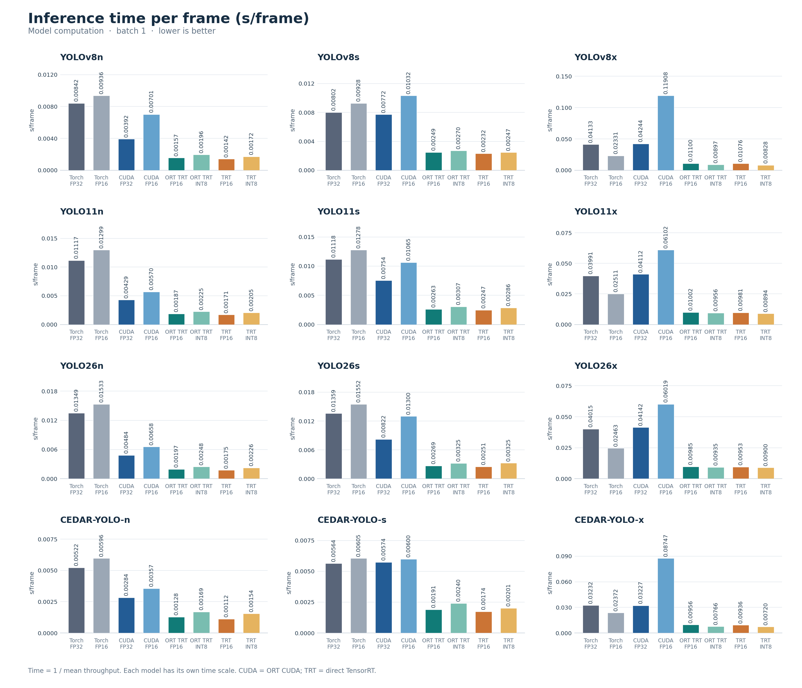
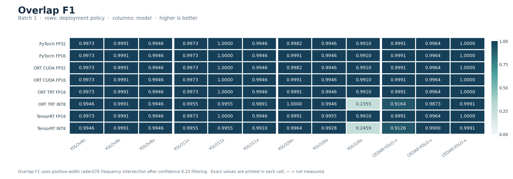
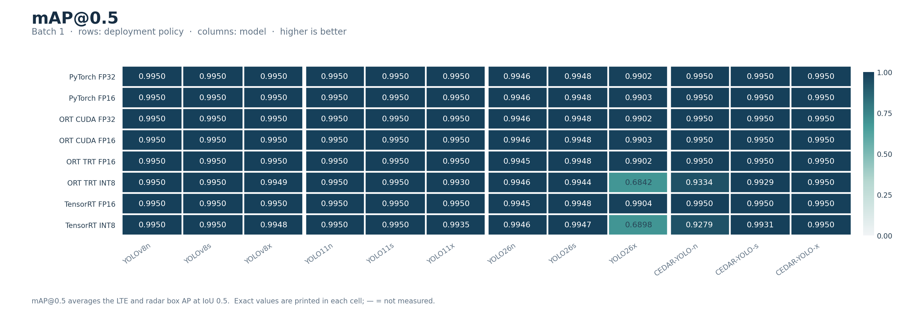

## Results

**288/288 GPU configurations completed: 12 models, batches 1, 4, 8, 8 deployment policies.**

The experiments evaluate 12 pretrained detectors on an **NVIDIA GeForce RTX 2070** PC. The figures show **batch 1, model computation**; quality is evaluated on the same **848 test images**. INT8 calibration uses 512 training images. Each policy uses the same source checkpoint for its model.

Quality is evaluated once per model/batch/policy on the test split, using the same checkpoint as its timing experiment. Overlap F1 and mAP are measured together; these are not historical scores or a separate supplementary evaluation.

### Inference speed

Inference time per frame is the inverse of mean throughput across the timing rounds; lower is better. Each panel uses its own time scale. Figure labels: Torch = PyTorch; CUDA = ONNX Runtime CUDA; ORT TRT = ONNX Runtime TensorRT; TRT = direct TensorRT.

ONNX Runtime with TensorRT FP16 achieves **2.96–6.83× the PyTorch FP32 throughput** across 12 models in this timing scope. Direct TensorRT FP16 achieves **3.25–7.71× the PyTorch FP32 throughput** across 12 models in this timing scope. For YOLOv8x, ORT CUDA FP16 takes 0.1191 s/frame, compared with 0.0413 s/frame for PyTorch FP32.

### Overlap F1

Rows are deployment policies and columns are models. Overlap F1 measures the frame-level radar/LTE frequency-overlap decision at confidence 0.25, using the same rule as MDI; higher is better.

The TensorRT FP16 configurations track each model's PyTorch FP32 quality: the largest absolute overlap-F1 change is **0.00090**. The largest absolute Overlap-F1 change with direct TensorRT INT8 is **0.74508** on YOLO26x: **0.9910 to 0.2459**. CEDAR-YOLO-n reaches **0.9991** with PyTorch FP32 and **0.9126** with direct TensorRT INT8. The INT8 drop is present in the frame-level overlap metric itself, not a comparison against box F1.

### mAP@0.5

The matrix reports mean average precision for LTE and radar boxes at IoU 0.5; higher is better.

Across the TensorRT FP16 configurations, the largest absolute mAP@0.5 change from PyTorch FP32 is **0.00019**. The largest mAP@0.5 reduction under direct TensorRT INT8 occurs on YOLO26x: **0.9902 to 0.6898**. INT8 deployment therefore requires validation for each model and batch configuration.

**Deployment assessment.** TensorRT FP16 provides the most consistent combination of faster model execution and preserved detection quality in this testbed. INT8 can further reduce computation time for selected models, with quality checked for the selected configuration. The full report separates model computation, the detector pipeline, and PNG-to-detection execution so application costs can be assessed alongside kernel speed.

[Complete report](REPORT.md) · [Combined measurements](data/summary.csv) · [Data guide](data/README.md)
