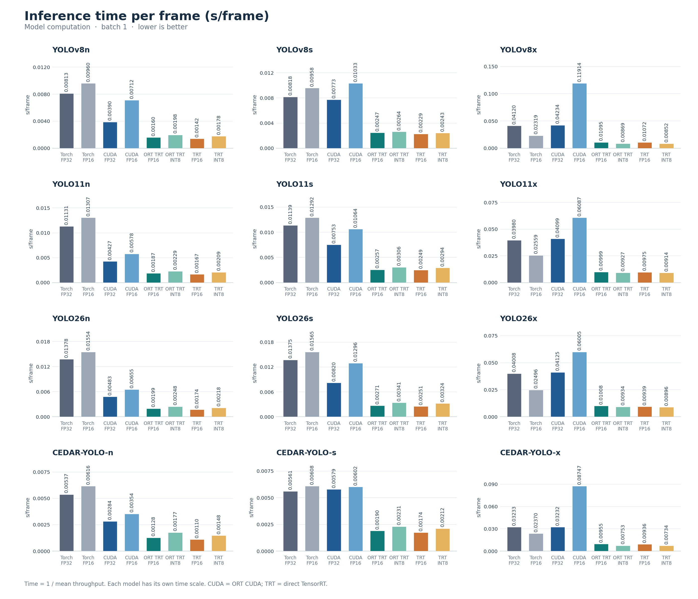
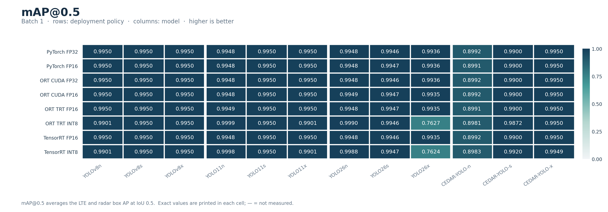
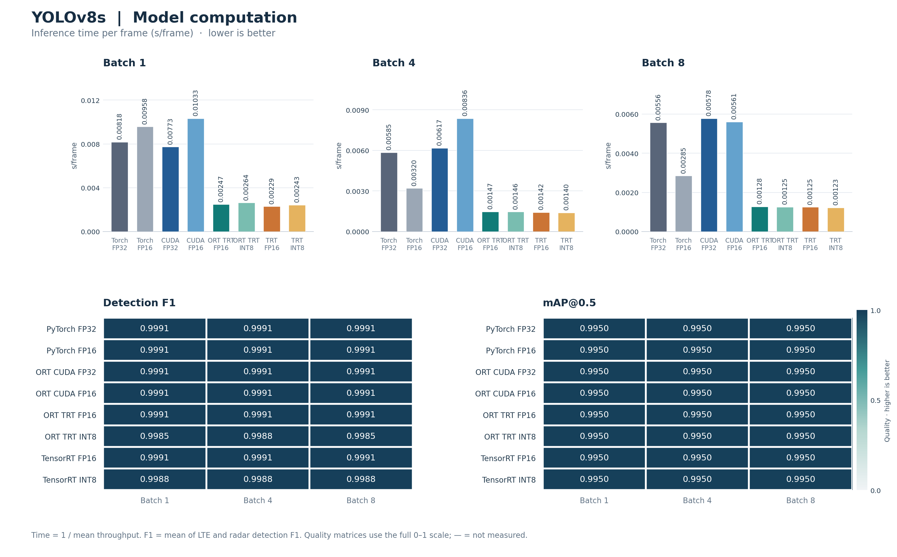
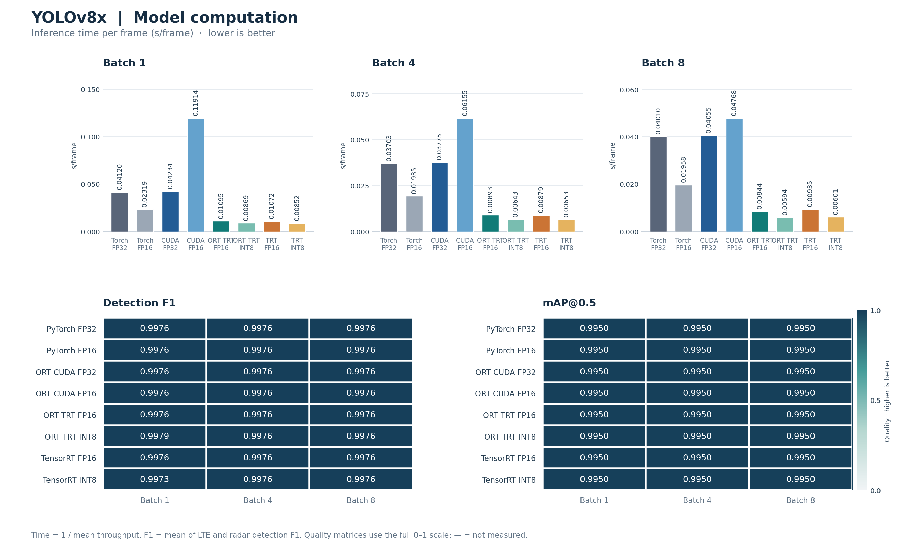
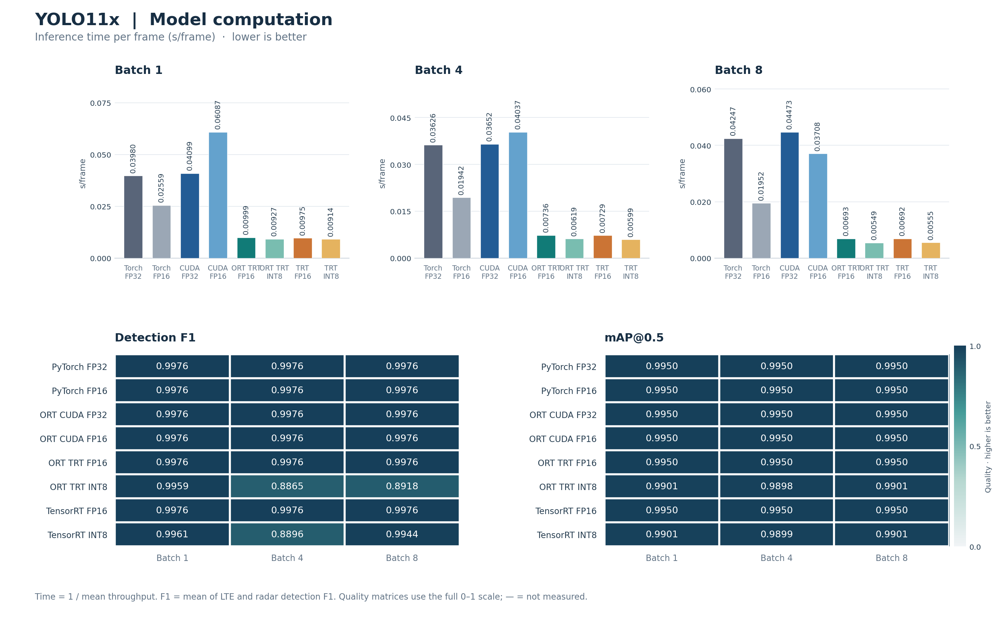
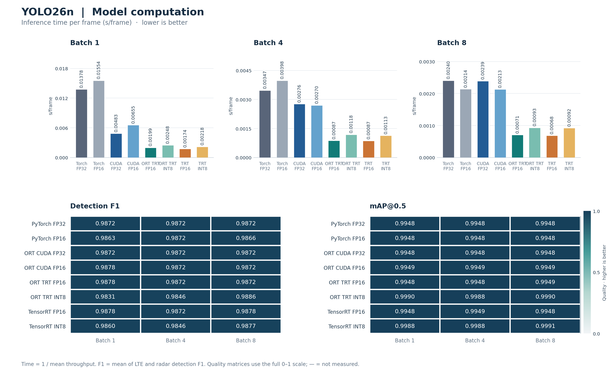
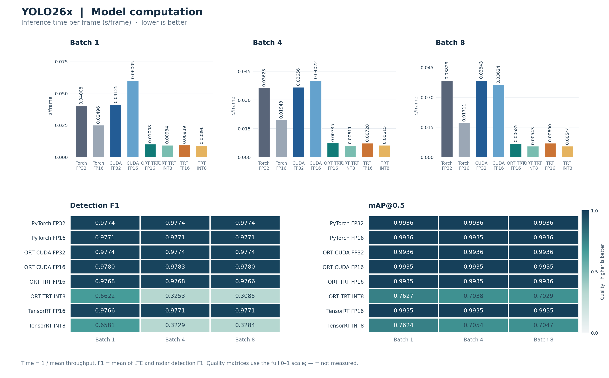
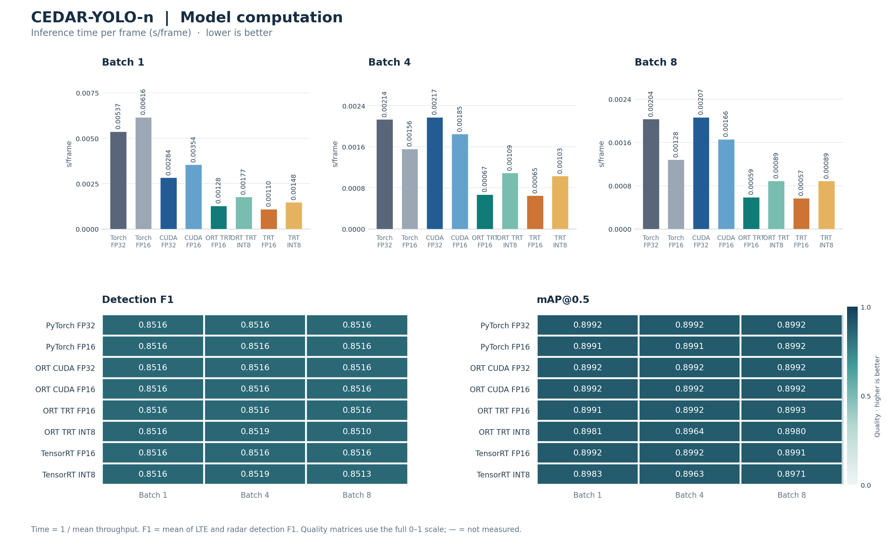
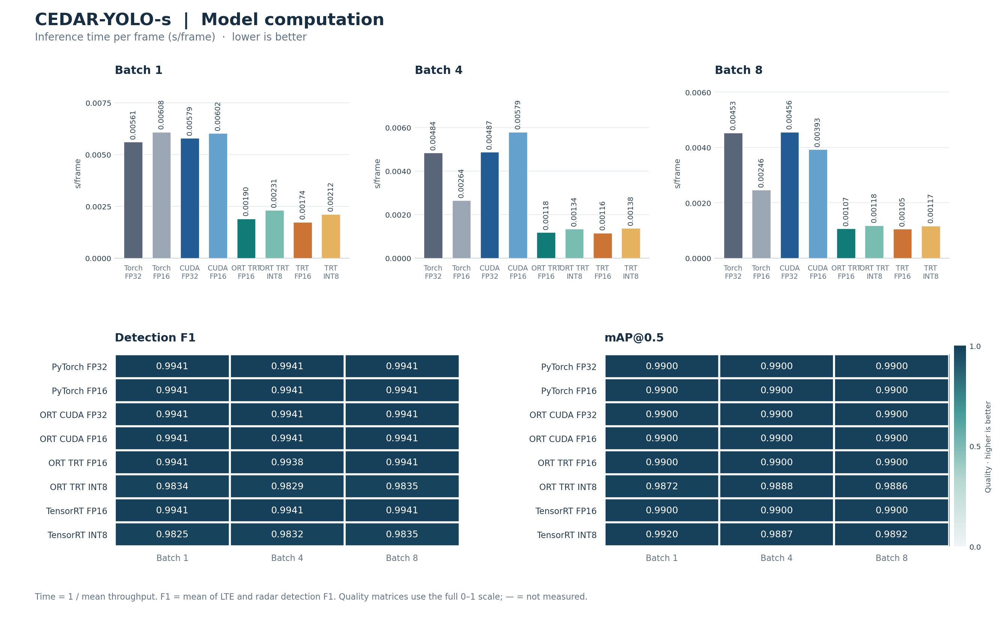

# CBRS-CEDAR-RT: complete GPU experiment report

**288/288 GPU routes completed: 12 models, batches 1, 4, 8, 8 deployment policies.**

Recorded experiment: `run-20261024-151307-737246`. All final measurements and earlier recorded attempts are stored together in [data/](data/README.md).

## Setup

**All experiments in this report run on the PC GPU**, in Conda `torch270_py312_cuda`; no Jetson deployment tests are reported. The `trained_models_mdi/` name identifies the CEDAR checkpoint edition, not the execution platform.

The [README environment table](../README.md#installation) lists tested/recommended versions. Compatible general runtime libraries can be used. For raw-I/Q conversion, preserve preprocessing library versions and parameters: even small pixel changes can invalidate pretrained predictions. The recorded RT experiments use the supplied PNGs directly.

- Device: **NVIDIA GeForce RTX 2070**, Windows-11-10.0.26300-SP0.
- Software: Python 3.12.13; PyTorch 2.7.1+cu128; ONNX Runtime 1.22.0; TensorRT 10.9.0.34.
- Evaluation: **validation split, 846 images**. INT8 calibration uses 512 training images.
- Models: YOLOv8, YOLO11 and YOLO26 at nano, small and extra-large sizes; CEDAR-YOLO-n/s/x with a 20 × 20 feature grid. CEDAR weights are from the `trained_models_mdi/` family.
- Timing: 3 rounds per scope, with separate synchronized latency and throughput loops. Each loop uses the recorded minimum duration and image count; inputs and runtime caches are warmed.
- Scope: GPU policies at batches 1, 4, 8. Original plan entries outside this evaluation remain in the data with `in_scope=False`.

| Timing scope | Included work |
|---|---|
| Model computation | Forward pass, with the input tensor already on the device |
| Detector pipeline | Preprocessing, forward pass and box decoding/NMS from a decoded image |
| Image to detection | PNG reading/decoding and the full detector pipeline; warm file cache |

## Metrics

| Metric | Meaning |
|---|---|
| Inference time per frame (s/frame) ↓ | Inverse of mean throughput across the three rounds. At batch > 1, this is time normalized by throughput, not request latency. |
| Detection F1 ↑ | Mean of LTE and radar box-detection F1, at confidence 0.25 and box IoU 0.5. This differs from the paper's frame-level overlap F1. |
| mAP@0.5 ↑ | Mean LTE/radar box AP at IoU 0.5; confidence-greedy matching and 101 recall points. |
| mAP@0.5:0.95 ↑ | Mean AP over IoU thresholds 0.50 to 0.95; retained in all detailed tables. |
| p50 / p95 / p99 | Per-batch request latency percentiles in milliseconds, averaged across rounds. |

Quality is evaluated once for each model/batch/policy. Repeated quality columns across timing scopes refer to that same evaluation.

## Results

- **FP16 model computation:** direct TensorRT FP16 reduces time per frame by 69.0–87.4% versus PyTorch FP32 across 12 models at batch 1. The largest absolute mAP@0.5 change is 0.00004, and the largest detection-F1 change is 0.00085.
- **INT8 quality depends on the model:** YOLO26x shows the largest batch-1 mAP@0.5 reduction among direct INT8 routes: 0.9936 → 0.7624. Detection F1 changes from 0.9774 to 0.6581. The detailed reports also show batch-dependent quality changes.
- **Full image inference has a different result:** with PNG decoding and preprocessing included, direct TensorRT FP16 reduces time per frame in 6 of 12 batch-1 comparisons. The forward-pass gain should therefore be read together with the full-pipeline measurements.

Vertical bars compare inference time per frame. Annotated matrices compare F1 and mAP. Quality colors span 0–1; timing panels use a separate scale for each model.






## Completion and data audit

| Batch | Completed GPU routes | Remaining |
|---:|---:|---:|
| 1 | 96/96 | 0 |
| 4 | 96/96 | 0 |
| 8 | 96/96 | 0 |

The final tables contain **864 model × batch × policy × timing-scope aggregates**. Each aggregate is checked against its original rounds and protocol signatures.

Earlier attempts are retained in `data/history.jsonl` (25 distinct archived attempts). They are excluded from the final averages. The original full experiment plan and canceled entries remain traceable in `data/routes.csv` and `data/metadata.json`.

## All model results

| Model | Final routes | Detailed results |
|---|---:|---|
| YOLOv8n | 24/24 | [Tables and figures](#cbrs_yolo8n) |
| YOLOv8s | 24/24 | [Tables and figures](#cbrs_yolo8s) |
| YOLOv8x | 24/24 | [Tables and figures](#cbrs_yolo8x) |
| YOLO11n | 24/24 | [Tables and figures](#cbrs_yolo11n) |
| YOLO11s | 24/24 | [Tables and figures](#cbrs_yolo11s) |
| YOLO11x | 24/24 | [Tables and figures](#cbrs_yolo11x) |
| YOLO26n | 24/24 | [Tables and figures](#cbrs_yolo26n) |
| YOLO26s | 24/24 | [Tables and figures](#cbrs_yolo26s) |
| YOLO26x | 24/24 | [Tables and figures](#cbrs_yolo26x) |
| CEDAR-YOLO-n | 24/24 | [Tables and figures](#sig_yolo_v8n_f20t20_c100) |
| CEDAR-YOLO-s | 24/24 | [Tables and figures](#sig_yolo_v8s_f20t20_c100) |
| CEDAR-YOLO-x | 24/24 | [Tables and figures](#sig_yolo_v8x_f20t20_c100) |

<a id="cbrs_yolo8n"></a>
### YOLOv8n

#### Model computation


| Batch | Policy | Time (s/frame) ↓ | F1 ↑ | LTE F1 | Radar F1 | mAP@0.5 ↑ | mAP@0.5:0.95 ↑ | p50 (ms/batch) | p95 (ms/batch) | p99 (ms/batch) |
|---:|---|---:|---:|---:|---:|---:|---:|---:|---:|---:|
| 1 | PyTorch FP32 | 0.008127 | 0.9976 | 0.9965 | 0.9988 | 0.9950 | 0.9897 | 8.147 | 8.933 | 10.467 |
| 1 | PyTorch FP16 | 0.009603 | 0.9976 | 0.9965 | 0.9988 | 0.9950 | 0.9897 | 9.672 | 10.399 | 12.174 |
| 1 | ORT CUDA FP32 | 0.003899 | 0.9976 | 0.9965 | 0.9988 | 0.9950 | 0.9897 | 3.805 | 4.311 | 4.830 |
| 1 | ORT CUDA FP16 | 0.007115 | 0.9976 | 0.9965 | 0.9988 | 0.9950 | 0.9897 | 7.206 | 7.434 | 7.962 |
| 1 | ORT TRT FP16 | 0.001597 | 0.9976 | 0.9965 | 0.9988 | 0.9950 | 0.9891 | 1.596 | 1.701 | 1.911 |
| 1 | ORT TRT INT8 | 0.001983 | 0.9976 | 0.9965 | 0.9988 | 0.9901 | 0.9864 | 1.975 | 2.101 | 2.680 |
| 1 | TensorRT FP16 | 0.001422 | 0.9976 | 0.9965 | 0.9988 | 0.9950 | 0.9891 | 1.493 | 1.586 | 1.992 |
| 1 | TensorRT INT8 | 0.001780 | 0.9979 | 0.9970 | 0.9988 | 0.9901 | 0.9864 | 1.878 | 1.973 | 2.295 |
| 4 | PyTorch FP32 | 0.002372 | 0.9976 | 0.9965 | 0.9988 | 0.9950 | 0.9897 | 9.852 | 10.065 | 12.103 |
| 4 | PyTorch FP16 | 0.002397 | 0.9976 | 0.9965 | 0.9988 | 0.9950 | 0.9897 | 9.412 | 10.567 | 12.712 |
| 4 | ORT CUDA FP32 | 0.002655 | 0.9976 | 0.9965 | 0.9988 | 0.9950 | 0.9897 | 10.642 | 10.793 | 10.921 |
| 4 | ORT CUDA FP16 | 0.002794 | 0.9976 | 0.9965 | 0.9988 | 0.9950 | 0.9892 | 11.184 | 11.358 | 11.509 |
| 4 | ORT TRT FP16 | 0.000791 | 0.9976 | 0.9965 | 0.9988 | 0.9950 | 0.9897 | 3.164 | 3.254 | 3.382 |
| 4 | ORT TRT INT8 | 0.001043 | 0.9982 | 0.9970 | 0.9994 | 0.9901 | 0.9867 | 4.161 | 4.300 | 4.411 |
| 4 | TensorRT FP16 | 0.000789 | 0.9976 | 0.9965 | 0.9988 | 0.9950 | 0.9896 | 3.215 | 3.322 | 3.398 |
| 4 | TensorRT INT8 | 0.001024 | 0.9979 | 0.9970 | 0.9988 | 0.9901 | 0.9873 | 4.233 | 4.357 | 4.446 |
| 8 | PyTorch FP32 | 0.002263 | 0.9976 | 0.9965 | 0.9988 | 0.9950 | 0.9897 | 18.468 | 18.672 | 18.798 |
| 8 | PyTorch FP16 | 0.001407 | 0.9976 | 0.9965 | 0.9988 | 0.9950 | 0.9897 | 11.568 | 11.876 | 14.744 |
| 8 | ORT CUDA FP32 | 0.002428 | 0.9976 | 0.9965 | 0.9988 | 0.9950 | 0.9897 | 19.424 | 19.658 | 19.809 |
| 8 | ORT CUDA FP16 | 0.002357 | 0.9976 | 0.9965 | 0.9988 | 0.9950 | 0.9892 | 18.873 | 19.053 | 19.198 |
| 8 | ORT TRT FP16 | 0.000678 | 0.9976 | 0.9965 | 0.9988 | 0.9950 | 0.9897 | 5.409 | 5.518 | 5.595 |
| 8 | ORT TRT INT8 | 0.000859 | 0.9976 | 0.9965 | 0.9988 | 0.9901 | 0.9865 | 6.864 | 6.996 | 7.096 |
| 8 | TensorRT FP16 | 0.000650 | 0.9976 | 0.9965 | 0.9988 | 0.9950 | 0.9897 | 5.311 | 5.398 | 5.451 |
| 8 | TensorRT INT8 | 0.000813 | 0.9976 | 0.9965 | 0.9988 | 0.9950 | 0.9880 | 6.650 | 6.757 | 6.842 |

#### Decoded image to detections

[Comparison figure](figures/cbrs_yolo8n_detector_pipeline.png)

| Batch | Policy | Time (s/frame) ↓ | F1 ↑ | LTE F1 | Radar F1 | mAP@0.5 ↑ | mAP@0.5:0.95 ↑ | p50 (ms/batch) | p95 (ms/batch) | p99 (ms/batch) |
|---:|---|---:|---:|---:|---:|---:|---:|---:|---:|---:|
| 1 | PyTorch FP32 | 0.013066 | 0.9976 | 0.9965 | 0.9988 | 0.9950 | 0.9897 | 12.948 | 14.430 | 16.367 |
| 1 | PyTorch FP16 | 0.014469 | 0.9976 | 0.9965 | 0.9988 | 0.9950 | 0.9897 | 14.400 | 15.421 | 17.378 |
| 1 | ORT CUDA FP32 | 0.008657 | 0.9976 | 0.9965 | 0.9988 | 0.9950 | 0.9897 | 8.639 | 9.409 | 10.174 |
| 1 | ORT CUDA FP16 | 0.011848 | 0.9976 | 0.9965 | 0.9988 | 0.9950 | 0.9897 | 11.880 | 12.400 | 13.021 |
| 1 | ORT TRT FP16 | 0.007048 | 0.9976 | 0.9965 | 0.9988 | 0.9950 | 0.9891 | 6.948 | 7.575 | 8.208 |
| 1 | ORT TRT INT8 | 0.007048 | 0.9976 | 0.9965 | 0.9988 | 0.9901 | 0.9864 | 6.951 | 7.608 | 8.374 |
| 1 | TensorRT FP16 | 0.006431 | 0.9976 | 0.9965 | 0.9988 | 0.9950 | 0.9891 | 6.355 | 6.955 | 7.600 |
| 1 | TensorRT INT8 | 0.006609 | 0.9979 | 0.9970 | 0.9988 | 0.9901 | 0.9864 | 6.537 | 7.185 | 7.867 |
| 4 | PyTorch FP32 | 0.006851 | 0.9976 | 0.9965 | 0.9988 | 0.9950 | 0.9897 | 26.955 | 29.404 | 31.649 |
| 4 | PyTorch FP16 | 0.006730 | 0.9976 | 0.9965 | 0.9988 | 0.9950 | 0.9897 | 26.645 | 28.485 | 32.141 |
| 4 | ORT CUDA FP32 | 0.007125 | 0.9976 | 0.9965 | 0.9988 | 0.9950 | 0.9897 | 28.362 | 30.968 | 31.897 |
| 4 | ORT CUDA FP16 | 0.007358 | 0.9976 | 0.9965 | 0.9988 | 0.9950 | 0.9892 | 28.390 | 30.192 | 31.769 |
| 4 | ORT TRT FP16 | 0.006376 | 0.9976 | 0.9965 | 0.9988 | 0.9950 | 0.9897 | 25.201 | 27.958 | 29.378 |
| 4 | ORT TRT INT8 | 0.006373 | 0.9982 | 0.9970 | 0.9994 | 0.9901 | 0.9867 | 25.091 | 27.698 | 28.989 |
| 4 | TensorRT FP16 | 0.006108 | 0.9976 | 0.9965 | 0.9988 | 0.9950 | 0.9896 | 23.764 | 26.149 | 28.584 |
| 4 | TensorRT INT8 | 0.006195 | 0.9979 | 0.9970 | 0.9988 | 0.9901 | 0.9873 | 24.372 | 27.113 | 29.780 |
| 8 | PyTorch FP32 | 0.006657 | 0.9976 | 0.9965 | 0.9988 | 0.9950 | 0.9897 | 54.000 | 56.072 | 58.897 |
| 8 | PyTorch FP16 | 0.006327 | 0.9976 | 0.9965 | 0.9988 | 0.9950 | 0.9897 | 50.453 | 52.381 | 53.775 |
| 8 | ORT CUDA FP32 | 0.006969 | 0.9976 | 0.9965 | 0.9988 | 0.9950 | 0.9897 | 55.508 | 59.146 | 61.237 |
| 8 | ORT CUDA FP16 | 0.006492 | 0.9976 | 0.9965 | 0.9988 | 0.9950 | 0.9892 | 52.055 | 54.091 | 56.138 |
| 8 | ORT TRT FP16 | 0.006070 | 0.9976 | 0.9965 | 0.9988 | 0.9950 | 0.9897 | 48.571 | 51.625 | 54.682 |
| 8 | ORT TRT INT8 | 0.006047 | 0.9976 | 0.9965 | 0.9988 | 0.9901 | 0.9865 | 48.836 | 51.559 | 54.135 |
| 8 | TensorRT FP16 | 0.005980 | 0.9976 | 0.9965 | 0.9988 | 0.9950 | 0.9897 | 47.821 | 50.621 | 52.313 |
| 8 | TensorRT INT8 | 0.006056 | 0.9976 | 0.9965 | 0.9988 | 0.9950 | 0.9880 | 48.409 | 51.552 | 54.159 |

#### PNG file to detections

[Comparison figure](figures/cbrs_yolo8n_image_to_detection.png)

| Batch | Policy | Time (s/frame) ↓ | F1 ↑ | LTE F1 | Radar F1 | mAP@0.5 ↑ | mAP@0.5:0.95 ↑ | p50 (ms/batch) | p95 (ms/batch) | p99 (ms/batch) |
|---:|---|---:|---:|---:|---:|---:|---:|---:|---:|---:|
| 1 | PyTorch FP32 | 0.034239 | 0.9976 | 0.9965 | 0.9988 | 0.9950 | 0.9897 | 35.152 | 36.868 | 39.940 |
| 1 | PyTorch FP16 | 0.034275 | 0.9976 | 0.9965 | 0.9988 | 0.9950 | 0.9897 | 33.438 | 38.233 | 40.090 |
| 1 | ORT CUDA FP32 | 0.035573 | 0.9976 | 0.9965 | 0.9988 | 0.9950 | 0.9897 | 35.894 | 37.761 | 44.121 |
| 1 | ORT CUDA FP16 | 0.035365 | 0.9976 | 0.9965 | 0.9988 | 0.9950 | 0.9897 | 35.881 | 37.358 | 38.370 |
| 1 | ORT TRT FP16 | 0.035641 | 0.9976 | 0.9965 | 0.9988 | 0.9950 | 0.9891 | 36.071 | 37.623 | 42.423 |
| 1 | ORT TRT INT8 | 0.036079 | 0.9976 | 0.9965 | 0.9988 | 0.9901 | 0.9864 | 35.303 | 40.513 | 45.347 |
| 1 | TensorRT FP16 | 0.036407 | 0.9976 | 0.9965 | 0.9988 | 0.9950 | 0.9891 | 36.880 | 38.406 | 44.053 |
| 1 | TensorRT INT8 | 0.036443 | 0.9979 | 0.9970 | 0.9988 | 0.9901 | 0.9864 | 37.990 | 39.364 | 41.979 |
| 4 | PyTorch FP32 | 0.028492 | 0.9976 | 0.9965 | 0.9988 | 0.9950 | 0.9897 | 112.237 | 143.548 | 148.604 |
| 4 | PyTorch FP16 | 0.029106 | 0.9976 | 0.9965 | 0.9988 | 0.9950 | 0.9897 | 116.080 | 156.215 | 163.909 |
| 4 | ORT CUDA FP32 | 0.028790 | 0.9976 | 0.9965 | 0.9988 | 0.9950 | 0.9897 | 115.298 | 145.118 | 149.439 |
| 4 | ORT CUDA FP16 | 0.031474 | 0.9976 | 0.9965 | 0.9988 | 0.9950 | 0.9892 | 123.135 | 145.282 | 160.119 |
| 4 | ORT TRT FP16 | 0.028850 | 0.9976 | 0.9965 | 0.9988 | 0.9950 | 0.9897 | 109.958 | 142.033 | 146.115 |
| 4 | ORT TRT INT8 | 0.031457 | 0.9982 | 0.9970 | 0.9994 | 0.9901 | 0.9867 | 120.667 | 157.599 | 159.950 |
| 4 | TensorRT FP16 | 0.029892 | 0.9976 | 0.9965 | 0.9988 | 0.9950 | 0.9896 | 113.240 | 145.795 | 151.206 |
| 4 | TensorRT INT8 | 0.032045 | 0.9979 | 0.9970 | 0.9988 | 0.9901 | 0.9873 | 122.902 | 160.815 | 163.402 |
| 8 | PyTorch FP32 | 0.028501 | 0.9976 | 0.9965 | 0.9988 | 0.9950 | 0.9897 | 232.535 | 238.721 | 243.824 |
| 8 | PyTorch FP16 | 0.027318 | 0.9976 | 0.9965 | 0.9988 | 0.9950 | 0.9897 | 222.693 | 250.504 | 336.369 |
| 8 | ORT CUDA FP32 | 0.029186 | 0.9976 | 0.9965 | 0.9988 | 0.9950 | 0.9897 | 239.667 | 248.373 | 250.855 |
| 8 | ORT CUDA FP16 | 0.027805 | 0.9976 | 0.9965 | 0.9988 | 0.9950 | 0.9892 | 224.109 | 265.378 | 273.450 |
| 8 | ORT TRT FP16 | 0.028238 | 0.9976 | 0.9965 | 0.9988 | 0.9950 | 0.9897 | 218.622 | 285.805 | 287.826 |
| 8 | ORT TRT INT8 | 0.030317 | 0.9976 | 0.9965 | 0.9988 | 0.9901 | 0.9865 | 238.138 | 314.327 | 319.381 |
| 8 | TensorRT FP16 | 0.028864 | 0.9976 | 0.9965 | 0.9988 | 0.9950 | 0.9897 | 224.365 | 291.664 | 294.180 |
| 8 | TensorRT INT8 | 0.030518 | 0.9976 | 0.9965 | 0.9988 | 0.9950 | 0.9880 | 239.071 | 314.652 | 316.708 |


<a id="cbrs_yolo8s"></a>
### YOLOv8s

#### Model computation



| Batch | Policy | Time (s/frame) ↓ | F1 ↑ | LTE F1 | Radar F1 | mAP@0.5 ↑ | mAP@0.5:0.95 ↑ | p50 (ms/batch) | p95 (ms/batch) | p99 (ms/batch) |
|---:|---|---:|---:|---:|---:|---:|---:|---:|---:|---:|
| 1 | PyTorch FP32 | 0.008184 | 0.9991 | 0.9988 | 0.9994 | 0.9950 | 0.9920 | 8.104 | 9.205 | 10.893 |
| 1 | PyTorch FP16 | 0.009577 | 0.9991 | 0.9988 | 0.9994 | 0.9950 | 0.9911 | 9.521 | 10.678 | 12.745 |
| 1 | ORT CUDA FP32 | 0.007734 | 0.9991 | 0.9988 | 0.9994 | 0.9950 | 0.9920 | 7.746 | 7.961 | 8.514 |
| 1 | ORT CUDA FP16 | 0.010328 | 0.9991 | 0.9988 | 0.9994 | 0.9950 | 0.9911 | 10.336 | 10.537 | 11.110 |
| 1 | ORT TRT FP16 | 0.002473 | 0.9991 | 0.9988 | 0.9994 | 0.9950 | 0.9911 | 2.471 | 2.564 | 2.735 |
| 1 | ORT TRT INT8 | 0.002639 | 0.9985 | 0.9988 | 0.9982 | 0.9950 | 0.9903 | 2.640 | 2.732 | 2.964 |
| 1 | TensorRT FP16 | 0.002289 | 0.9991 | 0.9988 | 0.9994 | 0.9950 | 0.9911 | 2.354 | 2.437 | 2.502 |
| 1 | TensorRT INT8 | 0.002426 | 0.9988 | 0.9988 | 0.9988 | 0.9950 | 0.9910 | 2.520 | 2.603 | 2.727 |
| 4 | PyTorch FP32 | 0.005849 | 0.9991 | 0.9988 | 0.9994 | 0.9950 | 0.9920 | 23.733 | 24.093 | 26.384 |
| 4 | PyTorch FP16 | 0.003195 | 0.9991 | 0.9988 | 0.9994 | 0.9950 | 0.9920 | 13.058 | 13.306 | 15.446 |
| 4 | ORT CUDA FP32 | 0.006174 | 0.9991 | 0.9988 | 0.9994 | 0.9950 | 0.9920 | 24.629 | 25.059 | 27.391 |
| 4 | ORT CUDA FP16 | 0.008364 | 0.9991 | 0.9988 | 0.9994 | 0.9950 | 0.9911 | 33.338 | 34.156 | 36.470 |
| 4 | ORT TRT FP16 | 0.001474 | 0.9991 | 0.9988 | 0.9994 | 0.9950 | 0.9920 | 5.874 | 6.019 | 6.191 |
| 4 | ORT TRT INT8 | 0.001464 | 0.9988 | 0.9988 | 0.9988 | 0.9950 | 0.9905 | 5.850 | 5.976 | 6.066 |
| 4 | TensorRT FP16 | 0.001422 | 0.9991 | 0.9988 | 0.9994 | 0.9950 | 0.9920 | 5.782 | 5.857 | 5.926 |
| 4 | TensorRT INT8 | 0.001399 | 0.9988 | 0.9988 | 0.9988 | 0.9950 | 0.9905 | 5.726 | 5.837 | 5.902 |
| 8 | PyTorch FP32 | 0.005562 | 0.9991 | 0.9988 | 0.9994 | 0.9950 | 0.9920 | 44.800 | 45.467 | 45.729 |
| 8 | PyTorch FP16 | 0.002845 | 0.9991 | 0.9988 | 0.9994 | 0.9950 | 0.9920 | 23.105 | 23.345 | 23.507 |
| 8 | ORT CUDA FP32 | 0.005779 | 0.9991 | 0.9988 | 0.9994 | 0.9950 | 0.9920 | 46.192 | 46.852 | 47.206 |
| 8 | ORT CUDA FP16 | 0.005609 | 0.9991 | 0.9988 | 0.9994 | 0.9950 | 0.9911 | 44.854 | 45.455 | 45.715 |
| 8 | ORT TRT FP16 | 0.001277 | 0.9991 | 0.9988 | 0.9994 | 0.9950 | 0.9920 | 10.214 | 10.414 | 10.525 |
| 8 | ORT TRT INT8 | 0.001255 | 0.9985 | 0.9988 | 0.9982 | 0.9950 | 0.9905 | 10.023 | 10.187 | 10.298 |
| 8 | TensorRT FP16 | 0.001250 | 0.9991 | 0.9988 | 0.9994 | 0.9950 | 0.9920 | 10.134 | 10.308 | 11.194 |
| 8 | TensorRT INT8 | 0.001226 | 0.9988 | 0.9988 | 0.9988 | 0.9950 | 0.9904 | 9.925 | 10.060 | 10.139 |

#### Decoded image to detections

[Comparison figure](figures/cbrs_yolo8s_detector_pipeline.png)

| Batch | Policy | Time (s/frame) ↓ | F1 ↑ | LTE F1 | Radar F1 | mAP@0.5 ↑ | mAP@0.5:0.95 ↑ | p50 (ms/batch) | p95 (ms/batch) | p99 (ms/batch) |
|---:|---|---:|---:|---:|---:|---:|---:|---:|---:|---:|
| 1 | PyTorch FP32 | 0.013071 | 0.9991 | 0.9988 | 0.9994 | 0.9950 | 0.9920 | 12.924 | 14.318 | 16.368 |
| 1 | PyTorch FP16 | 0.014383 | 0.9991 | 0.9988 | 0.9994 | 0.9950 | 0.9911 | 14.256 | 15.627 | 18.352 |
| 1 | ORT CUDA FP32 | 0.012615 | 0.9991 | 0.9988 | 0.9994 | 0.9950 | 0.9920 | 12.485 | 13.102 | 13.679 |
| 1 | ORT CUDA FP16 | 0.014988 | 0.9991 | 0.9988 | 0.9994 | 0.9950 | 0.9911 | 14.943 | 15.543 | 16.032 |
| 1 | ORT TRT FP16 | 0.007193 | 0.9991 | 0.9988 | 0.9994 | 0.9950 | 0.9911 | 7.140 | 7.735 | 8.242 |
| 1 | ORT TRT INT8 | 0.007142 | 0.9985 | 0.9988 | 0.9982 | 0.9950 | 0.9903 | 7.090 | 7.760 | 8.291 |
| 1 | TensorRT FP16 | 0.006627 | 0.9991 | 0.9988 | 0.9994 | 0.9950 | 0.9911 | 6.574 | 7.118 | 7.624 |
| 1 | TensorRT INT8 | 0.006890 | 0.9988 | 0.9988 | 0.9988 | 0.9950 | 0.9910 | 6.818 | 7.312 | 7.905 |
| 4 | PyTorch FP32 | 0.010296 | 0.9991 | 0.9988 | 0.9994 | 0.9950 | 0.9920 | 40.868 | 43.153 | 45.331 |
| 4 | PyTorch FP16 | 0.007478 | 0.9991 | 0.9988 | 0.9994 | 0.9950 | 0.9920 | 29.654 | 31.557 | 33.458 |
| 4 | ORT CUDA FP32 | 0.010531 | 0.9991 | 0.9988 | 0.9994 | 0.9950 | 0.9920 | 42.081 | 44.827 | 46.843 |
| 4 | ORT CUDA FP16 | 0.012625 | 0.9991 | 0.9988 | 0.9994 | 0.9950 | 0.9911 | 50.623 | 52.391 | 54.291 |
| 4 | ORT TRT FP16 | 0.006483 | 0.9991 | 0.9988 | 0.9994 | 0.9950 | 0.9920 | 25.122 | 28.295 | 30.718 |
| 4 | ORT TRT INT8 | 0.006345 | 0.9988 | 0.9988 | 0.9988 | 0.9950 | 0.9905 | 24.868 | 26.979 | 27.965 |
| 4 | TensorRT FP16 | 0.006142 | 0.9991 | 0.9988 | 0.9994 | 0.9950 | 0.9920 | 24.103 | 26.179 | 26.989 |
| 4 | TensorRT INT8 | 0.006146 | 0.9988 | 0.9988 | 0.9988 | 0.9950 | 0.9905 | 24.365 | 26.557 | 27.773 |
| 8 | PyTorch FP32 | 0.010001 | 0.9991 | 0.9988 | 0.9994 | 0.9950 | 0.9920 | 80.651 | 82.541 | 83.514 |
| 8 | PyTorch FP16 | 0.006992 | 0.9991 | 0.9988 | 0.9994 | 0.9950 | 0.9920 | 56.149 | 57.899 | 59.406 |
| 8 | ORT CUDA FP32 | 0.010136 | 0.9991 | 0.9988 | 0.9994 | 0.9950 | 0.9920 | 81.719 | 83.480 | 84.835 |
| 8 | ORT CUDA FP16 | 0.009812 | 0.9991 | 0.9988 | 0.9994 | 0.9950 | 0.9911 | 78.081 | 79.715 | 80.923 |
| 8 | ORT TRT FP16 | 0.006331 | 0.9991 | 0.9988 | 0.9994 | 0.9950 | 0.9920 | 51.517 | 58.113 | 62.908 |
| 8 | ORT TRT INT8 | 0.006142 | 0.9985 | 0.9988 | 0.9982 | 0.9950 | 0.9905 | 49.282 | 51.764 | 54.330 |
| 8 | TensorRT FP16 | 0.006041 | 0.9991 | 0.9988 | 0.9994 | 0.9950 | 0.9920 | 48.783 | 52.375 | 55.780 |
| 8 | TensorRT INT8 | 0.006102 | 0.9988 | 0.9988 | 0.9988 | 0.9950 | 0.9904 | 48.918 | 51.365 | 52.572 |

#### PNG file to detections

[Comparison figure](figures/cbrs_yolo8s_image_to_detection.png)

| Batch | Policy | Time (s/frame) ↓ | F1 ↑ | LTE F1 | Radar F1 | mAP@0.5 ↑ | mAP@0.5:0.95 ↑ | p50 (ms/batch) | p95 (ms/batch) | p99 (ms/batch) |
|---:|---|---:|---:|---:|---:|---:|---:|---:|---:|---:|
| 1 | PyTorch FP32 | 0.033553 | 0.9991 | 0.9988 | 0.9994 | 0.9950 | 0.9920 | 34.262 | 35.981 | 37.270 |
| 1 | PyTorch FP16 | 0.033441 | 0.9991 | 0.9988 | 0.9994 | 0.9950 | 0.9911 | 32.720 | 38.589 | 40.344 |
| 1 | ORT CUDA FP32 | 0.035157 | 0.9991 | 0.9988 | 0.9994 | 0.9950 | 0.9920 | 35.857 | 37.269 | 38.181 |
| 1 | ORT CUDA FP16 | 0.035363 | 0.9991 | 0.9988 | 0.9994 | 0.9950 | 0.9911 | 35.901 | 37.308 | 38.130 |
| 1 | ORT TRT FP16 | 0.033269 | 0.9991 | 0.9988 | 0.9994 | 0.9950 | 0.9911 | 33.034 | 42.266 | 45.271 |
| 1 | ORT TRT INT8 | 0.034710 | 0.9985 | 0.9988 | 0.9982 | 0.9950 | 0.9903 | 34.442 | 43.776 | 45.633 |
| 1 | TensorRT FP16 | 0.033801 | 0.9991 | 0.9988 | 0.9994 | 0.9950 | 0.9911 | 33.780 | 44.901 | 46.708 |
| 1 | TensorRT INT8 | 0.034163 | 0.9988 | 0.9988 | 0.9988 | 0.9950 | 0.9910 | 33.882 | 44.151 | 44.911 |
| 4 | PyTorch FP32 | 0.030566 | 0.9991 | 0.9988 | 0.9994 | 0.9950 | 0.9920 | 124.425 | 129.819 | 133.738 |
| 4 | PyTorch FP16 | 0.030546 | 0.9991 | 0.9988 | 0.9994 | 0.9950 | 0.9920 | 123.623 | 129.249 | 135.066 |
| 4 | ORT CUDA FP32 | 0.030725 | 0.9991 | 0.9988 | 0.9994 | 0.9950 | 0.9920 | 125.230 | 130.365 | 134.297 |
| 4 | ORT CUDA FP16 | 0.030849 | 0.9991 | 0.9988 | 0.9994 | 0.9950 | 0.9911 | 125.760 | 130.399 | 134.872 |
| 4 | ORT TRT FP16 | 0.030673 | 0.9991 | 0.9988 | 0.9994 | 0.9950 | 0.9920 | 123.085 | 152.739 | 176.491 |
| 4 | ORT TRT INT8 | 0.032936 | 0.9988 | 0.9988 | 0.9988 | 0.9950 | 0.9905 | 130.885 | 174.669 | 185.261 |
| 4 | TensorRT FP16 | 0.031414 | 0.9991 | 0.9988 | 0.9994 | 0.9950 | 0.9920 | 124.991 | 163.664 | 177.887 |
| 4 | TensorRT INT8 | 0.032817 | 0.9988 | 0.9988 | 0.9988 | 0.9950 | 0.9905 | 130.225 | 176.676 | 183.710 |
| 8 | PyTorch FP32 | 0.030411 | 0.9991 | 0.9988 | 0.9994 | 0.9950 | 0.9920 | 246.608 | 256.058 | 258.270 |
| 8 | PyTorch FP16 | 0.030188 | 0.9991 | 0.9988 | 0.9994 | 0.9950 | 0.9920 | 245.188 | 252.476 | 254.735 |
| 8 | ORT CUDA FP32 | 0.030456 | 0.9991 | 0.9988 | 0.9994 | 0.9950 | 0.9920 | 248.476 | 256.395 | 261.881 |
| 8 | ORT CUDA FP16 | 0.030342 | 0.9991 | 0.9988 | 0.9994 | 0.9950 | 0.9911 | 247.183 | 254.781 | 258.926 |
| 8 | ORT TRT FP16 | 0.028948 | 0.9991 | 0.9988 | 0.9994 | 0.9950 | 0.9920 | 232.176 | 275.375 | 353.179 |
| 8 | ORT TRT INT8 | 0.031486 | 0.9985 | 0.9988 | 0.9982 | 0.9950 | 0.9905 | 253.077 | 353.191 | 369.027 |
| 8 | TensorRT FP16 | 0.029566 | 0.9991 | 0.9988 | 0.9994 | 0.9950 | 0.9920 | 241.947 | 329.332 | 359.659 |
| 8 | TensorRT INT8 | 0.030798 | 0.9988 | 0.9988 | 0.9988 | 0.9950 | 0.9904 | 247.911 | 338.806 | 367.761 |


<a id="cbrs_yolo8x"></a>
### YOLOv8x

#### Model computation



| Batch | Policy | Time (s/frame) ↓ | F1 ↑ | LTE F1 | Radar F1 | mAP@0.5 ↑ | mAP@0.5:0.95 ↑ | p50 (ms/batch) | p95 (ms/batch) | p99 (ms/batch) |
|---:|---|---:|---:|---:|---:|---:|---:|---:|---:|---:|
| 1 | PyTorch FP32 | 0.041202 | 0.9976 | 0.9970 | 0.9982 | 0.9950 | 0.7440 | 41.440 | 42.147 | 42.433 |
| 1 | PyTorch FP16 | 0.023189 | 0.9976 | 0.9970 | 0.9982 | 0.9950 | 0.7440 | 23.543 | 23.770 | 24.167 |
| 1 | ORT CUDA FP32 | 0.042339 | 0.9976 | 0.9970 | 0.9982 | 0.9950 | 0.7440 | 42.244 | 42.976 | 43.312 |
| 1 | ORT CUDA FP16 | 0.119139 | 0.9976 | 0.9970 | 0.9982 | 0.9950 | 0.7440 | 119.087 | 119.966 | 120.609 |
| 1 | ORT TRT FP16 | 0.010950 | 0.9976 | 0.9970 | 0.9982 | 0.9950 | 0.7440 | 10.928 | 11.219 | 11.357 |
| 1 | ORT TRT INT8 | 0.008687 | 0.9979 | 0.9970 | 0.9988 | 0.9950 | 0.7444 | 8.678 | 8.839 | 8.943 |
| 1 | TensorRT FP16 | 0.010719 | 0.9976 | 0.9970 | 0.9982 | 0.9950 | 0.7440 | 10.851 | 11.108 | 11.265 |
| 1 | TensorRT INT8 | 0.008519 | 0.9973 | 0.9970 | 0.9976 | 0.9950 | 0.7445 | 8.661 | 8.833 | 8.924 |
| 4 | PyTorch FP32 | 0.037033 | 0.9976 | 0.9970 | 0.9982 | 0.9950 | 0.7440 | 148.392 | 149.788 | 150.548 |
| 4 | PyTorch FP16 | 0.019352 | 0.9976 | 0.9970 | 0.9982 | 0.9950 | 0.7440 | 77.619 | 78.817 | 79.366 |
| 4 | ORT CUDA FP32 | 0.037749 | 0.9976 | 0.9970 | 0.9982 | 0.9950 | 0.7440 | 150.776 | 152.436 | 153.167 |
| 4 | ORT CUDA FP16 | 0.061546 | 0.9976 | 0.9970 | 0.9982 | 0.9950 | 0.7440 | 245.682 | 247.787 | 248.429 |
| 4 | ORT TRT FP16 | 0.008931 | 0.9976 | 0.9970 | 0.9982 | 0.9950 | 0.7440 | 35.469 | 36.152 | 36.591 |
| 4 | ORT TRT INT8 | 0.006429 | 0.9976 | 0.9970 | 0.9982 | 0.9950 | 0.7445 | 25.620 | 26.129 | 26.513 |
| 4 | TensorRT FP16 | 0.008793 | 0.9976 | 0.9970 | 0.9982 | 0.9950 | 0.7440 | 35.183 | 35.861 | 36.331 |
| 4 | TensorRT INT8 | 0.006529 | 0.9976 | 0.9970 | 0.9982 | 0.9950 | 0.7445 | 26.243 | 26.897 | 27.301 |
| 8 | PyTorch FP32 | 0.040105 | 0.9976 | 0.9970 | 0.9982 | 0.9950 | 0.7440 | 321.066 | 322.303 | 323.167 |
| 8 | PyTorch FP16 | 0.019581 | 0.9976 | 0.9970 | 0.9982 | 0.9950 | 0.7440 | 156.870 | 157.538 | 158.595 |
| 8 | ORT CUDA FP32 | 0.040553 | 0.9976 | 0.9970 | 0.9982 | 0.9950 | 0.7440 | 324.174 | 325.543 | 326.404 |
| 8 | ORT CUDA FP16 | 0.047685 | 0.9976 | 0.9970 | 0.9982 | 0.9950 | 0.7440 | 385.063 | 420.403 | 432.036 |
| 8 | ORT TRT FP16 | 0.008442 | 0.9976 | 0.9970 | 0.9982 | 0.9950 | 0.7440 | 67.306 | 68.296 | 68.549 |
| 8 | ORT TRT INT8 | 0.005942 | 0.9976 | 0.9970 | 0.9982 | 0.9950 | 0.7439 | 47.299 | 48.436 | 48.834 |
| 8 | TensorRT FP16 | 0.009354 | 0.9976 | 0.9970 | 0.9982 | 0.9950 | 0.7440 | 76.943 | 84.602 | 88.489 |
| 8 | TensorRT INT8 | 0.006007 | 0.9976 | 0.9970 | 0.9982 | 0.9950 | 0.7439 | 46.839 | 55.005 | 57.547 |

#### Decoded image to detections

[Comparison figure](figures/cbrs_yolo8x_detector_pipeline.png)

| Batch | Policy | Time (s/frame) ↓ | F1 ↑ | LTE F1 | Radar F1 | mAP@0.5 ↑ | mAP@0.5:0.95 ↑ | p50 (ms/batch) | p95 (ms/batch) | p99 (ms/batch) |
|---:|---|---:|---:|---:|---:|---:|---:|---:|---:|---:|
| 1 | PyTorch FP32 | 0.046441 | 0.9976 | 0.9970 | 0.9982 | 0.9950 | 0.7440 | 46.418 | 47.234 | 47.879 |
| 1 | PyTorch FP16 | 0.028106 | 0.9976 | 0.9970 | 0.9982 | 0.9950 | 0.7440 | 28.087 | 28.526 | 29.071 |
| 1 | ORT CUDA FP32 | 0.047169 | 0.9976 | 0.9970 | 0.9982 | 0.9950 | 0.7440 | 47.149 | 47.985 | 48.443 |
| 1 | ORT CUDA FP16 | 0.124278 | 0.9976 | 0.9970 | 0.9982 | 0.9950 | 0.7440 | 124.192 | 125.125 | 125.787 |
| 1 | ORT TRT FP16 | 0.015409 | 0.9976 | 0.9970 | 0.9982 | 0.9950 | 0.7440 | 15.334 | 15.851 | 16.214 |
| 1 | ORT TRT INT8 | 0.013440 | 0.9979 | 0.9970 | 0.9988 | 0.9950 | 0.7444 | 13.417 | 13.964 | 14.357 |
| 1 | TensorRT FP16 | 0.015064 | 0.9976 | 0.9970 | 0.9982 | 0.9950 | 0.7440 | 15.017 | 15.503 | 15.804 |
| 1 | TensorRT INT8 | 0.013104 | 0.9973 | 0.9970 | 0.9976 | 0.9950 | 0.7445 | 13.064 | 13.559 | 13.942 |
| 4 | PyTorch FP32 | 0.041887 | 0.9976 | 0.9970 | 0.9982 | 0.9950 | 0.7440 | 167.454 | 168.598 | 169.749 |
| 4 | PyTorch FP16 | 0.023691 | 0.9976 | 0.9970 | 0.9982 | 0.9950 | 0.7440 | 94.805 | 95.951 | 96.769 |
| 4 | ORT CUDA FP32 | 0.042390 | 0.9976 | 0.9970 | 0.9982 | 0.9950 | 0.7440 | 169.479 | 170.765 | 171.516 |
| 4 | ORT CUDA FP16 | 0.065622 | 0.9976 | 0.9970 | 0.9982 | 0.9950 | 0.7440 | 262.403 | 263.771 | 265.103 |
| 4 | ORT TRT FP16 | 0.013195 | 0.9976 | 0.9970 | 0.9982 | 0.9950 | 0.7440 | 52.835 | 54.411 | 55.201 |
| 4 | ORT TRT INT8 | 0.010724 | 0.9976 | 0.9970 | 0.9982 | 0.9950 | 0.7445 | 42.628 | 44.530 | 45.205 |
| 4 | TensorRT FP16 | 0.013062 | 0.9976 | 0.9970 | 0.9982 | 0.9950 | 0.7440 | 52.263 | 53.953 | 54.955 |
| 4 | TensorRT INT8 | 0.010888 | 0.9976 | 0.9970 | 0.9982 | 0.9950 | 0.7445 | 43.277 | 45.143 | 45.738 |
| 8 | PyTorch FP32 | 0.044807 | 0.9976 | 0.9970 | 0.9982 | 0.9950 | 0.7440 | 358.176 | 361.208 | 366.039 |
| 8 | PyTorch FP16 | 0.023874 | 0.9976 | 0.9970 | 0.9982 | 0.9950 | 0.7440 | 190.788 | 192.405 | 193.565 |
| 8 | ORT CUDA FP32 | 0.045121 | 0.9976 | 0.9970 | 0.9982 | 0.9950 | 0.7440 | 360.905 | 363.254 | 364.174 |
| 8 | ORT CUDA FP16 | 0.053792 | 0.9976 | 0.9970 | 0.9982 | 0.9950 | 0.7440 | 458.632 | 472.065 | 476.671 |
| 8 | ORT TRT FP16 | 0.012802 | 0.9976 | 0.9970 | 0.9982 | 0.9950 | 0.7440 | 102.819 | 105.087 | 106.168 |
| 8 | ORT TRT INT8 | 0.010252 | 0.9976 | 0.9970 | 0.9982 | 0.9950 | 0.7439 | 82.623 | 85.817 | 86.913 |
| 8 | TensorRT FP16 | 0.013369 | 0.9976 | 0.9970 | 0.9982 | 0.9950 | 0.7440 | 108.595 | 123.161 | 131.039 |
| 8 | TensorRT INT8 | 0.010534 | 0.9976 | 0.9970 | 0.9982 | 0.9950 | 0.7439 | 81.917 | 92.562 | 98.481 |

#### PNG file to detections

[Comparison figure](figures/cbrs_yolo8x_image_to_detection.png)

| Batch | Policy | Time (s/frame) ↓ | F1 ↑ | LTE F1 | Radar F1 | mAP@0.5 ↑ | mAP@0.5:0.95 ↑ | p50 (ms/batch) | p95 (ms/batch) | p99 (ms/batch) |
|---:|---|---:|---:|---:|---:|---:|---:|---:|---:|---:|
| 1 | PyTorch FP32 | 0.062449 | 0.9976 | 0.9970 | 0.9982 | 0.9950 | 0.7440 | 63.214 | 64.297 | 65.218 |
| 1 | PyTorch FP16 | 0.044716 | 0.9976 | 0.9970 | 0.9982 | 0.9950 | 0.7440 | 45.535 | 46.391 | 47.350 |
| 1 | ORT CUDA FP32 | 0.063161 | 0.9976 | 0.9970 | 0.9982 | 0.9950 | 0.7440 | 63.993 | 65.071 | 65.775 |
| 1 | ORT CUDA FP16 | 0.140724 | 0.9976 | 0.9970 | 0.9982 | 0.9950 | 0.7440 | 141.421 | 142.760 | 143.730 |
| 1 | ORT TRT FP16 | 0.035401 | 0.9976 | 0.9970 | 0.9982 | 0.9950 | 0.7440 | 36.180 | 37.520 | 38.666 |
| 1 | ORT TRT INT8 | 0.038823 | 0.9979 | 0.9970 | 0.9988 | 0.9950 | 0.7444 | 39.189 | 40.838 | 41.840 |
| 1 | TensorRT FP16 | 0.035939 | 0.9976 | 0.9970 | 0.9982 | 0.9950 | 0.7440 | 36.603 | 37.810 | 38.453 |
| 1 | TensorRT INT8 | 0.037817 | 0.9973 | 0.9970 | 0.9976 | 0.9950 | 0.7445 | 38.404 | 39.881 | 40.697 |
| 4 | PyTorch FP32 | 0.058058 | 0.9976 | 0.9970 | 0.9982 | 0.9950 | 0.7440 | 234.794 | 238.540 | 241.562 |
| 4 | PyTorch FP16 | 0.039918 | 0.9976 | 0.9970 | 0.9982 | 0.9950 | 0.7440 | 162.124 | 165.274 | 166.373 |
| 4 | ORT CUDA FP32 | 0.058591 | 0.9976 | 0.9970 | 0.9982 | 0.9950 | 0.7440 | 236.748 | 240.294 | 241.330 |
| 4 | ORT CUDA FP16 | 0.081631 | 0.9976 | 0.9970 | 0.9982 | 0.9950 | 0.7440 | 328.802 | 332.978 | 334.611 |
| 4 | ORT TRT FP16 | 0.031967 | 0.9976 | 0.9970 | 0.9982 | 0.9950 | 0.7440 | 130.282 | 134.090 | 135.468 |
| 4 | ORT TRT INT8 | 0.034619 | 0.9976 | 0.9970 | 0.9982 | 0.9950 | 0.7445 | 139.818 | 147.643 | 152.267 |
| 4 | TensorRT FP16 | 0.032530 | 0.9976 | 0.9970 | 0.9982 | 0.9950 | 0.7440 | 132.383 | 136.279 | 138.470 |
| 4 | TensorRT INT8 | 0.033903 | 0.9976 | 0.9970 | 0.9982 | 0.9950 | 0.7445 | 137.300 | 143.655 | 147.117 |
| 8 | PyTorch FP32 | 0.060923 | 0.9976 | 0.9970 | 0.9982 | 0.9950 | 0.7440 | 492.206 | 499.949 | 502.926 |
| 8 | PyTorch FP16 | 0.039969 | 0.9976 | 0.9970 | 0.9982 | 0.9950 | 0.7440 | 324.502 | 331.232 | 332.743 |
| 8 | ORT CUDA FP32 | 0.065854 | 0.9976 | 0.9970 | 0.9982 | 0.9950 | 0.7440 | 501.809 | 569.420 | 616.285 |
| 8 | ORT CUDA FP16 | 0.064226 | 0.9976 | 0.9970 | 0.9982 | 0.9950 | 0.7440 | 511.338 | 537.190 | 544.492 |
| 8 | ORT TRT FP16 | 0.031438 | 0.9976 | 0.9970 | 0.9982 | 0.9950 | 0.7440 | 256.243 | 267.016 | 270.824 |
| 8 | ORT TRT INT8 | 0.034522 | 0.9976 | 0.9970 | 0.9982 | 0.9950 | 0.7439 | 277.434 | 286.548 | 291.892 |
| 8 | TensorRT FP16 | 0.033850 | 0.9976 | 0.9970 | 0.9982 | 0.9950 | 0.7440 | 261.286 | 286.348 | 309.742 |
| 8 | TensorRT INT8 | 0.033560 | 0.9976 | 0.9970 | 0.9982 | 0.9950 | 0.7439 | 268.851 | 293.267 | 308.779 |


<a id="cbrs_yolo11n"></a>
### YOLO11n

#### Model computation


| Batch | Policy | Time (s/frame) ↓ | F1 ↑ | LTE F1 | Radar F1 | mAP@0.5 ↑ | mAP@0.5:0.95 ↑ | p50 (ms/batch) | p95 (ms/batch) | p99 (ms/batch) |
|---:|---|---:|---:|---:|---:|---:|---:|---:|---:|---:|
| 1 | PyTorch FP32 | 0.011313 | 0.9979 | 0.9964 | 0.9994 | 0.9948 | 0.9919 | 11.347 | 12.186 | 13.590 |
| 1 | PyTorch FP16 | 0.013070 | 0.9979 | 0.9964 | 0.9994 | 0.9948 | 0.9919 | 13.185 | 14.007 | 16.164 |
| 1 | ORT CUDA FP32 | 0.004275 | 0.9979 | 0.9964 | 0.9994 | 0.9948 | 0.9919 | 4.197 | 4.651 | 5.420 |
| 1 | ORT CUDA FP16 | 0.005781 | 0.9979 | 0.9964 | 0.9994 | 0.9948 | 0.9920 | 5.773 | 6.144 | 6.553 |
| 1 | ORT TRT FP16 | 0.001868 | 0.9979 | 0.9964 | 0.9994 | 0.9949 | 0.9919 | 1.869 | 1.999 | 2.318 |
| 1 | ORT TRT INT8 | 0.002292 | 0.9982 | 0.9970 | 0.9994 | 0.9999 | 0.9902 | 2.279 | 2.437 | 2.686 |
| 1 | TensorRT FP16 | 0.001671 | 0.9979 | 0.9964 | 0.9994 | 0.9948 | 0.9919 | 1.723 | 1.861 | 1.976 |
| 1 | TensorRT INT8 | 0.002094 | 0.9979 | 0.9970 | 0.9988 | 0.9998 | 0.9911 | 2.177 | 2.333 | 2.488 |
| 4 | PyTorch FP32 | 0.002870 | 0.9979 | 0.9964 | 0.9994 | 0.9948 | 0.9919 | 11.432 | 13.090 | 15.685 |
| 4 | PyTorch FP16 | 0.003344 | 0.9979 | 0.9964 | 0.9994 | 0.9948 | 0.9919 | 13.486 | 14.591 | 17.223 |
| 4 | ORT CUDA FP32 | 0.002720 | 0.9979 | 0.9964 | 0.9994 | 0.9948 | 0.9919 | 10.894 | 11.068 | 11.190 |
| 4 | ORT CUDA FP16 | 0.002714 | 0.9979 | 0.9964 | 0.9994 | 0.9948 | 0.9920 | 10.877 | 11.055 | 11.197 |
| 4 | ORT TRT FP16 | 0.000866 | 0.9979 | 0.9964 | 0.9994 | 0.9948 | 0.9919 | 3.459 | 3.596 | 3.724 |
| 4 | ORT TRT INT8 | 0.001154 | 0.9982 | 0.9970 | 0.9994 | 0.9999 | 0.9917 | 4.606 | 4.776 | 4.883 |
| 4 | TensorRT FP16 | 0.000824 | 0.9979 | 0.9964 | 0.9994 | 0.9948 | 0.9920 | 3.380 | 3.492 | 3.562 |
| 4 | TensorRT INT8 | 0.001134 | 0.9982 | 0.9970 | 0.9994 | 0.9999 | 0.9917 | 4.654 | 4.807 | 4.892 |
| 8 | PyTorch FP32 | 0.002466 | 0.9979 | 0.9964 | 0.9994 | 0.9948 | 0.9919 | 20.344 | 23.437 | 25.043 |
| 8 | PyTorch FP16 | 0.001629 | 0.9979 | 0.9964 | 0.9994 | 0.9948 | 0.9919 | 13.067 | 14.574 | 18.192 |
| 8 | ORT CUDA FP32 | 0.002488 | 0.9979 | 0.9964 | 0.9994 | 0.9948 | 0.9919 | 19.610 | 21.886 | 23.564 |
| 8 | ORT CUDA FP16 | 0.002246 | 0.9979 | 0.9964 | 0.9994 | 0.9948 | 0.9920 | 17.684 | 19.679 | 21.529 |
| 8 | ORT TRT FP16 | 0.000732 | 0.9979 | 0.9964 | 0.9994 | 0.9948 | 0.9920 | 5.762 | 6.949 | 7.890 |
| 8 | ORT TRT INT8 | 0.000881 | 0.9985 | 0.9976 | 0.9994 | 0.9999 | 0.9921 | 6.929 | 8.405 | 9.128 |
| 8 | TensorRT FP16 | 0.000707 | 0.9979 | 0.9964 | 0.9994 | 0.9997 | 0.9920 | 5.668 | 6.614 | 7.662 |
| 8 | TensorRT INT8 | 0.000814 | 0.9982 | 0.9970 | 0.9994 | 0.9998 | 0.9911 | 6.248 | 8.264 | 9.809 |

#### Decoded image to detections

[Comparison figure](figures/cbrs_yolo11n_detector_pipeline.png)

| Batch | Policy | Time (s/frame) ↓ | F1 ↑ | LTE F1 | Radar F1 | mAP@0.5 ↑ | mAP@0.5:0.95 ↑ | p50 (ms/batch) | p95 (ms/batch) | p99 (ms/batch) |
|---:|---|---:|---:|---:|---:|---:|---:|---:|---:|---:|
| 1 | PyTorch FP32 | 0.016492 | 0.9979 | 0.9964 | 0.9994 | 0.9948 | 0.9919 | 16.362 | 17.487 | 19.668 |
| 1 | PyTorch FP16 | 0.017991 | 0.9979 | 0.9964 | 0.9994 | 0.9948 | 0.9919 | 17.937 | 19.152 | 21.776 |
| 1 | ORT CUDA FP32 | 0.009044 | 0.9979 | 0.9964 | 0.9994 | 0.9948 | 0.9919 | 8.902 | 9.669 | 11.141 |
| 1 | ORT CUDA FP16 | 0.010525 | 0.9979 | 0.9964 | 0.9994 | 0.9948 | 0.9920 | 10.469 | 11.270 | 12.218 |
| 1 | ORT TRT FP16 | 0.007142 | 0.9979 | 0.9964 | 0.9994 | 0.9949 | 0.9919 | 7.044 | 7.722 | 8.435 |
| 1 | ORT TRT INT8 | 0.007286 | 0.9982 | 0.9970 | 0.9994 | 0.9999 | 0.9902 | 7.212 | 7.993 | 8.830 |
| 1 | TensorRT FP16 | 0.006612 | 0.9979 | 0.9964 | 0.9994 | 0.9948 | 0.9919 | 6.536 | 7.208 | 8.033 |
| 1 | TensorRT INT8 | 0.006892 | 0.9979 | 0.9970 | 0.9988 | 0.9998 | 0.9911 | 6.822 | 7.440 | 8.466 |
| 4 | PyTorch FP32 | 0.007331 | 0.9979 | 0.9964 | 0.9994 | 0.9948 | 0.9919 | 28.929 | 31.477 | 34.177 |
| 4 | PyTorch FP16 | 0.007763 | 0.9979 | 0.9964 | 0.9994 | 0.9948 | 0.9919 | 30.841 | 33.140 | 35.659 |
| 4 | ORT CUDA FP32 | 0.007307 | 0.9979 | 0.9964 | 0.9994 | 0.9948 | 0.9919 | 28.501 | 31.499 | 32.732 |
| 4 | ORT CUDA FP16 | 0.006912 | 0.9979 | 0.9964 | 0.9994 | 0.9948 | 0.9920 | 27.560 | 28.833 | 29.619 |
| 4 | ORT TRT FP16 | 0.006290 | 0.9979 | 0.9964 | 0.9994 | 0.9948 | 0.9919 | 24.738 | 26.994 | 28.147 |
| 4 | ORT TRT INT8 | 0.006341 | 0.9982 | 0.9970 | 0.9994 | 0.9999 | 0.9917 | 24.871 | 27.016 | 27.898 |
| 4 | TensorRT FP16 | 0.006072 | 0.9979 | 0.9964 | 0.9994 | 0.9948 | 0.9920 | 23.799 | 25.949 | 26.760 |
| 4 | TensorRT INT8 | 0.006257 | 0.9982 | 0.9970 | 0.9994 | 0.9999 | 0.9917 | 24.563 | 26.654 | 27.495 |
| 8 | PyTorch FP32 | 0.006800 | 0.9979 | 0.9964 | 0.9994 | 0.9948 | 0.9919 | 54.884 | 58.678 | 60.052 |
| 8 | PyTorch FP16 | 0.006077 | 0.9979 | 0.9964 | 0.9994 | 0.9948 | 0.9919 | 48.130 | 52.437 | 55.120 |
| 8 | ORT CUDA FP32 | 0.007006 | 0.9979 | 0.9964 | 0.9994 | 0.9948 | 0.9919 | 56.837 | 62.874 | 65.577 |
| 8 | ORT CUDA FP16 | 0.006447 | 0.9979 | 0.9964 | 0.9994 | 0.9948 | 0.9920 | 51.542 | 55.129 | 57.485 |
| 8 | ORT TRT FP16 | 0.006148 | 0.9979 | 0.9964 | 0.9994 | 0.9948 | 0.9920 | 48.155 | 55.271 | 58.841 |
| 8 | ORT TRT INT8 | 0.006176 | 0.9985 | 0.9976 | 0.9994 | 0.9999 | 0.9921 | 48.633 | 54.966 | 58.004 |
| 8 | TensorRT FP16 | 0.005762 | 0.9979 | 0.9964 | 0.9994 | 0.9997 | 0.9920 | 45.794 | 51.103 | 55.368 |
| 8 | TensorRT INT8 | 0.006558 | 0.9982 | 0.9970 | 0.9994 | 0.9998 | 0.9911 | 49.017 | 63.660 | 75.985 |

#### PNG file to detections

[Comparison figure](figures/cbrs_yolo11n_image_to_detection.png)

| Batch | Policy | Time (s/frame) ↓ | F1 ↑ | LTE F1 | Radar F1 | mAP@0.5 ↑ | mAP@0.5:0.95 ↑ | p50 (ms/batch) | p95 (ms/batch) | p99 (ms/batch) |
|---:|---|---:|---:|---:|---:|---:|---:|---:|---:|---:|
| 1 | PyTorch FP32 | 0.035106 | 0.9979 | 0.9964 | 0.9994 | 0.9948 | 0.9919 | 35.720 | 37.244 | 38.999 |
| 1 | PyTorch FP16 | 0.036369 | 0.9979 | 0.9964 | 0.9994 | 0.9948 | 0.9919 | 36.279 | 40.562 | 41.242 |
| 1 | ORT CUDA FP32 | 0.036459 | 0.9979 | 0.9964 | 0.9994 | 0.9948 | 0.9919 | 36.776 | 37.783 | 38.518 |
| 1 | ORT CUDA FP16 | 0.032582 | 0.9979 | 0.9964 | 0.9994 | 0.9948 | 0.9920 | 31.541 | 41.078 | 41.954 |
| 1 | ORT TRT FP16 | 0.036112 | 0.9979 | 0.9964 | 0.9994 | 0.9949 | 0.9919 | 36.820 | 37.893 | 39.571 |
| 1 | ORT TRT INT8 | 0.036725 | 0.9982 | 0.9970 | 0.9994 | 0.9999 | 0.9902 | 36.210 | 40.730 | 42.145 |
| 1 | TensorRT FP16 | 0.036897 | 0.9979 | 0.9964 | 0.9994 | 0.9948 | 0.9919 | 37.592 | 38.641 | 39.454 |
| 1 | TensorRT INT8 | 0.036831 | 0.9979 | 0.9970 | 0.9988 | 0.9998 | 0.9911 | 37.952 | 40.337 | 41.098 |
| 4 | PyTorch FP32 | 0.028646 | 0.9979 | 0.9964 | 0.9994 | 0.9948 | 0.9919 | 116.599 | 143.724 | 151.094 |
| 4 | PyTorch FP16 | 0.029706 | 0.9979 | 0.9964 | 0.9994 | 0.9948 | 0.9919 | 118.705 | 142.855 | 168.616 |
| 4 | ORT CUDA FP32 | 0.028988 | 0.9979 | 0.9964 | 0.9994 | 0.9948 | 0.9919 | 117.650 | 146.752 | 152.756 |
| 4 | ORT CUDA FP16 | 0.030546 | 0.9979 | 0.9964 | 0.9994 | 0.9948 | 0.9920 | 123.108 | 135.076 | 168.810 |
| 4 | ORT TRT FP16 | 0.029378 | 0.9979 | 0.9964 | 0.9994 | 0.9948 | 0.9919 | 111.495 | 144.572 | 145.862 |
| 4 | ORT TRT INT8 | 0.031456 | 0.9982 | 0.9970 | 0.9994 | 0.9999 | 0.9917 | 121.793 | 162.963 | 165.359 |
| 4 | TensorRT FP16 | 0.030265 | 0.9979 | 0.9964 | 0.9994 | 0.9948 | 0.9920 | 114.458 | 147.746 | 149.326 |
| 4 | TensorRT INT8 | 0.032330 | 0.9982 | 0.9970 | 0.9994 | 0.9999 | 0.9917 | 125.682 | 167.449 | 171.160 |
| 8 | PyTorch FP32 | 0.028232 | 0.9979 | 0.9964 | 0.9994 | 0.9948 | 0.9919 | 224.959 | 256.509 | 281.895 |
| 8 | PyTorch FP16 | 0.027597 | 0.9979 | 0.9964 | 0.9994 | 0.9948 | 0.9919 | 218.257 | 273.288 | 314.325 |
| 8 | ORT CUDA FP32 | 0.028606 | 0.9979 | 0.9964 | 0.9994 | 0.9948 | 0.9919 | 226.278 | 265.048 | 288.804 |
| 8 | ORT CUDA FP16 | 0.027123 | 0.9979 | 0.9964 | 0.9994 | 0.9948 | 0.9920 | 209.378 | 281.409 | 303.074 |
| 8 | ORT TRT FP16 | 0.028186 | 0.9979 | 0.9964 | 0.9994 | 0.9948 | 0.9920 | 221.816 | 292.131 | 330.142 |
| 8 | ORT TRT INT8 | 0.031181 | 0.9985 | 0.9976 | 0.9994 | 0.9999 | 0.9921 | 247.305 | 316.359 | 383.242 |
| 8 | TensorRT FP16 | 0.029320 | 0.9979 | 0.9964 | 0.9994 | 0.9997 | 0.9920 | 228.701 | 296.075 | 302.850 |
| 8 | TensorRT INT8 | 0.029804 | 0.9982 | 0.9970 | 0.9994 | 0.9998 | 0.9911 | 237.776 | 318.360 | 382.396 |


<a id="cbrs_yolo11s"></a>
### YOLO11s

#### Model computation


| Batch | Policy | Time (s/frame) ↓ | F1 ↑ | LTE F1 | Radar F1 | mAP@0.5 ↑ | mAP@0.5:0.95 ↑ | p50 (ms/batch) | p95 (ms/batch) | p99 (ms/batch) |
|---:|---|---:|---:|---:|---:|---:|---:|---:|---:|---:|
| 1 | PyTorch FP32 | 0.011389 | 0.9988 | 0.9988 | 0.9988 | 0.9950 | 0.9915 | 11.277 | 12.529 | 14.494 |
| 1 | PyTorch FP16 | 0.012922 | 0.9988 | 0.9988 | 0.9988 | 0.9950 | 0.9916 | 12.940 | 14.132 | 16.319 |
| 1 | ORT CUDA FP32 | 0.007525 | 0.9988 | 0.9988 | 0.9988 | 0.9950 | 0.9915 | 7.621 | 7.835 | 7.991 |
| 1 | ORT CUDA FP16 | 0.010639 | 0.9988 | 0.9988 | 0.9988 | 0.9950 | 0.9916 | 10.666 | 10.857 | 11.015 |
| 1 | ORT TRT FP16 | 0.002574 | 0.9988 | 0.9988 | 0.9988 | 0.9950 | 0.9915 | 2.575 | 2.694 | 2.877 |
| 1 | ORT TRT INT8 | 0.003060 | 0.9979 | 0.9976 | 0.9982 | 0.9950 | 0.9916 | 3.048 | 3.227 | 3.773 |
| 1 | TensorRT FP16 | 0.002485 | 0.9988 | 0.9988 | 0.9988 | 0.9950 | 0.9915 | 2.579 | 2.667 | 2.836 |
| 1 | TensorRT INT8 | 0.002943 | 0.9982 | 0.9976 | 0.9988 | 0.9950 | 0.9920 | 3.049 | 3.166 | 3.319 |
| 4 | PyTorch FP32 | 0.005700 | 0.9988 | 0.9988 | 0.9988 | 0.9950 | 0.9915 | 23.149 | 23.444 | 23.595 |
| 4 | PyTorch FP16 | 0.003356 | 0.9988 | 0.9988 | 0.9988 | 0.9950 | 0.9916 | 13.576 | 14.493 | 17.559 |
| 4 | ORT CUDA FP32 | 0.005954 | 0.9988 | 0.9988 | 0.9988 | 0.9950 | 0.9915 | 23.804 | 24.138 | 24.379 |
| 4 | ORT CUDA FP16 | 0.005591 | 0.9988 | 0.9988 | 0.9988 | 0.9950 | 0.9916 | 22.344 | 22.707 | 22.924 |
| 4 | ORT TRT FP16 | 0.001476 | 0.9988 | 0.9988 | 0.9988 | 0.9950 | 0.9915 | 5.896 | 6.033 | 6.132 |
| 4 | ORT TRT INT8 | 0.001653 | 0.9982 | 0.9976 | 0.9988 | 0.9950 | 0.9916 | 6.597 | 6.763 | 6.853 |
| 4 | TensorRT FP16 | 0.001499 | 0.9988 | 0.9988 | 0.9988 | 0.9950 | 0.9915 | 6.106 | 6.216 | 6.285 |
| 4 | TensorRT INT8 | 0.001609 | 0.9979 | 0.9976 | 0.9982 | 0.9950 | 0.9915 | 6.548 | 6.686 | 6.752 |
| 8 | PyTorch FP32 | 0.005966 | 0.9988 | 0.9988 | 0.9988 | 0.9950 | 0.9915 | 48.142 | 54.532 | 56.442 |
| 8 | PyTorch FP16 | 0.002943 | 0.9988 | 0.9988 | 0.9988 | 0.9950 | 0.9916 | 24.729 | 27.882 | 28.938 |
| 8 | ORT CUDA FP32 | 0.005727 | 0.9988 | 0.9988 | 0.9988 | 0.9950 | 0.9915 | 45.248 | 48.745 | 51.306 |
| 8 | ORT CUDA FP16 | 0.005432 | 0.9988 | 0.9988 | 0.9988 | 0.9950 | 0.9916 | 42.196 | 47.670 | 49.856 |
| 8 | ORT TRT FP16 | 0.001334 | 0.9988 | 0.9988 | 0.9988 | 0.9950 | 0.9915 | 10.441 | 12.750 | 13.791 |
| 8 | ORT TRT INT8 | 0.001292 | 0.9979 | 0.9976 | 0.9982 | 0.9950 | 0.9920 | 9.551 | 11.912 | 12.732 |
| 8 | TensorRT FP16 | 0.001282 | 0.9988 | 0.9988 | 0.9988 | 0.9950 | 0.9915 | 10.119 | 12.252 | 13.152 |
| 8 | TensorRT INT8 | 0.001426 | 0.9979 | 0.9976 | 0.9982 | 0.9950 | 0.9916 | 11.520 | 13.150 | 13.646 |

#### Decoded image to detections

[Comparison figure](figures/cbrs_yolo11s_detector_pipeline.png)

| Batch | Policy | Time (s/frame) ↓ | F1 ↑ | LTE F1 | Radar F1 | mAP@0.5 ↑ | mAP@0.5:0.95 ↑ | p50 (ms/batch) | p95 (ms/batch) | p99 (ms/batch) |
|---:|---|---:|---:|---:|---:|---:|---:|---:|---:|---:|
| 1 | PyTorch FP32 | 0.016409 | 0.9988 | 0.9988 | 0.9988 | 0.9950 | 0.9915 | 16.217 | 17.641 | 20.093 |
| 1 | PyTorch FP16 | 0.017891 | 0.9988 | 0.9988 | 0.9988 | 0.9950 | 0.9916 | 17.775 | 19.503 | 22.501 |
| 1 | ORT CUDA FP32 | 0.012308 | 0.9988 | 0.9988 | 0.9988 | 0.9950 | 0.9915 | 12.358 | 12.921 | 13.400 |
| 1 | ORT CUDA FP16 | 0.015281 | 0.9988 | 0.9988 | 0.9988 | 0.9950 | 0.9916 | 15.269 | 15.725 | 16.133 |
| 1 | ORT TRT FP16 | 0.007051 | 0.9988 | 0.9988 | 0.9988 | 0.9950 | 0.9915 | 6.942 | 7.612 | 8.319 |
| 1 | ORT TRT INT8 | 0.007628 | 0.9979 | 0.9976 | 0.9982 | 0.9950 | 0.9916 | 7.541 | 8.251 | 9.081 |
| 1 | TensorRT FP16 | 0.006914 | 0.9988 | 0.9988 | 0.9988 | 0.9950 | 0.9915 | 6.835 | 7.386 | 8.044 |
| 1 | TensorRT INT8 | 0.007346 | 0.9982 | 0.9976 | 0.9988 | 0.9950 | 0.9920 | 7.282 | 7.833 | 8.713 |
| 4 | PyTorch FP32 | 0.010134 | 0.9988 | 0.9988 | 0.9988 | 0.9950 | 0.9915 | 40.141 | 42.186 | 43.071 |
| 4 | PyTorch FP16 | 0.007664 | 0.9988 | 0.9988 | 0.9988 | 0.9950 | 0.9916 | 30.467 | 32.339 | 35.764 |
| 4 | ORT CUDA FP32 | 0.010325 | 0.9988 | 0.9988 | 0.9988 | 0.9950 | 0.9915 | 40.896 | 42.812 | 43.573 |
| 4 | ORT CUDA FP16 | 0.009812 | 0.9988 | 0.9988 | 0.9988 | 0.9950 | 0.9916 | 39.158 | 40.729 | 41.493 |
| 4 | ORT TRT FP16 | 0.006500 | 0.9988 | 0.9988 | 0.9988 | 0.9950 | 0.9915 | 25.290 | 27.359 | 28.038 |
| 4 | ORT TRT INT8 | 0.006451 | 0.9982 | 0.9976 | 0.9988 | 0.9950 | 0.9916 | 24.987 | 27.091 | 28.098 |
| 4 | TensorRT FP16 | 0.006252 | 0.9988 | 0.9988 | 0.9988 | 0.9950 | 0.9915 | 24.501 | 26.570 | 27.314 |
| 4 | TensorRT INT8 | 0.006280 | 0.9979 | 0.9976 | 0.9982 | 0.9950 | 0.9915 | 24.608 | 26.740 | 27.572 |
| 8 | PyTorch FP32 | 0.011299 | 0.9988 | 0.9988 | 0.9988 | 0.9950 | 0.9915 | 90.359 | 97.396 | 104.368 |
| 8 | PyTorch FP16 | 0.007250 | 0.9988 | 0.9988 | 0.9988 | 0.9950 | 0.9916 | 59.897 | 69.711 | 78.371 |
| 8 | ORT CUDA FP32 | 0.010540 | 0.9988 | 0.9988 | 0.9988 | 0.9950 | 0.9915 | 81.819 | 91.701 | 97.299 |
| 8 | ORT CUDA FP16 | 0.010359 | 0.9988 | 0.9988 | 0.9988 | 0.9950 | 0.9916 | 78.623 | 87.000 | 92.780 |
| 8 | ORT TRT FP16 | 0.006250 | 0.9988 | 0.9988 | 0.9988 | 0.9950 | 0.9915 | 49.585 | 56.063 | 62.812 |
| 8 | ORT TRT INT8 | 0.006299 | 0.9979 | 0.9976 | 0.9982 | 0.9950 | 0.9920 | 49.624 | 59.153 | 67.362 |
| 8 | TensorRT FP16 | 0.006352 | 0.9988 | 0.9988 | 0.9988 | 0.9950 | 0.9915 | 49.503 | 58.576 | 67.444 |
| 8 | TensorRT INT8 | 0.006241 | 0.9979 | 0.9976 | 0.9982 | 0.9950 | 0.9916 | 49.919 | 55.253 | 61.008 |

#### PNG file to detections

[Comparison figure](figures/cbrs_yolo11s_image_to_detection.png)

| Batch | Policy | Time (s/frame) ↓ | F1 ↑ | LTE F1 | Radar F1 | mAP@0.5 ↑ | mAP@0.5:0.95 ↑ | p50 (ms/batch) | p95 (ms/batch) | p99 (ms/batch) |
|---:|---|---:|---:|---:|---:|---:|---:|---:|---:|---:|
| 1 | PyTorch FP32 | 0.034052 | 0.9988 | 0.9988 | 0.9988 | 0.9950 | 0.9915 | 34.821 | 36.465 | 38.838 |
| 1 | PyTorch FP16 | 0.036171 | 0.9988 | 0.9988 | 0.9988 | 0.9950 | 0.9916 | 36.023 | 39.744 | 40.829 |
| 1 | ORT CUDA FP32 | 0.035268 | 0.9988 | 0.9988 | 0.9988 | 0.9950 | 0.9915 | 36.068 | 37.316 | 38.067 |
| 1 | ORT CUDA FP16 | 0.035345 | 0.9988 | 0.9988 | 0.9988 | 0.9950 | 0.9916 | 35.964 | 37.171 | 37.800 |
| 1 | ORT TRT FP16 | 0.033494 | 0.9988 | 0.9988 | 0.9988 | 0.9950 | 0.9915 | 33.516 | 43.175 | 46.523 |
| 1 | ORT TRT INT8 | 0.036114 | 0.9979 | 0.9976 | 0.9982 | 0.9950 | 0.9916 | 36.376 | 38.335 | 51.068 |
| 1 | TensorRT FP16 | 0.034243 | 0.9988 | 0.9988 | 0.9988 | 0.9950 | 0.9915 | 34.287 | 43.761 | 47.663 |
| 1 | TensorRT INT8 | 0.036150 | 0.9982 | 0.9976 | 0.9988 | 0.9950 | 0.9920 | 36.414 | 38.142 | 50.891 |
| 4 | PyTorch FP32 | 0.030554 | 0.9988 | 0.9988 | 0.9988 | 0.9950 | 0.9915 | 125.014 | 128.498 | 130.225 |
| 4 | PyTorch FP16 | 0.030346 | 0.9988 | 0.9988 | 0.9988 | 0.9950 | 0.9916 | 123.965 | 127.565 | 129.418 |
| 4 | ORT CUDA FP32 | 0.030842 | 0.9988 | 0.9988 | 0.9988 | 0.9950 | 0.9915 | 125.922 | 129.652 | 131.843 |
| 4 | ORT CUDA FP16 | 0.030357 | 0.9988 | 0.9988 | 0.9988 | 0.9950 | 0.9916 | 122.542 | 135.927 | 156.846 |
| 4 | ORT TRT FP16 | 0.031284 | 0.9988 | 0.9988 | 0.9988 | 0.9950 | 0.9915 | 125.328 | 142.178 | 184.350 |
| 4 | ORT TRT INT8 | 0.033484 | 0.9982 | 0.9976 | 0.9988 | 0.9950 | 0.9916 | 136.027 | 140.195 | 178.979 |
| 4 | TensorRT FP16 | 0.032027 | 0.9988 | 0.9988 | 0.9988 | 0.9950 | 0.9915 | 130.017 | 136.052 | 191.789 |
| 4 | TensorRT INT8 | 0.033580 | 0.9979 | 0.9976 | 0.9982 | 0.9950 | 0.9915 | 136.333 | 142.444 | 162.559 |
| 8 | PyTorch FP32 | 0.030675 | 0.9988 | 0.9988 | 0.9988 | 0.9950 | 0.9915 | 247.228 | 260.748 | 269.425 |
| 8 | PyTorch FP16 | 0.029694 | 0.9988 | 0.9988 | 0.9988 | 0.9950 | 0.9916 | 238.011 | 264.526 | 279.072 |
| 8 | ORT CUDA FP32 | 0.029712 | 0.9988 | 0.9988 | 0.9988 | 0.9950 | 0.9915 | 242.021 | 257.931 | 265.528 |
| 8 | ORT CUDA FP16 | 0.029937 | 0.9988 | 0.9988 | 0.9988 | 0.9950 | 0.9916 | 237.260 | 256.889 | 272.685 |
| 8 | ORT TRT FP16 | 0.028405 | 0.9988 | 0.9988 | 0.9988 | 0.9950 | 0.9915 | 213.673 | 312.196 | 368.364 |
| 8 | ORT TRT INT8 | 0.031203 | 0.9979 | 0.9976 | 0.9982 | 0.9950 | 0.9920 | 238.098 | 329.910 | 396.844 |
| 8 | TensorRT FP16 | 0.028879 | 0.9988 | 0.9988 | 0.9988 | 0.9950 | 0.9915 | 232.114 | 322.054 | 381.046 |
| 8 | TensorRT INT8 | 0.030839 | 0.9979 | 0.9976 | 0.9982 | 0.9950 | 0.9916 | 238.947 | 323.819 | 413.708 |


<a id="cbrs_yolo11x"></a>
### YOLO11x

#### Model computation



| Batch | Policy | Time (s/frame) ↓ | F1 ↑ | LTE F1 | Radar F1 | mAP@0.5 ↑ | mAP@0.5:0.95 ↑ | p50 (ms/batch) | p95 (ms/batch) | p99 (ms/batch) |
|---:|---|---:|---:|---:|---:|---:|---:|---:|---:|---:|
| 1 | PyTorch FP32 | 0.039795 | 0.9976 | 0.9970 | 0.9982 | 0.9950 | 0.7436 | 40.048 | 40.601 | 40.997 |
| 1 | PyTorch FP16 | 0.025592 | 0.9976 | 0.9970 | 0.9982 | 0.9950 | 0.7436 | 25.201 | 28.617 | 32.143 |
| 1 | ORT CUDA FP32 | 0.040993 | 0.9976 | 0.9970 | 0.9982 | 0.9950 | 0.7436 | 40.905 | 41.545 | 41.973 |
| 1 | ORT CUDA FP16 | 0.060868 | 0.9976 | 0.9970 | 0.9982 | 0.9950 | 0.7436 | 60.825 | 61.372 | 61.718 |
| 1 | ORT TRT FP16 | 0.009994 | 0.9976 | 0.9970 | 0.9982 | 0.9950 | 0.7436 | 9.971 | 10.120 | 10.250 |
| 1 | ORT TRT INT8 | 0.009267 | 0.9959 | 0.9958 | 0.9959 | 0.9901 | 0.7425 | 9.253 | 9.467 | 9.590 |
| 1 | TensorRT FP16 | 0.009752 | 0.9976 | 0.9970 | 0.9982 | 0.9950 | 0.7436 | 9.846 | 10.022 | 10.148 |
| 1 | TensorRT INT8 | 0.009137 | 0.9961 | 0.9958 | 0.9965 | 0.9901 | 0.7426 | 9.236 | 9.431 | 9.548 |
| 4 | PyTorch FP32 | 0.036264 | 0.9976 | 0.9970 | 0.9982 | 0.9950 | 0.7436 | 145.350 | 146.477 | 147.215 |
| 4 | PyTorch FP16 | 0.019424 | 0.9976 | 0.9970 | 0.9982 | 0.9950 | 0.7436 | 77.945 | 78.601 | 79.007 |
| 4 | ORT CUDA FP32 | 0.036524 | 0.9976 | 0.9970 | 0.9982 | 0.9950 | 0.7436 | 145.960 | 147.111 | 147.874 |
| 4 | ORT CUDA FP16 | 0.040370 | 0.9976 | 0.9970 | 0.9982 | 0.9950 | 0.7436 | 161.427 | 161.946 | 162.722 |
| 4 | ORT TRT FP16 | 0.007363 | 0.9976 | 0.9970 | 0.9982 | 0.9950 | 0.7436 | 29.355 | 29.976 | 30.352 |
| 4 | ORT TRT INT8 | 0.006190 | 0.8865 | 0.7766 | 0.9965 | 0.9898 | 0.7341 | 24.707 | 25.058 | 25.325 |
| 4 | TensorRT FP16 | 0.007291 | 0.9976 | 0.9970 | 0.9982 | 0.9950 | 0.7436 | 29.208 | 29.824 | 30.125 |
| 4 | TensorRT INT8 | 0.005987 | 0.8896 | 0.7827 | 0.9965 | 0.9899 | 0.7347 | 24.040 | 24.329 | 24.523 |
| 8 | PyTorch FP32 | 0.042467 | 0.9976 | 0.9970 | 0.9982 | 0.9950 | 0.7436 | 326.492 | 362.254 | 367.779 |
| 8 | PyTorch FP16 | 0.019516 | 0.9976 | 0.9970 | 0.9982 | 0.9950 | 0.7436 | 151.356 | 164.418 | 166.547 |
| 8 | ORT CUDA FP32 | 0.044732 | 0.9976 | 0.9970 | 0.9982 | 0.9950 | 0.7436 | 383.070 | 390.151 | 392.800 |
| 8 | ORT CUDA FP16 | 0.037084 | 0.9976 | 0.9970 | 0.9982 | 0.9950 | 0.7436 | 293.349 | 310.023 | 326.086 |
| 8 | ORT TRT FP16 | 0.006934 | 0.9976 | 0.9970 | 0.9982 | 0.9950 | 0.7436 | 55.311 | 56.184 | 56.609 |
| 8 | ORT TRT INT8 | 0.005491 | 0.8918 | 0.7871 | 0.9965 | 0.9901 | 0.7335 | 43.793 | 44.581 | 44.858 |
| 8 | TensorRT FP16 | 0.006916 | 0.9976 | 0.9970 | 0.9982 | 0.9950 | 0.7436 | 55.298 | 56.186 | 56.687 |
| 8 | TensorRT INT8 | 0.005549 | 0.9944 | 0.9923 | 0.9965 | 0.9901 | 0.7425 | 44.240 | 48.293 | 50.796 |

#### Decoded image to detections

[Comparison figure](figures/cbrs_yolo11x_detector_pipeline.png)

| Batch | Policy | Time (s/frame) ↓ | F1 ↑ | LTE F1 | Radar F1 | mAP@0.5 ↑ | mAP@0.5:0.95 ↑ | p50 (ms/batch) | p95 (ms/batch) | p99 (ms/batch) |
|---:|---|---:|---:|---:|---:|---:|---:|---:|---:|---:|
| 1 | PyTorch FP32 | 0.044869 | 0.9976 | 0.9970 | 0.9982 | 0.9950 | 0.7436 | 44.810 | 45.450 | 45.836 |
| 1 | PyTorch FP16 | 0.030406 | 0.9976 | 0.9970 | 0.9982 | 0.9950 | 0.7436 | 29.933 | 33.665 | 37.303 |
| 1 | ORT CUDA FP32 | 0.045932 | 0.9976 | 0.9970 | 0.9982 | 0.9950 | 0.7436 | 45.928 | 46.581 | 46.965 |
| 1 | ORT CUDA FP16 | 0.066068 | 0.9976 | 0.9970 | 0.9982 | 0.9950 | 0.7436 | 66.018 | 66.703 | 67.236 |
| 1 | ORT TRT FP16 | 0.014657 | 0.9976 | 0.9970 | 0.9982 | 0.9950 | 0.7436 | 14.619 | 15.208 | 15.749 |
| 1 | ORT TRT INT8 | 0.014056 | 0.9959 | 0.9958 | 0.9959 | 0.9901 | 0.7425 | 14.019 | 14.619 | 15.082 |
| 1 | TensorRT FP16 | 0.014292 | 0.9976 | 0.9970 | 0.9982 | 0.9950 | 0.7436 | 14.238 | 14.760 | 15.051 |
| 1 | TensorRT INT8 | 0.013771 | 0.9961 | 0.9958 | 0.9965 | 0.9901 | 0.7426 | 13.752 | 14.275 | 14.774 |
| 4 | PyTorch FP32 | 0.041063 | 0.9976 | 0.9970 | 0.9982 | 0.9950 | 0.7436 | 164.224 | 165.564 | 166.680 |
| 4 | PyTorch FP16 | 0.023733 | 0.9976 | 0.9970 | 0.9982 | 0.9950 | 0.7436 | 94.935 | 96.122 | 97.039 |
| 4 | ORT CUDA FP32 | 0.041255 | 0.9976 | 0.9970 | 0.9982 | 0.9950 | 0.7436 | 164.920 | 166.158 | 166.976 |
| 4 | ORT CUDA FP16 | 0.044585 | 0.9976 | 0.9970 | 0.9982 | 0.9950 | 0.7436 | 178.330 | 179.379 | 180.168 |
| 4 | ORT TRT FP16 | 0.011646 | 0.9976 | 0.9970 | 0.9982 | 0.9950 | 0.7436 | 46.545 | 48.173 | 48.850 |
| 4 | ORT TRT INT8 | 0.010553 | 0.8865 | 0.7766 | 0.9965 | 0.9898 | 0.7341 | 41.874 | 43.864 | 44.549 |
| 4 | TensorRT FP16 | 0.011548 | 0.9976 | 0.9970 | 0.9982 | 0.9950 | 0.7436 | 46.171 | 47.764 | 48.582 |
| 4 | TensorRT INT8 | 0.010325 | 0.8896 | 0.7827 | 0.9965 | 0.9899 | 0.7347 | 41.043 | 43.017 | 43.986 |
| 8 | PyTorch FP32 | 0.046789 | 0.9976 | 0.9970 | 0.9982 | 0.9950 | 0.7436 | 372.046 | 410.769 | 425.737 |
| 8 | PyTorch FP16 | 0.022868 | 0.9976 | 0.9970 | 0.9982 | 0.9950 | 0.7436 | 181.973 | 195.897 | 197.988 |
| 8 | ORT CUDA FP32 | 0.049984 | 0.9976 | 0.9970 | 0.9982 | 0.9950 | 0.7436 | 424.544 | 434.015 | 436.759 |
| 8 | ORT CUDA FP16 | 0.042278 | 0.9976 | 0.9970 | 0.9982 | 0.9950 | 0.7436 | 337.418 | 366.865 | 380.165 |
| 8 | ORT TRT FP16 | 0.011352 | 0.9976 | 0.9970 | 0.9982 | 0.9950 | 0.7436 | 91.068 | 94.850 | 96.711 |
| 8 | ORT TRT INT8 | 0.009847 | 0.8918 | 0.7871 | 0.9965 | 0.9901 | 0.7335 | 79.213 | 81.114 | 82.827 |
| 8 | TensorRT FP16 | 0.011220 | 0.9976 | 0.9970 | 0.9982 | 0.9950 | 0.7436 | 90.316 | 92.706 | 94.114 |
| 8 | TensorRT INT8 | 0.010080 | 0.9944 | 0.9923 | 0.9965 | 0.9901 | 0.7425 | 80.079 | 86.338 | 91.525 |

#### PNG file to detections

[Comparison figure](figures/cbrs_yolo11x_image_to_detection.png)

| Batch | Policy | Time (s/frame) ↓ | F1 ↑ | LTE F1 | Radar F1 | mAP@0.5 ↑ | mAP@0.5:0.95 ↑ | p50 (ms/batch) | p95 (ms/batch) | p99 (ms/batch) |
|---:|---|---:|---:|---:|---:|---:|---:|---:|---:|---:|
| 1 | PyTorch FP32 | 0.060854 | 0.9976 | 0.9970 | 0.9982 | 0.9950 | 0.7436 | 61.652 | 62.685 | 63.595 |
| 1 | PyTorch FP16 | 0.047473 | 0.9976 | 0.9970 | 0.9982 | 0.9950 | 0.7436 | 47.758 | 51.252 | 55.263 |
| 1 | ORT CUDA FP32 | 0.062016 | 0.9976 | 0.9970 | 0.9982 | 0.9950 | 0.7436 | 62.798 | 63.955 | 65.039 |
| 1 | ORT CUDA FP16 | 0.082325 | 0.9976 | 0.9970 | 0.9982 | 0.9950 | 0.7436 | 83.047 | 84.155 | 85.210 |
| 1 | ORT TRT FP16 | 0.035465 | 0.9976 | 0.9970 | 0.9982 | 0.9950 | 0.7436 | 36.162 | 37.396 | 38.064 |
| 1 | ORT TRT INT8 | 0.038458 | 0.9959 | 0.9958 | 0.9959 | 0.9901 | 0.7425 | 38.914 | 40.600 | 42.563 |
| 1 | TensorRT FP16 | 0.036047 | 0.9976 | 0.9970 | 0.9982 | 0.9950 | 0.7436 | 36.798 | 37.925 | 38.683 |
| 1 | TensorRT INT8 | 0.037922 | 0.9961 | 0.9958 | 0.9965 | 0.9901 | 0.7426 | 38.571 | 39.915 | 40.903 |
| 4 | PyTorch FP32 | 0.057338 | 0.9976 | 0.9970 | 0.9982 | 0.9950 | 0.7436 | 231.573 | 235.298 | 239.334 |
| 4 | PyTorch FP16 | 0.039961 | 0.9976 | 0.9970 | 0.9982 | 0.9950 | 0.7436 | 162.374 | 165.565 | 167.848 |
| 4 | ORT CUDA FP32 | 0.057441 | 0.9976 | 0.9970 | 0.9982 | 0.9950 | 0.7436 | 232.212 | 235.789 | 237.060 |
| 4 | ORT CUDA FP16 | 0.060723 | 0.9976 | 0.9970 | 0.9982 | 0.9950 | 0.7436 | 245.265 | 248.745 | 250.152 |
| 4 | ORT TRT FP16 | 0.031794 | 0.9976 | 0.9970 | 0.9982 | 0.9950 | 0.7436 | 129.092 | 132.996 | 134.577 |
| 4 | ORT TRT INT8 | 0.034700 | 0.8865 | 0.7766 | 0.9965 | 0.9898 | 0.7341 | 141.014 | 147.103 | 150.008 |
| 4 | TensorRT FP16 | 0.032504 | 0.9976 | 0.9970 | 0.9982 | 0.9950 | 0.7436 | 132.059 | 136.531 | 138.628 |
| 4 | TensorRT INT8 | 0.034632 | 0.8896 | 0.7827 | 0.9965 | 0.9899 | 0.7347 | 139.651 | 146.059 | 148.252 |
| 8 | PyTorch FP32 | 0.061209 | 0.9976 | 0.9970 | 0.9982 | 0.9950 | 0.7436 | 493.109 | 536.521 | 562.862 |
| 8 | PyTorch FP16 | 0.040785 | 0.9976 | 0.9970 | 0.9982 | 0.9950 | 0.7436 | 322.450 | 344.195 | 369.017 |
| 8 | ORT CUDA FP32 | 0.061691 | 0.9976 | 0.9970 | 0.9982 | 0.9950 | 0.7436 | 494.162 | 537.076 | 551.365 |
| 8 | ORT CUDA FP16 | 0.059389 | 0.9976 | 0.9970 | 0.9982 | 0.9950 | 0.7436 | 467.400 | 487.260 | 517.351 |
| 8 | ORT TRT FP16 | 0.031414 | 0.9976 | 0.9970 | 0.9982 | 0.9950 | 0.7436 | 254.491 | 263.948 | 266.321 |
| 8 | ORT TRT INT8 | 0.035035 | 0.8918 | 0.7871 | 0.9965 | 0.9901 | 0.7335 | 284.620 | 293.576 | 296.345 |
| 8 | TensorRT FP16 | 0.032281 | 0.9976 | 0.9970 | 0.9982 | 0.9950 | 0.7436 | 261.954 | 270.641 | 273.485 |
| 8 | TensorRT INT8 | 0.035392 | 0.9944 | 0.9923 | 0.9965 | 0.9901 | 0.7425 | 283.867 | 326.899 | 364.738 |


<a id="cbrs_yolo26n"></a>
### YOLO26n

#### Model computation



| Batch | Policy | Time (s/frame) ↓ | F1 ↑ | LTE F1 | Radar F1 | mAP@0.5 ↑ | mAP@0.5:0.95 ↑ | p50 (ms/batch) | p95 (ms/batch) | p99 (ms/batch) |
|---:|---|---:|---:|---:|---:|---:|---:|---:|---:|---:|
| 1 | PyTorch FP32 | 0.013780 | 0.9872 | 0.9941 | 0.9803 | 0.9948 | 0.9914 | 13.750 | 15.096 | 17.240 |
| 1 | PyTorch FP16 | 0.015543 | 0.9863 | 0.9941 | 0.9786 | 0.9948 | 0.9915 | 15.492 | 16.800 | 19.323 |
| 1 | ORT CUDA FP32 | 0.004828 | 0.9872 | 0.9941 | 0.9803 | 0.9948 | 0.9914 | 4.751 | 5.270 | 5.802 |
| 1 | ORT CUDA FP16 | 0.006552 | 0.9878 | 0.9941 | 0.9814 | 0.9949 | 0.9915 | 6.504 | 7.046 | 7.763 |
| 1 | ORT TRT FP16 | 0.001986 | 0.9878 | 0.9947 | 0.9808 | 0.9948 | 0.9915 | 1.977 | 2.133 | 2.297 |
| 1 | ORT TRT INT8 | 0.002484 | 0.9831 | 0.9866 | 0.9797 | 0.9990 | 0.9884 | 2.467 | 2.641 | 2.837 |
| 1 | TensorRT FP16 | 0.001736 | 0.9878 | 0.9941 | 0.9814 | 0.9948 | 0.9915 | 1.779 | 1.916 | 2.041 |
| 1 | TensorRT INT8 | 0.002182 | 0.9860 | 0.9924 | 0.9797 | 0.9988 | 0.9867 | 2.261 | 2.443 | 2.607 |
| 4 | PyTorch FP32 | 0.003472 | 0.9872 | 0.9941 | 0.9803 | 0.9948 | 0.9914 | 13.831 | 15.225 | 18.238 |
| 4 | PyTorch FP16 | 0.003979 | 0.9872 | 0.9941 | 0.9803 | 0.9948 | 0.9914 | 15.772 | 17.954 | 21.053 |
| 4 | ORT CUDA FP32 | 0.002764 | 0.9872 | 0.9941 | 0.9803 | 0.9948 | 0.9914 | 11.107 | 11.323 | 11.494 |
| 4 | ORT CUDA FP16 | 0.002701 | 0.9872 | 0.9941 | 0.9803 | 0.9949 | 0.9914 | 10.856 | 11.159 | 11.330 |
| 4 | ORT TRT FP16 | 0.000869 | 0.9872 | 0.9947 | 0.9797 | 0.9948 | 0.9914 | 3.469 | 3.596 | 3.709 |
| 4 | ORT TRT INT8 | 0.001185 | 0.9846 | 0.9895 | 0.9797 | 0.9988 | 0.9870 | 4.730 | 4.901 | 5.018 |
| 4 | TensorRT FP16 | 0.000867 | 0.9872 | 0.9947 | 0.9797 | 0.9949 | 0.9914 | 3.530 | 3.651 | 3.727 |
| 4 | TensorRT INT8 | 0.001133 | 0.9846 | 0.9918 | 0.9773 | 0.9988 | 0.9870 | 4.648 | 4.811 | 4.921 |
| 8 | PyTorch FP32 | 0.002405 | 0.9872 | 0.9941 | 0.9803 | 0.9948 | 0.9914 | 18.992 | 22.008 | 27.812 |
| 8 | PyTorch FP16 | 0.002135 | 0.9866 | 0.9941 | 0.9791 | 0.9948 | 0.9915 | 15.833 | 21.339 | 25.534 |
| 8 | ORT CUDA FP32 | 0.002392 | 0.9872 | 0.9941 | 0.9803 | 0.9948 | 0.9914 | 19.169 | 19.553 | 19.772 |
| 8 | ORT CUDA FP16 | 0.002131 | 0.9872 | 0.9941 | 0.9803 | 0.9949 | 0.9914 | 16.975 | 17.706 | 18.935 |
| 8 | ORT TRT FP16 | 0.000707 | 0.9872 | 0.9947 | 0.9797 | 0.9949 | 0.9914 | 5.619 | 5.798 | 6.475 |
| 8 | ORT TRT INT8 | 0.000930 | 0.9886 | 0.9912 | 0.9860 | 0.9990 | 0.9883 | 7.416 | 7.650 | 8.662 |
| 8 | TensorRT FP16 | 0.000683 | 0.9878 | 0.9947 | 0.9808 | 0.9948 | 0.9915 | 5.539 | 6.221 | 7.561 |
| 8 | TensorRT INT8 | 0.000919 | 0.9877 | 0.9906 | 0.9848 | 0.9991 | 0.9870 | 7.435 | 7.668 | 8.578 |

#### Decoded image to detections

[Comparison figure](figures/cbrs_yolo26n_detector_pipeline.png)

| Batch | Policy | Time (s/frame) ↓ | F1 ↑ | LTE F1 | Radar F1 | mAP@0.5 ↑ | mAP@0.5:0.95 ↑ | p50 (ms/batch) | p95 (ms/batch) | p99 (ms/batch) |
|---:|---|---:|---:|---:|---:|---:|---:|---:|---:|---:|
| 1 | PyTorch FP32 | 0.017850 | 0.9872 | 0.9941 | 0.9803 | 0.9948 | 0.9914 | 17.699 | 19.306 | 21.896 |
| 1 | PyTorch FP16 | 0.019763 | 0.9863 | 0.9941 | 0.9786 | 0.9948 | 0.9915 | 19.680 | 21.065 | 23.655 |
| 1 | ORT CUDA FP32 | 0.008664 | 0.9872 | 0.9941 | 0.9803 | 0.9948 | 0.9914 | 8.598 | 9.359 | 11.023 |
| 1 | ORT CUDA FP16 | 0.010239 | 0.9878 | 0.9941 | 0.9814 | 0.9949 | 0.9915 | 10.181 | 10.816 | 12.047 |
| 1 | ORT TRT FP16 | 0.005908 | 0.9878 | 0.9947 | 0.9808 | 0.9948 | 0.9915 | 5.851 | 6.396 | 7.049 |
| 1 | ORT TRT INT8 | 0.006220 | 0.9831 | 0.9866 | 0.9797 | 0.9990 | 0.9884 | 6.125 | 6.628 | 7.643 |
| 1 | TensorRT FP16 | 0.005479 | 0.9878 | 0.9941 | 0.9814 | 0.9948 | 0.9915 | 5.390 | 5.815 | 6.507 |
| 1 | TensorRT INT8 | 0.005753 | 0.9860 | 0.9924 | 0.9797 | 0.9988 | 0.9867 | 5.702 | 6.254 | 7.349 |
| 4 | PyTorch FP32 | 0.007097 | 0.9872 | 0.9941 | 0.9803 | 0.9948 | 0.9914 | 27.867 | 30.254 | 33.569 |
| 4 | PyTorch FP16 | 0.007529 | 0.9872 | 0.9941 | 0.9803 | 0.9948 | 0.9914 | 29.964 | 31.737 | 34.642 |
| 4 | ORT CUDA FP32 | 0.006379 | 0.9872 | 0.9941 | 0.9803 | 0.9948 | 0.9914 | 24.986 | 27.285 | 28.282 |
| 4 | ORT CUDA FP16 | 0.006251 | 0.9872 | 0.9941 | 0.9803 | 0.9949 | 0.9914 | 24.517 | 25.738 | 26.434 |
| 4 | ORT TRT FP16 | 0.004954 | 0.9872 | 0.9947 | 0.9797 | 0.9948 | 0.9914 | 19.568 | 21.663 | 22.624 |
| 4 | ORT TRT INT8 | 0.004996 | 0.9846 | 0.9895 | 0.9797 | 0.9988 | 0.9870 | 19.628 | 21.615 | 22.131 |
| 4 | TensorRT FP16 | 0.004820 | 0.9872 | 0.9947 | 0.9797 | 0.9949 | 0.9914 | 19.044 | 21.031 | 21.636 |
| 4 | TensorRT INT8 | 0.004840 | 0.9846 | 0.9918 | 0.9773 | 0.9988 | 0.9870 | 19.123 | 21.098 | 21.621 |
| 8 | PyTorch FP32 | 0.006139 | 0.9872 | 0.9941 | 0.9803 | 0.9948 | 0.9914 | 48.890 | 53.677 | 59.064 |
| 8 | PyTorch FP16 | 0.005333 | 0.9866 | 0.9941 | 0.9791 | 0.9948 | 0.9915 | 42.216 | 47.680 | 54.824 |
| 8 | ORT CUDA FP32 | 0.006045 | 0.9872 | 0.9941 | 0.9803 | 0.9948 | 0.9914 | 49.005 | 53.309 | 56.782 |
| 8 | ORT CUDA FP16 | 0.005479 | 0.9872 | 0.9941 | 0.9803 | 0.9949 | 0.9914 | 43.524 | 47.080 | 50.998 |
| 8 | ORT TRT FP16 | 0.004940 | 0.9872 | 0.9947 | 0.9797 | 0.9949 | 0.9914 | 37.915 | 41.875 | 43.833 |
| 8 | ORT TRT INT8 | 0.005022 | 0.9886 | 0.9912 | 0.9860 | 0.9990 | 0.9883 | 38.764 | 42.687 | 45.264 |
| 8 | TensorRT FP16 | 0.004853 | 0.9878 | 0.9947 | 0.9808 | 0.9948 | 0.9915 | 38.795 | 44.407 | 49.103 |
| 8 | TensorRT INT8 | 0.004871 | 0.9877 | 0.9906 | 0.9848 | 0.9991 | 0.9870 | 38.173 | 42.087 | 43.893 |

#### PNG file to detections

[Comparison figure](figures/cbrs_yolo26n_image_to_detection.png)

| Batch | Policy | Time (s/frame) ↓ | F1 ↑ | LTE F1 | Radar F1 | mAP@0.5 ↑ | mAP@0.5:0.95 ↑ | p50 (ms/batch) | p95 (ms/batch) | p99 (ms/batch) |
|---:|---|---:|---:|---:|---:|---:|---:|---:|---:|---:|
| 1 | PyTorch FP32 | 0.035883 | 0.9872 | 0.9941 | 0.9803 | 0.9948 | 0.9914 | 36.263 | 37.907 | 40.999 |
| 1 | PyTorch FP16 | 0.037443 | 0.9863 | 0.9941 | 0.9786 | 0.9948 | 0.9915 | 37.841 | 40.748 | 43.512 |
| 1 | ORT CUDA FP32 | 0.034962 | 0.9872 | 0.9941 | 0.9803 | 0.9948 | 0.9914 | 36.080 | 37.230 | 37.948 |
| 1 | ORT CUDA FP16 | 0.034166 | 0.9878 | 0.9941 | 0.9814 | 0.9949 | 0.9915 | 34.756 | 36.095 | 36.746 |
| 1 | ORT TRT FP16 | 0.034427 | 0.9878 | 0.9947 | 0.9808 | 0.9948 | 0.9915 | 35.890 | 37.140 | 37.977 |
| 1 | ORT TRT INT8 | 0.035011 | 0.9831 | 0.9866 | 0.9797 | 0.9990 | 0.9884 | 36.528 | 37.890 | 38.731 |
| 1 | TensorRT FP16 | 0.035969 | 0.9878 | 0.9941 | 0.9814 | 0.9948 | 0.9915 | 36.665 | 37.667 | 38.545 |
| 1 | TensorRT INT8 | 0.034999 | 0.9860 | 0.9924 | 0.9797 | 0.9988 | 0.9867 | 35.831 | 36.830 | 37.771 |
| 4 | PyTorch FP32 | 0.027861 | 0.9872 | 0.9941 | 0.9803 | 0.9948 | 0.9914 | 113.689 | 137.399 | 144.545 |
| 4 | PyTorch FP16 | 0.028449 | 0.9872 | 0.9941 | 0.9803 | 0.9948 | 0.9914 | 114.389 | 145.161 | 162.443 |
| 4 | ORT CUDA FP32 | 0.027701 | 0.9872 | 0.9941 | 0.9803 | 0.9948 | 0.9914 | 111.979 | 141.148 | 146.831 |
| 4 | ORT CUDA FP16 | 0.029861 | 0.9872 | 0.9941 | 0.9803 | 0.9949 | 0.9914 | 118.790 | 135.477 | 160.710 |
| 4 | ORT TRT FP16 | 0.028974 | 0.9872 | 0.9947 | 0.9797 | 0.9948 | 0.9914 | 112.687 | 138.696 | 139.656 |
| 4 | ORT TRT INT8 | 0.029431 | 0.9846 | 0.9895 | 0.9797 | 0.9988 | 0.9870 | 114.876 | 152.164 | 154.194 |
| 4 | TensorRT FP16 | 0.029375 | 0.9872 | 0.9947 | 0.9797 | 0.9949 | 0.9914 | 111.873 | 145.412 | 147.840 |
| 4 | TensorRT INT8 | 0.029260 | 0.9846 | 0.9918 | 0.9773 | 0.9988 | 0.9870 | 113.757 | 150.821 | 152.634 |
| 8 | PyTorch FP32 | 0.029001 | 0.9872 | 0.9941 | 0.9803 | 0.9948 | 0.9914 | 227.803 | 259.139 | 272.035 |
| 8 | PyTorch FP16 | 0.026856 | 0.9866 | 0.9941 | 0.9791 | 0.9948 | 0.9915 | 220.777 | 252.156 | 337.400 |
| 8 | ORT CUDA FP32 | 0.028228 | 0.9872 | 0.9941 | 0.9803 | 0.9948 | 0.9914 | 229.580 | 260.326 | 276.131 |
| 8 | ORT CUDA FP16 | 0.027844 | 0.9872 | 0.9941 | 0.9803 | 0.9949 | 0.9914 | 227.380 | 268.754 | 335.674 |
| 8 | ORT TRT FP16 | 0.027572 | 0.9872 | 0.9947 | 0.9797 | 0.9949 | 0.9914 | 213.364 | 282.275 | 292.507 |
| 8 | ORT TRT INT8 | 0.029349 | 0.9886 | 0.9912 | 0.9860 | 0.9990 | 0.9883 | 228.327 | 306.995 | 324.022 |
| 8 | TensorRT FP16 | 0.028136 | 0.9878 | 0.9947 | 0.9808 | 0.9948 | 0.9915 | 222.033 | 294.165 | 344.115 |
| 8 | TensorRT INT8 | 0.028893 | 0.9877 | 0.9906 | 0.9848 | 0.9991 | 0.9870 | 227.738 | 303.969 | 310.940 |


<a id="cbrs_yolo26s"></a>
### YOLO26s

#### Model computation


| Batch | Policy | Time (s/frame) ↓ | F1 ↑ | LTE F1 | Radar F1 | mAP@0.5 ↑ | mAP@0.5:0.95 ↑ | p50 (ms/batch) | p95 (ms/batch) | p99 (ms/batch) |
|---:|---|---:|---:|---:|---:|---:|---:|---:|---:|---:|
| 1 | PyTorch FP32 | 0.013746 | 0.9906 | 0.9888 | 0.9924 | 0.9946 | 0.9930 | 13.683 | 14.984 | 17.290 |
| 1 | PyTorch FP16 | 0.015655 | 0.9909 | 0.9894 | 0.9924 | 0.9947 | 0.9930 | 15.602 | 17.053 | 19.744 |
| 1 | ORT CUDA FP32 | 0.008202 | 0.9906 | 0.9888 | 0.9924 | 0.9946 | 0.9930 | 8.284 | 8.635 | 8.778 |
| 1 | ORT CUDA FP16 | 0.012958 | 0.9900 | 0.9877 | 0.9924 | 0.9947 | 0.9931 | 13.010 | 13.240 | 13.438 |
| 1 | ORT TRT FP16 | 0.002707 | 0.9903 | 0.9882 | 0.9924 | 0.9947 | 0.9931 | 2.705 | 2.831 | 3.044 |
| 1 | ORT TRT INT8 | 0.003414 | 0.9871 | 0.9900 | 0.9843 | 0.9946 | 0.9926 | 3.408 | 3.560 | 3.745 |
| 1 | TensorRT FP16 | 0.002514 | 0.9903 | 0.9882 | 0.9924 | 0.9946 | 0.9930 | 2.587 | 2.734 | 3.072 |
| 1 | TensorRT INT8 | 0.003236 | 0.9883 | 0.9905 | 0.9860 | 0.9947 | 0.9926 | 3.315 | 3.467 | 3.635 |
| 4 | PyTorch FP32 | 0.005907 | 0.9906 | 0.9888 | 0.9924 | 0.9946 | 0.9930 | 23.896 | 24.153 | 24.318 |
| 4 | PyTorch FP16 | 0.004041 | 0.9906 | 0.9888 | 0.9924 | 0.9946 | 0.9930 | 16.125 | 17.636 | 21.162 |
| 4 | ORT CUDA FP32 | 0.006115 | 0.9906 | 0.9888 | 0.9924 | 0.9946 | 0.9930 | 24.455 | 24.829 | 25.050 |
| 4 | ORT CUDA FP16 | 0.005805 | 0.9906 | 0.9888 | 0.9924 | 0.9946 | 0.9931 | 23.238 | 24.729 | 25.479 |
| 4 | ORT TRT FP16 | 0.001603 | 0.9900 | 0.9877 | 0.9924 | 0.9946 | 0.9930 | 6.407 | 6.533 | 6.607 |
| 4 | ORT TRT INT8 | 0.001731 | 0.9915 | 0.9906 | 0.9924 | 0.9947 | 0.9932 | 6.909 | 7.080 | 7.174 |
| 4 | TensorRT FP16 | 0.001542 | 0.9900 | 0.9877 | 0.9924 | 0.9946 | 0.9930 | 6.279 | 6.421 | 6.496 |
| 4 | TensorRT INT8 | 0.001643 | 0.9903 | 0.9911 | 0.9895 | 0.9946 | 0.9933 | 6.661 | 6.804 | 6.878 |
| 8 | PyTorch FP32 | 0.005753 | 0.9906 | 0.9888 | 0.9924 | 0.9946 | 0.9930 | 45.814 | 47.500 | 51.536 |
| 8 | PyTorch FP16 | 0.002988 | 0.9906 | 0.9888 | 0.9924 | 0.9946 | 0.9930 | 24.057 | 25.039 | 26.593 |
| 8 | ORT CUDA FP32 | 0.005789 | 0.9906 | 0.9888 | 0.9924 | 0.9946 | 0.9930 | 46.205 | 47.526 | 48.003 |
| 8 | ORT CUDA FP16 | 0.005089 | 0.9906 | 0.9888 | 0.9924 | 0.9946 | 0.9931 | 40.533 | 41.884 | 42.402 |
| 8 | ORT TRT FP16 | 0.001362 | 0.9897 | 0.9865 | 0.9929 | 0.9946 | 0.9930 | 10.858 | 11.164 | 12.360 |
| 8 | ORT TRT INT8 | 0.001464 | 0.9897 | 0.9882 | 0.9912 | 0.9947 | 0.9933 | 11.654 | 11.964 | 13.117 |
| 8 | TensorRT FP16 | 0.001276 | 0.9906 | 0.9888 | 0.9924 | 0.9946 | 0.9930 | 10.345 | 10.597 | 11.755 |
| 8 | TensorRT INT8 | 0.001426 | 0.9874 | 0.9900 | 0.9848 | 0.9947 | 0.9932 | 11.535 | 11.813 | 12.960 |

#### Decoded image to detections

[Comparison figure](figures/cbrs_yolo26s_detector_pipeline.png)

| Batch | Policy | Time (s/frame) ↓ | F1 ↑ | LTE F1 | Radar F1 | mAP@0.5 ↑ | mAP@0.5:0.95 ↑ | p50 (ms/batch) | p95 (ms/batch) | p99 (ms/batch) |
|---:|---|---:|---:|---:|---:|---:|---:|---:|---:|---:|
| 1 | PyTorch FP32 | 0.017740 | 0.9906 | 0.9888 | 0.9924 | 0.9946 | 0.9930 | 17.533 | 19.049 | 21.876 |
| 1 | PyTorch FP16 | 0.019699 | 0.9909 | 0.9894 | 0.9924 | 0.9947 | 0.9930 | 19.501 | 21.262 | 24.263 |
| 1 | ORT CUDA FP32 | 0.012032 | 0.9906 | 0.9888 | 0.9924 | 0.9946 | 0.9930 | 12.086 | 12.605 | 13.061 |
| 1 | ORT CUDA FP16 | 0.016677 | 0.9900 | 0.9877 | 0.9924 | 0.9947 | 0.9931 | 16.653 | 17.103 | 17.651 |
| 1 | ORT TRT FP16 | 0.006355 | 0.9903 | 0.9882 | 0.9924 | 0.9947 | 0.9931 | 6.315 | 6.823 | 7.363 |
| 1 | ORT TRT INT8 | 0.007076 | 0.9871 | 0.9900 | 0.9843 | 0.9946 | 0.9926 | 6.997 | 7.547 | 8.425 |
| 1 | TensorRT FP16 | 0.006124 | 0.9903 | 0.9882 | 0.9924 | 0.9946 | 0.9930 | 6.083 | 6.574 | 7.214 |
| 1 | TensorRT INT8 | 0.006822 | 0.9883 | 0.9905 | 0.9860 | 0.9947 | 0.9926 | 6.765 | 7.449 | 8.573 |
| 4 | PyTorch FP32 | 0.009495 | 0.9906 | 0.9888 | 0.9924 | 0.9946 | 0.9930 | 37.489 | 39.392 | 40.014 |
| 4 | PyTorch FP16 | 0.007513 | 0.9906 | 0.9888 | 0.9924 | 0.9946 | 0.9930 | 29.961 | 31.820 | 34.162 |
| 4 | ORT CUDA FP32 | 0.009597 | 0.9906 | 0.9888 | 0.9924 | 0.9946 | 0.9930 | 38.600 | 41.221 | 42.329 |
| 4 | ORT CUDA FP16 | 0.009186 | 0.9906 | 0.9888 | 0.9924 | 0.9946 | 0.9931 | 36.663 | 37.766 | 38.796 |
| 4 | ORT TRT FP16 | 0.005259 | 0.9900 | 0.9877 | 0.9924 | 0.9946 | 0.9930 | 20.380 | 22.965 | 23.941 |
| 4 | ORT TRT INT8 | 0.005246 | 0.9915 | 0.9906 | 0.9924 | 0.9947 | 0.9932 | 20.740 | 22.726 | 23.876 |
| 4 | TensorRT FP16 | 0.004997 | 0.9900 | 0.9877 | 0.9924 | 0.9946 | 0.9930 | 19.670 | 21.624 | 22.085 |
| 4 | TensorRT INT8 | 0.005123 | 0.9903 | 0.9911 | 0.9895 | 0.9946 | 0.9933 | 20.185 | 22.173 | 22.746 |
| 8 | PyTorch FP32 | 0.009470 | 0.9906 | 0.9888 | 0.9924 | 0.9946 | 0.9930 | 75.693 | 80.993 | 84.424 |
| 8 | PyTorch FP16 | 0.006333 | 0.9906 | 0.9888 | 0.9924 | 0.9946 | 0.9930 | 50.578 | 52.225 | 53.443 |
| 8 | ORT CUDA FP32 | 0.009373 | 0.9906 | 0.9888 | 0.9924 | 0.9946 | 0.9930 | 75.235 | 78.305 | 81.554 |
| 8 | ORT CUDA FP16 | 0.008389 | 0.9906 | 0.9888 | 0.9924 | 0.9946 | 0.9931 | 67.106 | 68.948 | 70.290 |
| 8 | ORT TRT FP16 | 0.004875 | 0.9897 | 0.9865 | 0.9929 | 0.9946 | 0.9930 | 38.240 | 42.275 | 44.312 |
| 8 | ORT TRT INT8 | 0.005464 | 0.9897 | 0.9882 | 0.9912 | 0.9947 | 0.9933 | 41.896 | 48.489 | 52.755 |
| 8 | TensorRT FP16 | 0.005230 | 0.9906 | 0.9888 | 0.9924 | 0.9946 | 0.9930 | 40.229 | 46.245 | 50.319 |
| 8 | TensorRT INT8 | 0.005076 | 0.9874 | 0.9900 | 0.9848 | 0.9947 | 0.9932 | 40.391 | 45.544 | 50.147 |

#### PNG file to detections

[Comparison figure](figures/cbrs_yolo26s_image_to_detection.png)

| Batch | Policy | Time (s/frame) ↓ | F1 ↑ | LTE F1 | Radar F1 | mAP@0.5 ↑ | mAP@0.5:0.95 ↑ | p50 (ms/batch) | p95 (ms/batch) | p99 (ms/batch) |
|---:|---|---:|---:|---:|---:|---:|---:|---:|---:|---:|
| 1 | PyTorch FP32 | 0.034764 | 0.9906 | 0.9888 | 0.9924 | 0.9946 | 0.9930 | 35.385 | 37.065 | 39.850 |
| 1 | PyTorch FP16 | 0.037003 | 0.9909 | 0.9894 | 0.9924 | 0.9947 | 0.9930 | 37.484 | 39.957 | 42.489 |
| 1 | ORT CUDA FP32 | 0.034355 | 0.9906 | 0.9888 | 0.9924 | 0.9946 | 0.9930 | 35.011 | 36.463 | 37.079 |
| 1 | ORT CUDA FP16 | 0.034882 | 0.9900 | 0.9877 | 0.9924 | 0.9947 | 0.9931 | 35.406 | 36.720 | 37.485 |
| 1 | ORT TRT FP16 | 0.032787 | 0.9903 | 0.9882 | 0.9924 | 0.9947 | 0.9931 | 32.834 | 39.952 | 45.705 |
| 1 | ORT TRT INT8 | 0.034701 | 0.9871 | 0.9900 | 0.9843 | 0.9946 | 0.9926 | 35.298 | 36.767 | 46.882 |
| 1 | TensorRT FP16 | 0.033677 | 0.9903 | 0.9882 | 0.9924 | 0.9946 | 0.9930 | 33.771 | 39.050 | 47.114 |
| 1 | TensorRT INT8 | 0.034743 | 0.9883 | 0.9905 | 0.9860 | 0.9947 | 0.9926 | 35.250 | 36.422 | 39.480 |
| 4 | PyTorch FP32 | 0.029881 | 0.9906 | 0.9888 | 0.9924 | 0.9946 | 0.9930 | 122.229 | 125.676 | 127.866 |
| 4 | PyTorch FP16 | 0.029722 | 0.9906 | 0.9888 | 0.9924 | 0.9946 | 0.9930 | 121.230 | 124.840 | 126.959 |
| 4 | ORT CUDA FP32 | 0.030138 | 0.9906 | 0.9888 | 0.9924 | 0.9946 | 0.9930 | 123.331 | 127.065 | 127.980 |
| 4 | ORT CUDA FP16 | 0.030236 | 0.9906 | 0.9888 | 0.9924 | 0.9946 | 0.9931 | 123.820 | 130.626 | 137.691 |
| 4 | ORT TRT FP16 | 0.030950 | 0.9900 | 0.9877 | 0.9924 | 0.9946 | 0.9930 | 125.164 | 130.934 | 186.155 |
| 4 | ORT TRT INT8 | 0.031872 | 0.9915 | 0.9906 | 0.9924 | 0.9947 | 0.9932 | 128.200 | 137.258 | 180.092 |
| 4 | TensorRT FP16 | 0.031372 | 0.9900 | 0.9877 | 0.9924 | 0.9946 | 0.9930 | 127.498 | 134.786 | 192.515 |
| 4 | TensorRT INT8 | 0.031695 | 0.9903 | 0.9911 | 0.9895 | 0.9946 | 0.9933 | 126.859 | 138.485 | 185.003 |
| 8 | PyTorch FP32 | 0.029658 | 0.9906 | 0.9888 | 0.9924 | 0.9946 | 0.9930 | 241.343 | 266.397 | 283.323 |
| 8 | PyTorch FP16 | 0.029724 | 0.9906 | 0.9888 | 0.9924 | 0.9946 | 0.9930 | 240.124 | 249.972 | 253.055 |
| 8 | ORT CUDA FP32 | 0.030080 | 0.9906 | 0.9888 | 0.9924 | 0.9946 | 0.9930 | 243.988 | 256.573 | 262.467 |
| 8 | ORT CUDA FP16 | 0.029642 | 0.9906 | 0.9888 | 0.9924 | 0.9946 | 0.9931 | 240.439 | 250.477 | 252.964 |
| 8 | ORT TRT FP16 | 0.028942 | 0.9897 | 0.9865 | 0.9929 | 0.9946 | 0.9930 | 243.979 | 261.812 | 323.656 |
| 8 | ORT TRT INT8 | 0.032078 | 0.9897 | 0.9882 | 0.9912 | 0.9947 | 0.9933 | 255.828 | 279.127 | 374.549 |
| 8 | TensorRT FP16 | 0.030156 | 0.9906 | 0.9888 | 0.9924 | 0.9946 | 0.9930 | 248.665 | 287.937 | 368.778 |
| 8 | TensorRT INT8 | 0.031568 | 0.9874 | 0.9900 | 0.9848 | 0.9947 | 0.9932 | 257.720 | 289.707 | 386.050 |


<a id="cbrs_yolo26x"></a>
### YOLO26x

#### Model computation



| Batch | Policy | Time (s/frame) ↓ | F1 ↑ | LTE F1 | Radar F1 | mAP@0.5 ↑ | mAP@0.5:0.95 ↑ | p50 (ms/batch) | p95 (ms/batch) | p99 (ms/batch) |
|---:|---|---:|---:|---:|---:|---:|---:|---:|---:|---:|
| 1 | PyTorch FP32 | 0.040076 | 0.9774 | 0.9947 | 0.9601 | 0.9936 | 0.9916 | 40.265 | 40.796 | 41.221 |
| 1 | PyTorch FP16 | 0.024956 | 0.9771 | 0.9947 | 0.9595 | 0.9936 | 0.9916 | 24.935 | 27.874 | 31.361 |
| 1 | ORT CUDA FP32 | 0.041246 | 0.9774 | 0.9947 | 0.9601 | 0.9936 | 0.9916 | 41.159 | 41.799 | 42.385 |
| 1 | ORT CUDA FP16 | 0.060047 | 0.9780 | 0.9947 | 0.9613 | 0.9935 | 0.9915 | 60.016 | 60.573 | 60.809 |
| 1 | ORT TRT FP16 | 0.010076 | 0.9768 | 0.9947 | 0.9590 | 0.9935 | 0.9915 | 9.691 | 12.773 | 14.438 |
| 1 | ORT TRT INT8 | 0.009337 | 0.6622 | 0.7270 | 0.5975 | 0.7627 | 0.6136 | 9.325 | 9.534 | 9.657 |
| 1 | TensorRT FP16 | 0.009390 | 0.9766 | 0.9947 | 0.9584 | 0.9935 | 0.9915 | 9.461 | 9.669 | 9.808 |
| 1 | TensorRT INT8 | 0.008957 | 0.6581 | 0.7216 | 0.5946 | 0.7624 | 0.6081 | 9.055 | 9.277 | 9.424 |
| 4 | PyTorch FP32 | 0.036253 | 0.9774 | 0.9947 | 0.9601 | 0.9936 | 0.9916 | 145.071 | 146.484 | 147.078 |
| 4 | PyTorch FP16 | 0.019432 | 0.9771 | 0.9947 | 0.9595 | 0.9935 | 0.9915 | 77.836 | 78.645 | 78.987 |
| 4 | ORT CUDA FP32 | 0.036563 | 0.9774 | 0.9947 | 0.9601 | 0.9936 | 0.9916 | 145.988 | 147.094 | 147.839 |
| 4 | ORT CUDA FP16 | 0.040218 | 0.9783 | 0.9947 | 0.9618 | 0.9935 | 0.9915 | 160.752 | 161.691 | 162.271 |
| 4 | ORT TRT FP16 | 0.007354 | 0.9768 | 0.9947 | 0.9589 | 0.9935 | 0.9915 | 29.297 | 29.938 | 30.238 |
| 4 | ORT TRT INT8 | 0.006115 | 0.3253 | 0.3652 | 0.2854 | 0.7038 | 0.4170 | 24.377 | 24.757 | 24.945 |
| 4 | TensorRT FP16 | 0.007284 | 0.9771 | 0.9947 | 0.9595 | 0.9935 | 0.9915 | 29.123 | 29.744 | 30.011 |
| 4 | TensorRT INT8 | 0.006152 | 0.3229 | 0.3428 | 0.3029 | 0.7054 | 0.4203 | 24.664 | 25.074 | 25.278 |
| 8 | PyTorch FP32 | 0.038292 | 0.9774 | 0.9947 | 0.9601 | 0.9936 | 0.9916 | 306.269 | 308.029 | 310.489 |
| 8 | PyTorch FP16 | 0.017111 | 0.9771 | 0.9947 | 0.9595 | 0.9936 | 0.9916 | 136.786 | 138.449 | 139.041 |
| 8 | ORT CUDA FP32 | 0.038433 | 0.9774 | 0.9947 | 0.9601 | 0.9936 | 0.9916 | 307.131 | 309.089 | 310.101 |
| 8 | ORT CUDA FP16 | 0.036239 | 0.9780 | 0.9947 | 0.9613 | 0.9935 | 0.9915 | 289.495 | 292.321 | 294.061 |
| 8 | ORT TRT FP16 | 0.006850 | 0.9766 | 0.9947 | 0.9584 | 0.9936 | 0.9916 | 54.642 | 55.556 | 55.873 |
| 8 | ORT TRT INT8 | 0.005434 | 0.3085 | 0.3428 | 0.2743 | 0.7029 | 0.4184 | 43.312 | 44.046 | 44.321 |
| 8 | TensorRT FP16 | 0.006899 | 0.9771 | 0.9947 | 0.9595 | 0.9935 | 0.9915 | 55.047 | 56.582 | 57.180 |
| 8 | TensorRT INT8 | 0.005440 | 0.3284 | 0.3731 | 0.2838 | 0.7047 | 0.4214 | 43.471 | 44.232 | 44.492 |

#### Decoded image to detections

[Comparison figure](figures/cbrs_yolo26x_detector_pipeline.png)

| Batch | Policy | Time (s/frame) ↓ | F1 ↑ | LTE F1 | Radar F1 | mAP@0.5 ↑ | mAP@0.5:0.95 ↑ | p50 (ms/batch) | p95 (ms/batch) | p99 (ms/batch) |
|---:|---|---:|---:|---:|---:|---:|---:|---:|---:|---:|
| 1 | PyTorch FP32 | 0.044128 | 0.9774 | 0.9947 | 0.9601 | 0.9936 | 0.9916 | 44.121 | 44.759 | 45.202 |
| 1 | PyTorch FP16 | 0.028911 | 0.9771 | 0.9947 | 0.9595 | 0.9936 | 0.9916 | 28.615 | 31.920 | 35.443 |
| 1 | ORT CUDA FP32 | 0.045101 | 0.9774 | 0.9947 | 0.9601 | 0.9936 | 0.9916 | 45.108 | 45.759 | 46.220 |
| 1 | ORT CUDA FP16 | 0.063892 | 0.9780 | 0.9947 | 0.9613 | 0.9935 | 0.9915 | 63.813 | 64.614 | 65.481 |
| 1 | ORT TRT FP16 | 0.013416 | 0.9768 | 0.9947 | 0.9590 | 0.9935 | 0.9915 | 13.226 | 14.003 | 14.611 |
| 1 | ORT TRT INT8 | 0.012980 | 0.6622 | 0.7270 | 0.5975 | 0.7627 | 0.6136 | 12.942 | 13.470 | 13.954 |
| 1 | TensorRT FP16 | 0.012892 | 0.9766 | 0.9947 | 0.9584 | 0.9935 | 0.9915 | 12.919 | 13.407 | 13.880 |
| 1 | TensorRT INT8 | 0.012537 | 0.6581 | 0.7216 | 0.5946 | 0.7624 | 0.6081 | 12.487 | 12.960 | 13.551 |
| 4 | PyTorch FP32 | 0.040400 | 0.9774 | 0.9947 | 0.9601 | 0.9936 | 0.9916 | 161.613 | 162.277 | 163.293 |
| 4 | PyTorch FP16 | 0.022915 | 0.9771 | 0.9947 | 0.9595 | 0.9935 | 0.9915 | 91.594 | 92.665 | 93.726 |
| 4 | ORT CUDA FP32 | 0.040429 | 0.9774 | 0.9947 | 0.9601 | 0.9936 | 0.9916 | 161.674 | 162.641 | 163.496 |
| 4 | ORT CUDA FP16 | 0.043599 | 0.9783 | 0.9947 | 0.9618 | 0.9935 | 0.9915 | 174.381 | 175.561 | 177.474 |
| 4 | ORT TRT FP16 | 0.010699 | 0.9768 | 0.9947 | 0.9589 | 0.9935 | 0.9915 | 42.582 | 44.483 | 45.200 |
| 4 | ORT TRT INT8 | 0.009573 | 0.3253 | 0.3652 | 0.2854 | 0.7038 | 0.4170 | 37.851 | 40.254 | 40.761 |
| 4 | TensorRT FP16 | 0.010627 | 0.9771 | 0.9947 | 0.9595 | 0.9935 | 0.9915 | 42.231 | 44.089 | 44.715 |
| 4 | TensorRT INT8 | 0.009507 | 0.3229 | 0.3428 | 0.3029 | 0.7054 | 0.4203 | 37.718 | 39.666 | 40.238 |
| 8 | PyTorch FP32 | 0.042280 | 0.9774 | 0.9947 | 0.9601 | 0.9936 | 0.9916 | 338.017 | 343.986 | 347.797 |
| 8 | PyTorch FP16 | 0.020710 | 0.9771 | 0.9947 | 0.9595 | 0.9936 | 0.9916 | 164.498 | 167.208 | 170.463 |
| 8 | ORT CUDA FP32 | 0.042411 | 0.9774 | 0.9947 | 0.9601 | 0.9936 | 0.9916 | 339.087 | 345.103 | 348.634 |
| 8 | ORT CUDA FP16 | 0.039667 | 0.9780 | 0.9947 | 0.9613 | 0.9935 | 0.9915 | 317.307 | 319.905 | 322.028 |
| 8 | ORT TRT FP16 | 0.010302 | 0.9766 | 0.9947 | 0.9584 | 0.9936 | 0.9916 | 82.744 | 84.593 | 88.348 |
| 8 | ORT TRT INT8 | 0.008830 | 0.3085 | 0.3428 | 0.2743 | 0.7029 | 0.4184 | 71.439 | 73.223 | 76.090 |
| 8 | TensorRT FP16 | 0.010347 | 0.9771 | 0.9947 | 0.9595 | 0.9935 | 0.9915 | 83.207 | 85.385 | 86.607 |
| 8 | TensorRT INT8 | 0.008828 | 0.3284 | 0.3731 | 0.2838 | 0.7047 | 0.4214 | 71.381 | 72.685 | 73.977 |

#### PNG file to detections

[Comparison figure](figures/cbrs_yolo26x_image_to_detection.png)

| Batch | Policy | Time (s/frame) ↓ | F1 ↑ | LTE F1 | Radar F1 | mAP@0.5 ↑ | mAP@0.5:0.95 ↑ | p50 (ms/batch) | p95 (ms/batch) | p99 (ms/batch) |
|---:|---|---:|---:|---:|---:|---:|---:|---:|---:|---:|
| 1 | PyTorch FP32 | 0.060154 | 0.9774 | 0.9947 | 0.9601 | 0.9936 | 0.9916 | 60.930 | 62.028 | 62.915 |
| 1 | PyTorch FP16 | 0.045930 | 0.9771 | 0.9947 | 0.9595 | 0.9936 | 0.9916 | 46.318 | 49.088 | 52.394 |
| 1 | ORT CUDA FP32 | 0.061126 | 0.9774 | 0.9947 | 0.9601 | 0.9936 | 0.9916 | 61.889 | 63.018 | 64.208 |
| 1 | ORT CUDA FP16 | 0.080255 | 0.9780 | 0.9947 | 0.9613 | 0.9935 | 0.9915 | 80.968 | 81.971 | 82.977 |
| 1 | ORT TRT FP16 | 0.034803 | 0.9768 | 0.9947 | 0.9590 | 0.9935 | 0.9915 | 34.931 | 36.730 | 38.341 |
| 1 | ORT TRT INT8 | 0.035911 | 0.6622 | 0.7270 | 0.5975 | 0.7627 | 0.6136 | 36.549 | 37.764 | 38.618 |
| 1 | TensorRT FP16 | 0.035022 | 0.9766 | 0.9947 | 0.9584 | 0.9935 | 0.9915 | 35.643 | 36.948 | 38.263 |
| 1 | TensorRT INT8 | 0.035078 | 0.6581 | 0.7216 | 0.5946 | 0.7624 | 0.6081 | 35.650 | 37.027 | 37.727 |
| 4 | PyTorch FP32 | 0.056417 | 0.9774 | 0.9947 | 0.9601 | 0.9936 | 0.9916 | 227.904 | 231.607 | 232.696 |
| 4 | PyTorch FP16 | 0.039094 | 0.9771 | 0.9947 | 0.9595 | 0.9935 | 0.9915 | 159.036 | 162.070 | 163.123 |
| 4 | ORT CUDA FP32 | 0.056546 | 0.9774 | 0.9947 | 0.9601 | 0.9936 | 0.9916 | 228.584 | 232.435 | 233.588 |
| 4 | ORT CUDA FP16 | 0.059503 | 0.9783 | 0.9947 | 0.9618 | 0.9935 | 0.9915 | 240.649 | 244.003 | 245.436 |
| 4 | ORT TRT FP16 | 0.031571 | 0.9768 | 0.9947 | 0.9589 | 0.9935 | 0.9915 | 128.669 | 132.300 | 135.835 |
| 4 | ORT TRT INT8 | 0.033152 | 0.3253 | 0.3652 | 0.2854 | 0.7038 | 0.4170 | 134.234 | 140.719 | 145.768 |
| 4 | TensorRT FP16 | 0.032304 | 0.9771 | 0.9947 | 0.9595 | 0.9935 | 0.9915 | 131.616 | 136.891 | 140.397 |
| 4 | TensorRT INT8 | 0.032099 | 0.3229 | 0.3428 | 0.3029 | 0.7054 | 0.4203 | 130.614 | 135.416 | 137.365 |
| 8 | PyTorch FP32 | 0.059135 | 0.9774 | 0.9947 | 0.9601 | 0.9936 | 0.9916 | 474.361 | 486.762 | 497.040 |
| 8 | PyTorch FP16 | 0.037698 | 0.9771 | 0.9947 | 0.9595 | 0.9936 | 0.9916 | 302.386 | 313.941 | 321.003 |
| 8 | ORT CUDA FP32 | 0.059239 | 0.9774 | 0.9947 | 0.9601 | 0.9936 | 0.9916 | 475.964 | 488.699 | 495.726 |
| 8 | ORT CUDA FP16 | 0.055625 | 0.9780 | 0.9947 | 0.9613 | 0.9935 | 0.9915 | 449.459 | 456.879 | 462.283 |
| 8 | ORT TRT FP16 | 0.030992 | 0.9766 | 0.9947 | 0.9584 | 0.9936 | 0.9916 | 251.760 | 260.891 | 264.411 |
| 8 | ORT TRT INT8 | 0.032646 | 0.3085 | 0.3428 | 0.2743 | 0.7029 | 0.4184 | 264.124 | 277.042 | 286.169 |
| 8 | TensorRT FP16 | 0.031963 | 0.9771 | 0.9947 | 0.9595 | 0.9935 | 0.9915 | 259.382 | 270.512 | 276.257 |
| 8 | TensorRT INT8 | 0.032024 | 0.3284 | 0.3731 | 0.2838 | 0.7047 | 0.4214 | 259.968 | 268.582 | 272.317 |


<a id="sig_yolo_v8n_f20t20_c100"></a>
### CEDAR-YOLO-n

#### Model computation



| Batch | Policy | Time (s/frame) ↓ | F1 ↑ | LTE F1 | Radar F1 | mAP@0.5 ↑ | mAP@0.5:0.95 ↑ | p50 (ms/batch) | p95 (ms/batch) | p99 (ms/batch) |
|---:|---|---:|---:|---:|---:|---:|---:|---:|---:|---:|
| 1 | PyTorch FP32 | 0.005371 | 0.8516 | 0.9988 | 0.7043 | 0.8992 | 0.8964 | 5.407 | 5.892 | 7.106 |
| 1 | PyTorch FP16 | 0.006161 | 0.8516 | 0.9988 | 0.7043 | 0.8991 | 0.8964 | 6.252 | 6.774 | 8.091 |
| 1 | ORT CUDA FP32 | 0.002838 | 0.8516 | 0.9988 | 0.7043 | 0.8992 | 0.8964 | 2.828 | 2.989 | 3.197 |
| 1 | ORT CUDA FP16 | 0.003544 | 0.8516 | 0.9988 | 0.7043 | 0.8992 | 0.8964 | 3.534 | 3.700 | 3.822 |
| 1 | ORT TRT FP16 | 0.001284 | 0.8516 | 0.9988 | 0.7043 | 0.8991 | 0.8963 | 1.287 | 1.381 | 1.574 |
| 1 | ORT TRT INT8 | 0.001769 | 0.8516 | 0.9994 | 0.7037 | 0.8981 | 0.8949 | 1.770 | 1.882 | 2.033 |
| 1 | TensorRT FP16 | 0.001102 | 0.8516 | 0.9988 | 0.7043 | 0.8992 | 0.8964 | 1.176 | 1.277 | 1.426 |
| 1 | TensorRT INT8 | 0.001477 | 0.8516 | 0.9994 | 0.7037 | 0.8983 | 0.8950 | 1.577 | 1.695 | 1.956 |
| 4 | PyTorch FP32 | 0.002135 | 0.8516 | 0.9988 | 0.7043 | 0.8992 | 0.8964 | 8.931 | 9.046 | 9.147 |
| 4 | PyTorch FP16 | 0.001560 | 0.8516 | 0.9988 | 0.7043 | 0.8991 | 0.8964 | 6.316 | 6.938 | 8.797 |
| 4 | ORT CUDA FP32 | 0.002175 | 0.8516 | 0.9988 | 0.7043 | 0.8992 | 0.8964 | 8.704 | 8.837 | 8.924 |
| 4 | ORT CUDA FP16 | 0.001849 | 0.8516 | 0.9988 | 0.7043 | 0.8992 | 0.8965 | 7.394 | 7.538 | 7.618 |
| 4 | ORT TRT FP16 | 0.000674 | 0.8516 | 0.9988 | 0.7043 | 0.8992 | 0.8964 | 2.692 | 2.787 | 2.850 |
| 4 | ORT TRT INT8 | 0.001091 | 0.8519 | 0.9994 | 0.7043 | 0.8964 | 0.8916 | 4.364 | 4.461 | 4.540 |
| 4 | TensorRT FP16 | 0.000652 | 0.8516 | 0.9988 | 0.7043 | 0.8992 | 0.8967 | 2.684 | 2.781 | 2.834 |
| 4 | TensorRT INT8 | 0.001034 | 0.8519 | 0.9994 | 0.7043 | 0.8963 | 0.8916 | 4.280 | 4.382 | 4.437 |
| 8 | PyTorch FP32 | 0.002035 | 0.8516 | 0.9988 | 0.7043 | 0.8992 | 0.8964 | 16.631 | 17.171 | 18.200 |
| 8 | PyTorch FP16 | 0.001283 | 0.8516 | 0.9988 | 0.7043 | 0.8992 | 0.8964 | 10.551 | 10.783 | 11.938 |
| 8 | ORT CUDA FP32 | 0.002068 | 0.8516 | 0.9988 | 0.7043 | 0.8992 | 0.8964 | 16.476 | 17.013 | 18.085 |
| 8 | ORT CUDA FP16 | 0.001663 | 0.8516 | 0.9988 | 0.7043 | 0.8992 | 0.8965 | 13.231 | 13.688 | 14.819 |
| 8 | ORT TRT FP16 | 0.000591 | 0.8516 | 0.9988 | 0.7043 | 0.8993 | 0.8965 | 4.696 | 4.829 | 5.386 |
| 8 | ORT TRT INT8 | 0.000894 | 0.8510 | 0.9976 | 0.7043 | 0.8980 | 0.8932 | 7.120 | 7.341 | 8.462 |
| 8 | TensorRT FP16 | 0.000573 | 0.8516 | 0.9988 | 0.7043 | 0.8991 | 0.8964 | 4.669 | 4.792 | 5.442 |
| 8 | TensorRT INT8 | 0.000888 | 0.8513 | 0.9982 | 0.7043 | 0.8971 | 0.8923 | 7.197 | 7.347 | 8.417 |

#### Decoded image to detections

[Comparison figure](figures/sig_yolo_v8n_f20t20_c100_detector_pipeline.png)

| Batch | Policy | Time (s/frame) ↓ | F1 ↑ | LTE F1 | Radar F1 | mAP@0.5 ↑ | mAP@0.5:0.95 ↑ | p50 (ms/batch) | p95 (ms/batch) | p99 (ms/batch) |
|---:|---|---:|---:|---:|---:|---:|---:|---:|---:|---:|
| 1 | PyTorch FP32 | 0.010116 | 0.8516 | 0.9988 | 0.7043 | 0.8992 | 0.8964 | 10.049 | 10.828 | 12.308 |
| 1 | PyTorch FP16 | 0.010886 | 0.8516 | 0.9988 | 0.7043 | 0.8991 | 0.8964 | 10.816 | 11.676 | 13.394 |
| 1 | ORT CUDA FP32 | 0.007338 | 0.8516 | 0.9988 | 0.7043 | 0.8992 | 0.8964 | 7.315 | 7.892 | 8.393 |
| 1 | ORT CUDA FP16 | 0.007979 | 0.8516 | 0.9988 | 0.7043 | 0.8992 | 0.8964 | 7.969 | 8.390 | 8.750 |
| 1 | ORT TRT FP16 | 0.007026 | 0.8516 | 0.9988 | 0.7043 | 0.8991 | 0.8963 | 6.982 | 7.450 | 8.082 |
| 1 | ORT TRT INT8 | 0.007086 | 0.8516 | 0.9994 | 0.7037 | 0.8981 | 0.8949 | 7.074 | 7.597 | 8.104 |
| 1 | TensorRT FP16 | 0.006436 | 0.8516 | 0.9988 | 0.7043 | 0.8992 | 0.8964 | 6.362 | 6.810 | 7.188 |
| 1 | TensorRT INT8 | 0.006615 | 0.8516 | 0.9994 | 0.7037 | 0.8983 | 0.8950 | 6.585 | 7.123 | 7.653 |
| 4 | PyTorch FP32 | 0.006523 | 0.8516 | 0.9988 | 0.7043 | 0.8992 | 0.8964 | 25.579 | 27.710 | 28.448 |
| 4 | PyTorch FP16 | 0.006350 | 0.8516 | 0.9988 | 0.7043 | 0.8991 | 0.8964 | 25.165 | 26.487 | 27.837 |
| 4 | ORT CUDA FP32 | 0.006482 | 0.8516 | 0.9988 | 0.7043 | 0.8992 | 0.8964 | 25.952 | 28.596 | 30.138 |
| 4 | ORT CUDA FP16 | 0.006615 | 0.8516 | 0.9988 | 0.7043 | 0.8992 | 0.8965 | 25.822 | 27.129 | 27.964 |
| 4 | ORT TRT FP16 | 0.006208 | 0.8516 | 0.9988 | 0.7043 | 0.8992 | 0.8964 | 24.503 | 27.156 | 28.128 |
| 4 | ORT TRT INT8 | 0.006495 | 0.8519 | 0.9994 | 0.7043 | 0.8964 | 0.8916 | 25.469 | 28.549 | 29.663 |
| 4 | TensorRT FP16 | 0.006178 | 0.8516 | 0.9988 | 0.7043 | 0.8992 | 0.8967 | 24.789 | 27.575 | 28.874 |
| 4 | TensorRT INT8 | 0.006050 | 0.8519 | 0.9994 | 0.7043 | 0.8963 | 0.8916 | 23.810 | 25.874 | 26.546 |
| 8 | PyTorch FP32 | 0.006384 | 0.8516 | 0.9988 | 0.7043 | 0.8992 | 0.8964 | 51.727 | 54.891 | 58.376 |
| 8 | PyTorch FP16 | 0.006124 | 0.8516 | 0.9988 | 0.7043 | 0.8992 | 0.8964 | 48.123 | 50.800 | 52.247 |
| 8 | ORT CUDA FP32 | 0.006387 | 0.8516 | 0.9988 | 0.7043 | 0.8992 | 0.8964 | 51.312 | 54.162 | 55.339 |
| 8 | ORT CUDA FP16 | 0.006067 | 0.8516 | 0.9988 | 0.7043 | 0.8992 | 0.8965 | 48.127 | 50.323 | 51.890 |
| 8 | ORT TRT FP16 | 0.005961 | 0.8516 | 0.9988 | 0.7043 | 0.8993 | 0.8965 | 47.257 | 50.876 | 52.918 |
| 8 | ORT TRT INT8 | 0.006095 | 0.8510 | 0.9976 | 0.7043 | 0.8980 | 0.8932 | 49.015 | 54.023 | 58.033 |
| 8 | TensorRT FP16 | 0.005882 | 0.8516 | 0.9988 | 0.7043 | 0.8991 | 0.8964 | 47.542 | 51.931 | 56.414 |
| 8 | TensorRT INT8 | 0.005953 | 0.8513 | 0.9982 | 0.7043 | 0.8971 | 0.8923 | 47.375 | 50.363 | 51.895 |

#### PNG file to detections

[Comparison figure](figures/sig_yolo_v8n_f20t20_c100_image_to_detection.png)

| Batch | Policy | Time (s/frame) ↓ | F1 ↑ | LTE F1 | Radar F1 | mAP@0.5 ↑ | mAP@0.5:0.95 ↑ | p50 (ms/batch) | p95 (ms/batch) | p99 (ms/batch) |
|---:|---|---:|---:|---:|---:|---:|---:|---:|---:|---:|
| 1 | PyTorch FP32 | 0.033690 | 0.8516 | 0.9988 | 0.7043 | 0.8992 | 0.8964 | 34.486 | 35.835 | 36.616 |
| 1 | PyTorch FP16 | 0.031793 | 0.8516 | 0.9988 | 0.7043 | 0.8991 | 0.8964 | 30.543 | 37.543 | 38.371 |
| 1 | ORT CUDA FP32 | 0.033334 | 0.8516 | 0.9988 | 0.7043 | 0.8992 | 0.8964 | 33.914 | 35.156 | 41.849 |
| 1 | ORT CUDA FP16 | 0.034163 | 0.8516 | 0.9988 | 0.7043 | 0.8992 | 0.8964 | 34.856 | 36.011 | 36.802 |
| 1 | ORT TRT FP16 | 0.034027 | 0.8516 | 0.9988 | 0.7043 | 0.8991 | 0.8963 | 35.310 | 36.272 | 37.048 |
| 1 | ORT TRT INT8 | 0.031969 | 0.8516 | 0.9994 | 0.7037 | 0.8981 | 0.8949 | 31.064 | 41.037 | 41.645 |
| 1 | TensorRT FP16 | 0.034129 | 0.8516 | 0.9988 | 0.7043 | 0.8992 | 0.8964 | 34.865 | 35.905 | 37.245 |
| 1 | TensorRT INT8 | 0.033694 | 0.8516 | 0.9994 | 0.7037 | 0.8983 | 0.8950 | 33.225 | 38.808 | 39.778 |
| 4 | PyTorch FP32 | 0.028049 | 0.8516 | 0.9988 | 0.7043 | 0.8992 | 0.8964 | 114.663 | 118.010 | 120.833 |
| 4 | PyTorch FP16 | 0.029101 | 0.8516 | 0.9988 | 0.7043 | 0.8991 | 0.8964 | 115.664 | 158.585 | 167.516 |
| 4 | ORT CUDA FP32 | 0.028020 | 0.8516 | 0.9988 | 0.7043 | 0.8992 | 0.8964 | 115.212 | 119.731 | 128.718 |
| 4 | ORT CUDA FP16 | 0.028986 | 0.8516 | 0.9988 | 0.7043 | 0.8992 | 0.8965 | 115.323 | 154.722 | 159.531 |
| 4 | ORT TRT FP16 | 0.029210 | 0.8516 | 0.9988 | 0.7043 | 0.8992 | 0.8964 | 108.846 | 140.684 | 142.643 |
| 4 | ORT TRT INT8 | 0.030911 | 0.8519 | 0.9994 | 0.7043 | 0.8964 | 0.8916 | 120.294 | 166.429 | 170.057 |
| 4 | TensorRT FP16 | 0.029541 | 0.8516 | 0.9988 | 0.7043 | 0.8992 | 0.8967 | 111.263 | 143.522 | 145.365 |
| 4 | TensorRT INT8 | 0.031093 | 0.8519 | 0.9994 | 0.7043 | 0.8963 | 0.8916 | 120.607 | 166.087 | 167.929 |
| 8 | PyTorch FP32 | 0.027424 | 0.8516 | 0.9988 | 0.7043 | 0.8992 | 0.8964 | 224.220 | 233.246 | 237.306 |
| 8 | PyTorch FP16 | 0.027314 | 0.8516 | 0.9988 | 0.7043 | 0.8992 | 0.8964 | 219.060 | 251.931 | 341.222 |
| 8 | ORT CUDA FP32 | 0.027675 | 0.8516 | 0.9988 | 0.7043 | 0.8992 | 0.8964 | 226.447 | 236.403 | 244.072 |
| 8 | ORT CUDA FP16 | 0.027719 | 0.8516 | 0.9988 | 0.7043 | 0.8992 | 0.8965 | 221.108 | 255.106 | 329.450 |
| 8 | ORT TRT FP16 | 0.027685 | 0.8516 | 0.9988 | 0.7043 | 0.8993 | 0.8965 | 214.705 | 282.475 | 289.779 |
| 8 | ORT TRT INT8 | 0.029376 | 0.8510 | 0.9976 | 0.7043 | 0.8980 | 0.8932 | 230.472 | 305.243 | 319.982 |
| 8 | TensorRT FP16 | 0.028213 | 0.8516 | 0.9988 | 0.7043 | 0.8991 | 0.8964 | 219.336 | 288.348 | 302.481 |
| 8 | TensorRT INT8 | 0.029501 | 0.8513 | 0.9982 | 0.7043 | 0.8971 | 0.8923 | 233.676 | 317.446 | 330.899 |


<a id="sig_yolo_v8s_f20t20_c100"></a>
### CEDAR-YOLO-s

#### Model computation



| Batch | Policy | Time (s/frame) ↓ | F1 ↑ | LTE F1 | Radar F1 | mAP@0.5 ↑ | mAP@0.5:0.95 ↑ | p50 (ms/batch) | p95 (ms/batch) | p99 (ms/batch) |
|---:|---|---:|---:|---:|---:|---:|---:|---:|---:|---:|
| 1 | PyTorch FP32 | 0.005607 | 0.9941 | 0.9976 | 0.9906 | 0.9900 | 0.9900 | 6.026 | 6.314 | 7.681 |
| 1 | PyTorch FP16 | 0.006084 | 0.9941 | 0.9976 | 0.9906 | 0.9900 | 0.9900 | 5.939 | 6.941 | 8.621 |
| 1 | ORT CUDA FP32 | 0.005787 | 0.9941 | 0.9976 | 0.9906 | 0.9900 | 0.9900 | 5.795 | 5.926 | 5.995 |
| 1 | ORT CUDA FP16 | 0.006024 | 0.9941 | 0.9976 | 0.9906 | 0.9900 | 0.9900 | 6.032 | 6.144 | 6.218 |
| 1 | ORT TRT FP16 | 0.001905 | 0.9941 | 0.9976 | 0.9906 | 0.9900 | 0.9900 | 1.902 | 1.990 | 2.079 |
| 1 | ORT TRT INT8 | 0.002306 | 0.9834 | 0.9971 | 0.9697 | 0.9872 | 0.9854 | 2.292 | 2.415 | 2.577 |
| 1 | TensorRT FP16 | 0.001739 | 0.9941 | 0.9976 | 0.9906 | 0.9900 | 0.9900 | 1.830 | 1.908 | 1.961 |
| 1 | TensorRT INT8 | 0.002121 | 0.9825 | 0.9971 | 0.9680 | 0.9920 | 0.9858 | 2.239 | 2.330 | 2.398 |
| 4 | PyTorch FP32 | 0.004836 | 0.9941 | 0.9976 | 0.9906 | 0.9900 | 0.9900 | 19.725 | 19.936 | 20.085 |
| 4 | PyTorch FP16 | 0.002645 | 0.9941 | 0.9976 | 0.9906 | 0.9900 | 0.9900 | 10.898 | 11.051 | 11.185 |
| 4 | ORT CUDA FP32 | 0.004872 | 0.9941 | 0.9976 | 0.9906 | 0.9900 | 0.9900 | 19.477 | 19.704 | 19.826 |
| 4 | ORT CUDA FP16 | 0.005790 | 0.9941 | 0.9976 | 0.9906 | 0.9900 | 0.9900 | 23.105 | 23.547 | 23.775 |
| 4 | ORT TRT FP16 | 0.001181 | 0.9938 | 0.9976 | 0.9900 | 0.9900 | 0.9900 | 4.719 | 4.810 | 4.874 |
| 4 | ORT TRT INT8 | 0.001341 | 0.9829 | 0.9976 | 0.9682 | 0.9888 | 0.9887 | 5.358 | 5.460 | 5.566 |
| 4 | TensorRT FP16 | 0.001156 | 0.9941 | 0.9976 | 0.9906 | 0.9900 | 0.9900 | 4.706 | 4.788 | 4.836 |
| 4 | TensorRT INT8 | 0.001376 | 0.9832 | 0.9976 | 0.9688 | 0.9887 | 0.9881 | 5.637 | 5.732 | 5.801 |
| 8 | PyTorch FP32 | 0.004530 | 0.9941 | 0.9976 | 0.9906 | 0.9900 | 0.9900 | 36.532 | 37.898 | 38.188 |
| 8 | PyTorch FP16 | 0.002461 | 0.9941 | 0.9976 | 0.9906 | 0.9900 | 0.9900 | 19.992 | 20.535 | 21.520 |
| 8 | ORT CUDA FP32 | 0.004558 | 0.9941 | 0.9976 | 0.9906 | 0.9900 | 0.9900 | 36.303 | 37.739 | 38.046 |
| 8 | ORT CUDA FP16 | 0.003927 | 0.9941 | 0.9976 | 0.9906 | 0.9900 | 0.9900 | 31.292 | 32.602 | 33.121 |
| 8 | ORT TRT FP16 | 0.001067 | 0.9941 | 0.9976 | 0.9906 | 0.9900 | 0.9900 | 8.512 | 8.646 | 8.708 |
| 8 | ORT TRT INT8 | 0.001180 | 0.9835 | 0.9971 | 0.9699 | 0.9886 | 0.9880 | 9.420 | 10.572 | 12.666 |
| 8 | TensorRT FP16 | 0.001052 | 0.9941 | 0.9976 | 0.9906 | 0.9900 | 0.9900 | 8.469 | 8.640 | 9.862 |
| 8 | TensorRT INT8 | 0.001167 | 0.9835 | 0.9971 | 0.9699 | 0.9892 | 0.9892 | 9.459 | 9.688 | 11.012 |

#### Decoded image to detections

[Comparison figure](figures/sig_yolo_v8s_f20t20_c100_detector_pipeline.png)

| Batch | Policy | Time (s/frame) ↓ | F1 ↑ | LTE F1 | Radar F1 | mAP@0.5 ↑ | mAP@0.5:0.95 ↑ | p50 (ms/batch) | p95 (ms/batch) | p99 (ms/batch) |
|---:|---|---:|---:|---:|---:|---:|---:|---:|---:|---:|
| 1 | PyTorch FP32 | 0.010423 | 0.9941 | 0.9976 | 0.9906 | 0.9900 | 0.9900 | 10.336 | 11.004 | 12.530 |
| 1 | PyTorch FP16 | 0.010755 | 0.9941 | 0.9976 | 0.9906 | 0.9900 | 0.9900 | 10.559 | 11.934 | 13.984 |
| 1 | ORT CUDA FP32 | 0.010378 | 0.9941 | 0.9976 | 0.9906 | 0.9900 | 0.9900 | 10.369 | 10.871 | 11.310 |
| 1 | ORT CUDA FP16 | 0.010626 | 0.9941 | 0.9976 | 0.9906 | 0.9900 | 0.9900 | 10.547 | 10.990 | 11.481 |
| 1 | ORT TRT FP16 | 0.007231 | 0.9941 | 0.9976 | 0.9906 | 0.9900 | 0.9900 | 7.195 | 7.665 | 8.164 |
| 1 | ORT TRT INT8 | 0.007546 | 0.9834 | 0.9971 | 0.9697 | 0.9872 | 0.9854 | 7.361 | 8.382 | 9.232 |
| 1 | TensorRT FP16 | 0.006463 | 0.9941 | 0.9976 | 0.9906 | 0.9900 | 0.9900 | 6.436 | 6.852 | 7.231 |
| 1 | TensorRT INT8 | 0.006560 | 0.9825 | 0.9971 | 0.9680 | 0.9920 | 0.9858 | 6.524 | 7.002 | 7.532 |
| 4 | PyTorch FP32 | 0.009226 | 0.9941 | 0.9976 | 0.9906 | 0.9900 | 0.9900 | 36.489 | 38.534 | 39.295 |
| 4 | PyTorch FP16 | 0.006799 | 0.9941 | 0.9976 | 0.9906 | 0.9900 | 0.9900 | 27.055 | 28.241 | 29.008 |
| 4 | ORT CUDA FP32 | 0.009528 | 0.9941 | 0.9976 | 0.9906 | 0.9900 | 0.9900 | 37.595 | 41.143 | 41.814 |
| 4 | ORT CUDA FP16 | 0.009854 | 0.9941 | 0.9976 | 0.9906 | 0.9900 | 0.9900 | 39.317 | 40.604 | 41.335 |
| 4 | ORT TRT FP16 | 0.006223 | 0.9938 | 0.9976 | 0.9900 | 0.9900 | 0.9900 | 24.227 | 26.270 | 26.965 |
| 4 | ORT TRT INT8 | 0.006500 | 0.9829 | 0.9976 | 0.9682 | 0.9888 | 0.9887 | 25.115 | 27.854 | 29.185 |
| 4 | TensorRT FP16 | 0.006011 | 0.9941 | 0.9976 | 0.9906 | 0.9900 | 0.9900 | 23.554 | 25.610 | 26.304 |
| 4 | TensorRT INT8 | 0.006004 | 0.9832 | 0.9976 | 0.9688 | 0.9887 | 0.9881 | 23.579 | 25.603 | 26.400 |
| 8 | PyTorch FP32 | 0.008965 | 0.9941 | 0.9976 | 0.9906 | 0.9900 | 0.9900 | 71.962 | 74.634 | 76.422 |
| 8 | PyTorch FP16 | 0.006583 | 0.9941 | 0.9976 | 0.9906 | 0.9900 | 0.9900 | 52.472 | 54.515 | 55.932 |
| 8 | ORT CUDA FP32 | 0.009126 | 0.9941 | 0.9976 | 0.9906 | 0.9900 | 0.9900 | 71.995 | 76.809 | 80.731 |
| 8 | ORT CUDA FP16 | 0.008006 | 0.9941 | 0.9976 | 0.9906 | 0.9900 | 0.9900 | 63.727 | 65.965 | 67.340 |
| 8 | ORT TRT FP16 | 0.005949 | 0.9941 | 0.9976 | 0.9906 | 0.9900 | 0.9900 | 47.403 | 50.079 | 51.206 |
| 8 | ORT TRT INT8 | 0.005871 | 0.9835 | 0.9971 | 0.9699 | 0.9886 | 0.9880 | 47.695 | 51.443 | 53.976 |
| 8 | TensorRT FP16 | 0.005925 | 0.9941 | 0.9976 | 0.9906 | 0.9900 | 0.9900 | 47.299 | 50.186 | 51.328 |
| 8 | TensorRT INT8 | 0.005889 | 0.9835 | 0.9971 | 0.9699 | 0.9892 | 0.9892 | 47.632 | 50.924 | 55.354 |

#### PNG file to detections

[Comparison figure](figures/sig_yolo_v8s_f20t20_c100_image_to_detection.png)

| Batch | Policy | Time (s/frame) ↓ | F1 ↑ | LTE F1 | Radar F1 | mAP@0.5 ↑ | mAP@0.5:0.95 ↑ | p50 (ms/batch) | p95 (ms/batch) | p99 (ms/batch) |
|---:|---|---:|---:|---:|---:|---:|---:|---:|---:|---:|
| 1 | PyTorch FP32 | 0.033386 | 0.9941 | 0.9976 | 0.9906 | 0.9900 | 0.9900 | 33.912 | 35.519 | 36.522 |
| 1 | PyTorch FP16 | 0.031520 | 0.9941 | 0.9976 | 0.9906 | 0.9900 | 0.9900 | 30.704 | 38.636 | 39.420 |
| 1 | ORT CUDA FP32 | 0.033579 | 0.9941 | 0.9976 | 0.9906 | 0.9900 | 0.9900 | 34.187 | 35.716 | 36.433 |
| 1 | ORT CUDA FP16 | 0.031986 | 0.9941 | 0.9976 | 0.9906 | 0.9900 | 0.9900 | 31.771 | 38.533 | 39.419 |
| 1 | ORT TRT FP16 | 0.031581 | 0.9941 | 0.9976 | 0.9906 | 0.9900 | 0.9900 | 31.528 | 41.389 | 45.514 |
| 1 | ORT TRT INT8 | 0.034385 | 0.9834 | 0.9971 | 0.9697 | 0.9872 | 0.9854 | 34.712 | 37.051 | 51.302 |
| 1 | TensorRT FP16 | 0.032319 | 0.9941 | 0.9976 | 0.9906 | 0.9900 | 0.9900 | 32.111 | 45.132 | 46.099 |
| 1 | TensorRT INT8 | 0.034375 | 0.9825 | 0.9971 | 0.9680 | 0.9920 | 0.9858 | 34.697 | 36.219 | 51.434 |
| 4 | PyTorch FP32 | 0.030564 | 0.9941 | 0.9976 | 0.9906 | 0.9900 | 0.9900 | 124.989 | 129.189 | 134.657 |
| 4 | PyTorch FP16 | 0.029476 | 0.9941 | 0.9976 | 0.9906 | 0.9900 | 0.9900 | 120.398 | 123.858 | 125.472 |
| 4 | ORT CUDA FP32 | 0.030566 | 0.9941 | 0.9976 | 0.9906 | 0.9900 | 0.9900 | 124.948 | 128.672 | 130.447 |
| 4 | ORT CUDA FP16 | 0.030519 | 0.9941 | 0.9976 | 0.9906 | 0.9900 | 0.9900 | 124.578 | 128.633 | 130.251 |
| 4 | ORT TRT FP16 | 0.029736 | 0.9938 | 0.9976 | 0.9900 | 0.9900 | 0.9900 | 118.049 | 168.489 | 172.645 |
| 4 | ORT TRT INT8 | 0.031373 | 0.9829 | 0.9976 | 0.9682 | 0.9888 | 0.9887 | 126.210 | 151.153 | 186.623 |
| 4 | TensorRT FP16 | 0.030456 | 0.9941 | 0.9976 | 0.9906 | 0.9900 | 0.9900 | 121.565 | 167.843 | 178.468 |
| 4 | TensorRT INT8 | 0.032662 | 0.9832 | 0.9976 | 0.9688 | 0.9887 | 0.9881 | 131.077 | 136.540 | 198.148 |
| 8 | PyTorch FP32 | 0.030237 | 0.9941 | 0.9976 | 0.9906 | 0.9900 | 0.9900 | 246.583 | 257.350 | 264.966 |
| 8 | PyTorch FP16 | 0.028746 | 0.9941 | 0.9976 | 0.9906 | 0.9900 | 0.9900 | 233.257 | 241.304 | 243.989 |
| 8 | ORT CUDA FP32 | 0.030295 | 0.9941 | 0.9976 | 0.9906 | 0.9900 | 0.9900 | 245.944 | 255.209 | 259.226 |
| 8 | ORT CUDA FP16 | 0.030063 | 0.9941 | 0.9976 | 0.9906 | 0.9900 | 0.9900 | 244.458 | 255.579 | 263.097 |
| 8 | ORT TRT FP16 | 0.027553 | 0.9941 | 0.9976 | 0.9906 | 0.9900 | 0.9900 | 221.183 | 244.659 | 353.185 |
| 8 | ORT TRT INT8 | 0.028876 | 0.9835 | 0.9971 | 0.9699 | 0.9886 | 0.9880 | 237.403 | 260.929 | 361.304 |
| 8 | TensorRT FP16 | 0.028882 | 0.9941 | 0.9976 | 0.9906 | 0.9900 | 0.9900 | 228.913 | 271.403 | 362.265 |
| 8 | TensorRT INT8 | 0.030148 | 0.9835 | 0.9971 | 0.9699 | 0.9892 | 0.9892 | 239.526 | 315.806 | 368.214 |


<a id="sig_yolo_v8x_f20t20_c100"></a>
### CEDAR-YOLO-x

#### Model computation


| Batch | Policy | Time (s/frame) ↓ | F1 ↑ | LTE F1 | Radar F1 | mAP@0.5 ↑ | mAP@0.5:0.95 ↑ | p50 (ms/batch) | p95 (ms/batch) | p99 (ms/batch) |
|---:|---|---:|---:|---:|---:|---:|---:|---:|---:|---:|
| 1 | PyTorch FP32 | 0.032333 | 0.9982 | 0.9982 | 0.9982 | 0.9950 | 0.9940 | 32.668 | 33.537 | 33.735 |
| 1 | PyTorch FP16 | 0.023705 | 0.9982 | 0.9982 | 0.9982 | 0.9950 | 0.9940 | 24.119 | 24.290 | 24.474 |
| 1 | ORT CUDA FP32 | 0.032319 | 0.9982 | 0.9982 | 0.9982 | 0.9950 | 0.9940 | 32.233 | 33.041 | 33.458 |
| 1 | ORT CUDA FP16 | 0.087470 | 0.9982 | 0.9982 | 0.9982 | 0.9950 | 0.9940 | 87.437 | 87.828 | 88.850 |
| 1 | ORT TRT FP16 | 0.009546 | 0.9982 | 0.9982 | 0.9982 | 0.9950 | 0.9940 | 9.546 | 9.711 | 9.854 |
| 1 | ORT TRT INT8 | 0.007535 | 0.9991 | 0.9988 | 0.9994 | 0.9950 | 0.9930 | 7.534 | 7.661 | 7.762 |
| 1 | TensorRT FP16 | 0.009361 | 0.9982 | 0.9982 | 0.9982 | 0.9950 | 0.9940 | 9.487 | 9.623 | 9.727 |
| 1 | TensorRT INT8 | 0.007339 | 0.9988 | 0.9988 | 0.9988 | 0.9949 | 0.9924 | 7.466 | 7.571 | 7.649 |
| 4 | PyTorch FP32 | 0.030278 | 0.9982 | 0.9982 | 0.9982 | 0.9950 | 0.9940 | 121.274 | 121.839 | 122.407 |
| 4 | PyTorch FP16 | 0.021096 | 0.9982 | 0.9982 | 0.9982 | 0.9950 | 0.9940 | 84.678 | 85.257 | 85.744 |
| 4 | ORT CUDA FP32 | 0.030096 | 0.9982 | 0.9982 | 0.9982 | 0.9950 | 0.9940 | 120.287 | 120.984 | 121.868 |
| 4 | ORT CUDA FP16 | 0.047292 | 0.9982 | 0.9982 | 0.9982 | 0.9950 | 0.9940 | 188.992 | 190.318 | 191.097 |
| 4 | ORT TRT FP16 | 0.007951 | 0.9982 | 0.9982 | 0.9982 | 0.9950 | 0.9940 | 31.690 | 32.222 | 32.587 |
| 4 | ORT TRT INT8 | 0.006124 | 0.9994 | 0.9988 | 1.0000 | 0.9950 | 0.9929 | 24.427 | 24.803 | 25.045 |
| 4 | TensorRT FP16 | 0.007935 | 0.9982 | 0.9982 | 0.9982 | 0.9950 | 0.9940 | 31.745 | 32.395 | 32.894 |
| 4 | TensorRT INT8 | 0.006074 | 0.9994 | 0.9988 | 1.0000 | 0.9950 | 0.9929 | 24.343 | 24.728 | 24.939 |
| 8 | PyTorch FP32 | 0.034945 | 0.9982 | 0.9982 | 0.9982 | 0.9950 | 0.9940 | 279.891 | 282.265 | 283.421 |
| 8 | PyTorch FP16 | 0.020899 | 0.9982 | 0.9982 | 0.9982 | 0.9950 | 0.9940 | 167.156 | 168.958 | 169.646 |
| 8 | ORT CUDA FP32 | 0.034730 | 0.9982 | 0.9982 | 0.9982 | 0.9950 | 0.9940 | 277.474 | 279.415 | 280.963 |
| 8 | ORT CUDA FP16 | 0.035898 | 0.9982 | 0.9982 | 0.9982 | 0.9950 | 0.9940 | 286.812 | 289.226 | 290.268 |
| 8 | ORT TRT FP16 | 0.007682 | 0.9982 | 0.9982 | 0.9982 | 0.9950 | 0.9940 | 61.173 | 62.271 | 62.612 |
| 8 | ORT TRT INT8 | 0.005713 | 0.9988 | 0.9988 | 0.9988 | 0.9950 | 0.9939 | 45.470 | 46.242 | 46.505 |
| 8 | TensorRT FP16 | 0.007641 | 0.9982 | 0.9982 | 0.9982 | 0.9950 | 0.9940 | 60.950 | 62.048 | 62.428 |
| 8 | TensorRT INT8 | 0.005688 | 0.9994 | 0.9988 | 1.0000 | 0.9950 | 0.9925 | 45.549 | 46.283 | 46.608 |

#### Decoded image to detections

[Comparison figure](figures/sig_yolo_v8x_f20t20_c100_detector_pipeline.png)

| Batch | Policy | Time (s/frame) ↓ | F1 ↑ | LTE F1 | Radar F1 | mAP@0.5 ↑ | mAP@0.5:0.95 ↑ | p50 (ms/batch) | p95 (ms/batch) | p99 (ms/batch) |
|---:|---|---:|---:|---:|---:|---:|---:|---:|---:|---:|
| 1 | PyTorch FP32 | 0.037272 | 0.9982 | 0.9982 | 0.9982 | 0.9950 | 0.9940 | 37.241 | 37.959 | 38.415 |
| 1 | PyTorch FP16 | 0.028610 | 0.9982 | 0.9982 | 0.9982 | 0.9950 | 0.9940 | 28.563 | 28.967 | 29.316 |
| 1 | ORT CUDA FP32 | 0.036996 | 0.9982 | 0.9982 | 0.9982 | 0.9950 | 0.9940 | 36.981 | 37.684 | 38.149 |
| 1 | ORT CUDA FP16 | 0.092404 | 0.9982 | 0.9982 | 0.9982 | 0.9950 | 0.9940 | 92.375 | 92.990 | 93.867 |
| 1 | ORT TRT FP16 | 0.014131 | 0.9982 | 0.9982 | 0.9982 | 0.9950 | 0.9940 | 13.999 | 14.550 | 15.005 |
| 1 | ORT TRT INT8 | 0.012238 | 0.9991 | 0.9988 | 0.9994 | 0.9950 | 0.9930 | 12.186 | 12.711 | 13.234 |
| 1 | TensorRT FP16 | 0.013767 | 0.9982 | 0.9982 | 0.9982 | 0.9950 | 0.9940 | 13.698 | 14.204 | 14.563 |
| 1 | TensorRT INT8 | 0.011804 | 0.9988 | 0.9988 | 0.9988 | 0.9949 | 0.9924 | 11.761 | 12.236 | 12.686 |
| 4 | PyTorch FP32 | 0.035007 | 0.9982 | 0.9982 | 0.9982 | 0.9950 | 0.9940 | 139.976 | 141.077 | 142.008 |
| 4 | PyTorch FP16 | 0.025271 | 0.9982 | 0.9982 | 0.9982 | 0.9950 | 0.9940 | 100.990 | 101.916 | 102.896 |
| 4 | ORT CUDA FP32 | 0.034725 | 0.9982 | 0.9982 | 0.9982 | 0.9950 | 0.9940 | 138.800 | 139.845 | 140.808 |
| 4 | ORT CUDA FP16 | 0.051672 | 0.9982 | 0.9982 | 0.9982 | 0.9950 | 0.9940 | 206.689 | 208.201 | 208.986 |
| 4 | ORT TRT FP16 | 0.012126 | 0.9982 | 0.9982 | 0.9982 | 0.9950 | 0.9940 | 48.521 | 50.017 | 50.669 |
| 4 | ORT TRT INT8 | 0.010331 | 0.9994 | 0.9988 | 1.0000 | 0.9950 | 0.9929 | 41.100 | 43.112 | 44.216 |
| 4 | TensorRT FP16 | 0.012122 | 0.9982 | 0.9982 | 0.9982 | 0.9950 | 0.9940 | 48.534 | 50.004 | 50.732 |
| 4 | TensorRT INT8 | 0.010278 | 0.9994 | 0.9988 | 1.0000 | 0.9950 | 0.9929 | 40.824 | 42.761 | 43.397 |
| 8 | PyTorch FP32 | 0.039470 | 0.9982 | 0.9982 | 0.9982 | 0.9950 | 0.9940 | 315.759 | 318.654 | 322.332 |
| 8 | PyTorch FP16 | 0.025103 | 0.9982 | 0.9982 | 0.9982 | 0.9950 | 0.9940 | 200.251 | 202.593 | 203.502 |
| 8 | ORT CUDA FP32 | 0.039197 | 0.9982 | 0.9982 | 0.9982 | 0.9950 | 0.9940 | 313.383 | 316.370 | 318.810 |
| 8 | ORT CUDA FP16 | 0.039978 | 0.9982 | 0.9982 | 0.9982 | 0.9950 | 0.9940 | 319.628 | 322.691 | 323.938 |
| 8 | ORT TRT FP16 | 0.012080 | 0.9982 | 0.9982 | 0.9982 | 0.9950 | 0.9940 | 95.872 | 98.090 | 100.870 |
| 8 | ORT TRT INT8 | 0.009971 | 0.9988 | 0.9988 | 0.9988 | 0.9950 | 0.9939 | 80.249 | 81.993 | 83.373 |
| 8 | TensorRT FP16 | 0.011874 | 0.9982 | 0.9982 | 0.9982 | 0.9950 | 0.9940 | 95.389 | 96.907 | 97.604 |
| 8 | TensorRT INT8 | 0.009890 | 0.9994 | 0.9988 | 1.0000 | 0.9950 | 0.9925 | 79.934 | 82.263 | 84.260 |

#### PNG file to detections

[Comparison figure](figures/sig_yolo_v8x_f20t20_c100_image_to_detection.png)

| Batch | Policy | Time (s/frame) ↓ | F1 ↑ | LTE F1 | Radar F1 | mAP@0.5 ↑ | mAP@0.5:0.95 ↑ | p50 (ms/batch) | p95 (ms/batch) | p99 (ms/batch) |
|---:|---|---:|---:|---:|---:|---:|---:|---:|---:|---:|
| 1 | PyTorch FP32 | 0.053444 | 0.9982 | 0.9982 | 0.9982 | 0.9950 | 0.9940 | 54.215 | 55.286 | 56.257 |
| 1 | PyTorch FP16 | 0.045007 | 0.9982 | 0.9982 | 0.9982 | 0.9950 | 0.9940 | 45.846 | 46.692 | 47.436 |
| 1 | ORT CUDA FP32 | 0.053114 | 0.9982 | 0.9982 | 0.9982 | 0.9950 | 0.9940 | 53.826 | 54.868 | 55.905 |
| 1 | ORT CUDA FP16 | 0.108910 | 0.9982 | 0.9982 | 0.9982 | 0.9950 | 0.9940 | 109.692 | 110.800 | 111.786 |
| 1 | ORT TRT FP16 | 0.034683 | 0.9982 | 0.9982 | 0.9982 | 0.9950 | 0.9940 | 35.427 | 36.775 | 37.471 |
| 1 | ORT TRT INT8 | 0.037159 | 0.9991 | 0.9988 | 0.9994 | 0.9950 | 0.9930 | 37.843 | 39.084 | 40.035 |
| 1 | TensorRT FP16 | 0.034926 | 0.9982 | 0.9982 | 0.9982 | 0.9950 | 0.9940 | 35.343 | 36.783 | 37.433 |
| 1 | TensorRT INT8 | 0.036205 | 0.9988 | 0.9988 | 0.9988 | 0.9949 | 0.9924 | 36.833 | 38.019 | 38.800 |
| 4 | PyTorch FP32 | 0.051057 | 0.9982 | 0.9982 | 0.9982 | 0.9950 | 0.9940 | 206.944 | 210.276 | 213.560 |
| 4 | PyTorch FP16 | 0.041486 | 0.9982 | 0.9982 | 0.9982 | 0.9950 | 0.9940 | 168.379 | 171.782 | 174.466 |
| 4 | ORT CUDA FP32 | 0.050765 | 0.9982 | 0.9982 | 0.9982 | 0.9950 | 0.9940 | 205.630 | 208.878 | 210.217 |
| 4 | ORT CUDA FP16 | 0.067605 | 0.9982 | 0.9982 | 0.9982 | 0.9950 | 0.9940 | 272.858 | 276.337 | 277.852 |
| 4 | ORT TRT FP16 | 0.031145 | 0.9982 | 0.9982 | 0.9982 | 0.9950 | 0.9940 | 126.870 | 130.313 | 132.056 |
| 4 | ORT TRT INT8 | 0.032769 | 0.9994 | 0.9988 | 1.0000 | 0.9950 | 0.9929 | 132.753 | 138.211 | 140.316 |
| 4 | TensorRT FP16 | 0.031713 | 0.9982 | 0.9982 | 0.9982 | 0.9950 | 0.9940 | 129.152 | 132.706 | 133.895 |
| 4 | TensorRT INT8 | 0.032665 | 0.9994 | 0.9988 | 1.0000 | 0.9950 | 0.9929 | 132.435 | 136.582 | 138.140 |
| 8 | PyTorch FP32 | 0.055698 | 0.9982 | 0.9982 | 0.9982 | 0.9950 | 0.9940 | 450.197 | 456.432 | 460.635 |
| 8 | PyTorch FP16 | 0.041219 | 0.9982 | 0.9982 | 0.9982 | 0.9950 | 0.9940 | 334.202 | 341.732 | 344.933 |
| 8 | ORT CUDA FP32 | 0.055485 | 0.9982 | 0.9982 | 0.9982 | 0.9950 | 0.9940 | 447.874 | 457.259 | 462.780 |
| 8 | ORT CUDA FP16 | 0.056138 | 0.9982 | 0.9982 | 0.9982 | 0.9950 | 0.9940 | 453.375 | 460.338 | 466.777 |
| 8 | ORT TRT FP16 | 0.030796 | 0.9982 | 0.9982 | 0.9982 | 0.9950 | 0.9940 | 250.447 | 258.069 | 261.980 |
| 8 | ORT TRT INT8 | 0.032381 | 0.9988 | 0.9988 | 0.9988 | 0.9950 | 0.9939 | 262.899 | 274.434 | 279.328 |
| 8 | TensorRT FP16 | 0.031323 | 0.9982 | 0.9982 | 0.9982 | 0.9950 | 0.9940 | 255.226 | 266.283 | 270.299 |
| 8 | TensorRT INT8 | 0.032125 | 0.9994 | 0.9988 | 1.0000 | 0.9950 | 0.9925 | 260.667 | 268.894 | 272.007 |

## Rebuild or analyze

```bash
python -m pip install -r requirements.txt
python analyze_results.py
```

The command reads `results/data/`, verifies checksums and regenerates this report, all figures and the root README. It needs no GPU, images, weights or former output directories.

For your own analysis, read `results/data/summary.csv` directly, or use:

```python
import sys
sys.path.insert(0, "src")
from cbrs_quant.results_store import table
summary = table("results", "summary")
rounds = table("results", "rounds")
```

See [data/README.md](data/README.md) for file schemas, scope filtering and provenance.
