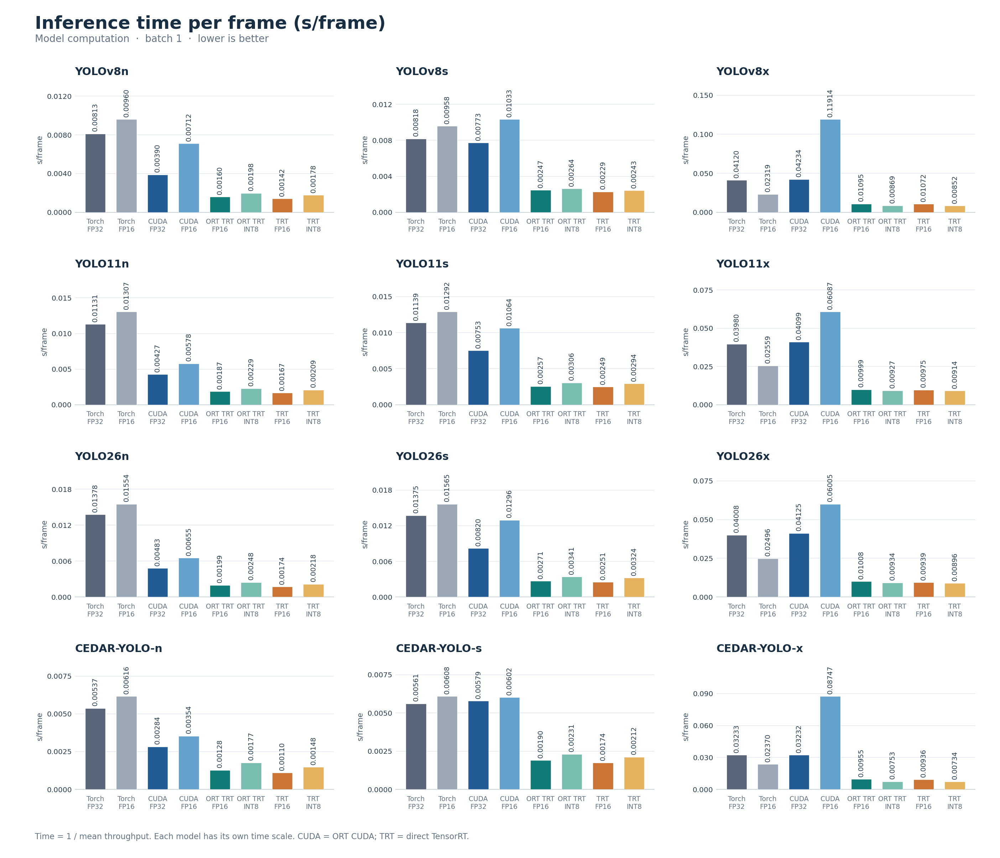
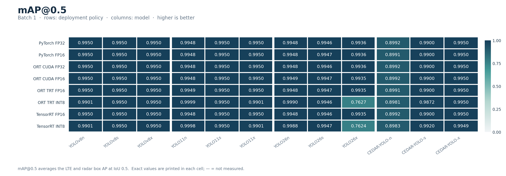

## Results

**288/288 GPU routes completed: 12 models, batches 1, 4, 8, 8 deployment policies.**

The experiments evaluate 12 pretrained detectors on an **NVIDIA GeForce RTX 2070** PC. The figures show **batch 1, model computation**; quality is evaluated on the same **846 validation images**. INT8 calibration uses 512 training images. Each policy uses the same source checkpoint for its model.

### Inference speed

Inference time per frame is the inverse of mean throughput across the timing rounds; lower is better. Each panel uses its own time scale. CUDA labels denote ONNX Runtime CUDA; TRT denotes direct TensorRT.

ONNX Runtime with TensorRT FP16 (route B) achieves **2.94–6.94× the PyTorch FP32 throughput** across 12 models in this timing scope. Direct TensorRT FP16 (route C) achieves **3.22–7.94× the PyTorch FP32 throughput** across 12 models in this timing scope. For YOLOv8x, ORT CUDA FP16 takes 0.1191 s/frame (route A), compared with 0.0412 s/frame for PyTorch FP32.

### Detection F1

Rows are deployment policies and columns are models. Values average LTE and radar box-detection F1 at confidence 0.25 and box IoU 0.5; higher is better.

The TensorRT FP16 routes track each model's PyTorch FP32 quality: the largest absolute detection-F1 change is **0.00085**. INT8 has a larger, model-dependent effect. For YOLO26x, direct TensorRT INT8 changes F1 from **0.9774 to 0.6581**.

### mAP@0.5

The matrix reports mean average precision for LTE and radar boxes at IoU 0.5; higher is better.

Across the TensorRT FP16 routes, the largest absolute mAP@0.5 change from PyTorch FP32 is **0.00008**. The largest mAP@0.5 reduction under direct TensorRT INT8 occurs on YOLO26x: **0.9936 → 0.7624**. INT8 deployment therefore requires validation for each model and batch configuration.

**Deployment assessment.** TensorRT FP16 provides the most consistent combination of faster model execution and preserved detection quality in this testbed. INT8 can further reduce computation time for selected models, with quality checked for the selected configuration. The full report separates model computation, the detector pipeline, and PNG-to-detection execution so application costs can be assessed alongside kernel speed.

[Complete report](REPORT.md) · [Combined measurements](data/summary.csv) · [Data guide](data/README.md)
